

# Yume Companion

**Your AI companion for Windows and Android**
Chat · Voice calls · Avatars (images, Live2D, 3D VRM) · Memory · Role-play stage · Organizer · Phone control

[Deutsch](README.de.md) · **English**

**💬 [Join our Discord server](https://discord.gg/5RBgNMCPKC)**: ask questions, share feedback, characters and ideas.

[Features](#features-in-detail) · [Which AIs are inside?](#which-ais-are-inside) · [Avatars](#avatars-images-live2d-vrm) · [Quick start](#quick-start) · [📖 Documentation online](https://kreqzxoo.github.io/Yume-Companion/#/en/) · [Support](#support-the-project)

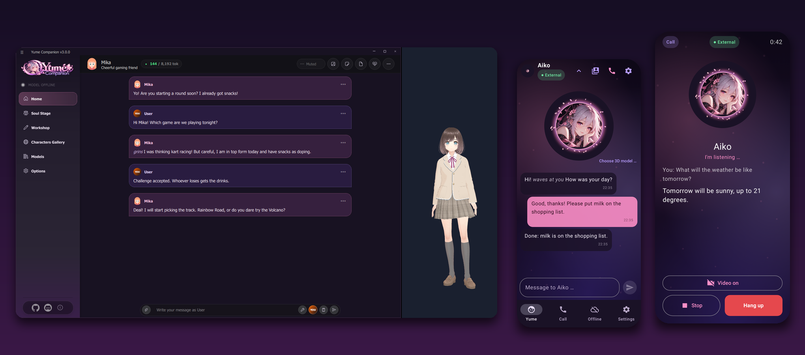

> **Status:** 3.0.0 **beta**. A lot works, some parts are still rough. Please report bugs as an [issue](../../issues).
> **Language:** The program itself comes with German, English and Russian translations. The detailed manual is available in English in [`docs/en/`](docs/en/README.md) (every chapter has screenshots) and as a website (language switch at the top). Only the publishing guide, license list and Ko-fi tiers are German-only.

---

## What is Yume Companion?

Yume Companion is a Windows application where AI characters remember you, react to you, and are reachable everywhere: in the chat on your PC, as a figure on your desktop, by call and chat on your phone, in role-play, and as an assistant for everyday life. Everything runs either **100 % locally and privately** on your computer or with cloud models of your choice.

## At a glance

| | |
| --- | --- |
| 💬 **Chat and voice** | Text and voice chat, calls with wake word, file and image attachments, lorebooks, personas, tools |
| 🧠 **Memory** | Facts, feelings, user profile and a diary, with 4 modes and automatic summaries |
| 🎭 **Avatars** | Expression images, **Live2D**, **3D VRM**; 28 emotions drive facial expression and movement |
| 🗣️ **Voice** | 6 speech engines (local and cloud), RVC voice conversion, speech recognition with echo protection (half duplex or full duplex via WebRTC AEC3) |
| 🎲 **Yume Stage** | Text adventures with an AI game master, dice checks, inventory, side characters, multiple characters |
| 🖥️ **Desktop companion** | A figure on your desktop with a mood model, screen vision and quick actions |
| 📅 **Organizer** | Calendar, mail (read only), reminders, lists, morning briefing, commute time, birthdays, knowledge base, letters and invoices |
| 🛠️ **Tools** | Web search, browser agent, PC control, code, files, MCP, Home Assistant, Spotify, Discord, image generation |
| 📱 **Android app** | **Replaces the Google Assistant** (default assistant, wake word on the home screen), chat, calls, 3D avatar, phone control by the AI, alarm clock, car and wall modes, offline emergency mode |
| 🖧 **Yume LLM Server** | turns a second PC into an AI server for speech, vision, images and tools |
| 🌐 **Web** | Web client in the browser and a dashboard with live values (CPU, GPU, tokens/s, context) |

## Which AIs are inside?

Yume Companion bundles several AI models, each of which can run locally or on another PC. The language model can also be replaced by a cloud provider.

| Task | What is used | Where it runs |
| --- | --- | --- |
| **Language model** (the "personality") | Any GGUF model via **llama.cpp** (CUDA, Vulkan, HIP, SYCL or CPU), Ollama, or your own OpenAI-compatible endpoint | local · other PC · cloud |
| **Cloud providers** | OpenAI, Anthropic, Google Gemini, DeepSeek, Mistral, OpenRouter, Grok, Qwen, Z.AI, Player2 | cloud |
| **Vision** (understanding images) | Small separate vision model, e.g. Qwen2.5-VL 3B; also for "look at my screen" | local · other PC |
| **Speech output (TTS)** | **Qwen3-TTS**, **XTTSv2**, **Kokoro**, **Silero**, **Edge TTS**, **ElevenLabs** | local · cloud |
| **Voice conversion** | **RVC** | local |
| **Speech input (STT)** | **Faster-Whisper** with Silero VAD, wake word, echo protection: half duplex or full-duplex echo cancellation (WebRTC AEC3) | local |
| **Emotion detection** | Classifier with **28 emotions**, drives facial expression and movement of the avatars | local |
| **Memory** | Bilingual embedding model (e5, German/English) plus an agent that maintains facts and the diary | local |
| **Tool models** | Qwen3 4B / 8B / 14B and Qwen2.5-Coder 7B for browser agent, planning and code | local · other PC |
| **Image generation** | Automatic1111, ComfyUI, NovelAI, DALL-E 3, FLUX; in the LLM server also stable-diffusion.cpp | local · other PC · cloud |

## Avatars: images, Live2D, VRM

Every character can be shown in four ways. A classifier reads each answer and assigns one of **28 emotions**; the avatar reacts to it.

| Type | Description |
| --- | --- |
| **Expression images** | One file per emotion (PNG, JPG, GIF). Lightest option, hardly any CPU/GPU load |
| **Live2D** | `.moc3` models with blinking, poses, lip sync; a motion can be assigned to every emotion |
| **VRM (3D)** | Free 3D models, e.g. from VRoid Studio or VRoid Hub, with hair and cloth physics, facial expressions and eye contact |
| **None** | Just the character card |

A **VRM 3D avatar** in the chat. Two free VRoid sample models (pixiv, redistribution allowed) are included and assigned to the demo characters Mika and Kai:

| Mika (VRM "Anime Girl") | Kai (VRM "Anime Man") |
| --- | --- |
| 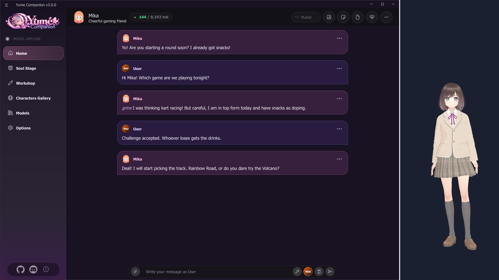 | 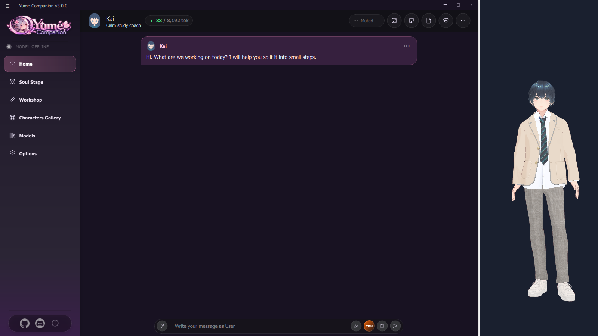 |

> The two VRM sample models are in `assets/emotions/vrm/` (license see [NOTICE.md](NOTICE.md)). Live2D models and other VRM models belong to their creators and are **not** in the repository: put your own or freely licensed models into `assets/emotions/live2d/` or `assets/emotions/vrm/`.

## Features in detail

### 💬 Chat and characters
Chat with message menu (edit, regenerate, translate, create image, voice message), author's notes, backgrounds, personas, system prompts and lorebooks. Characters can be created with the editor or the AI assistant, imported and exported as cards.

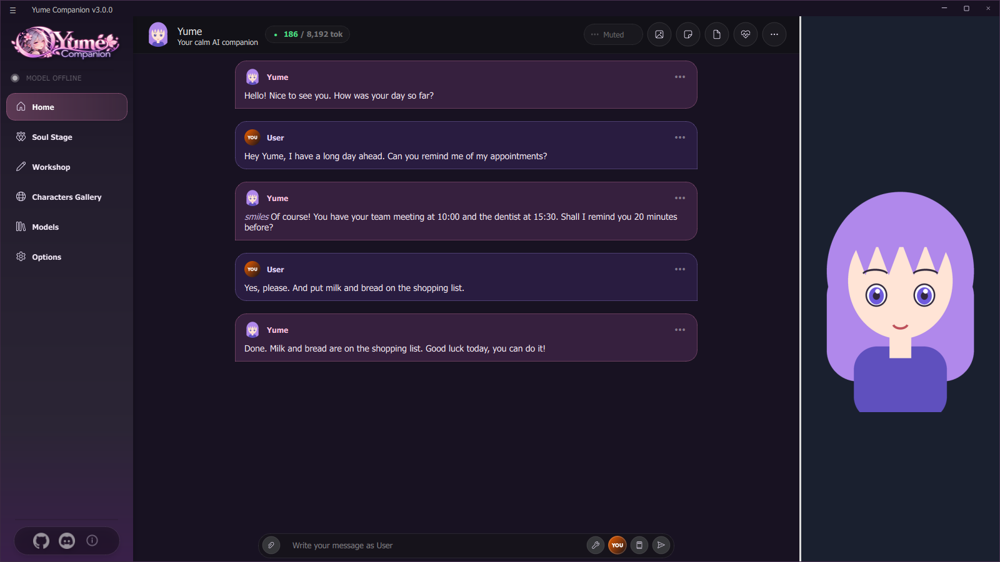

### 🧠 Memory
The character remembers facts about you and its own development, and keeps a diary. Four modes, from "full sync" to "diary only", adapt to the power of your PC. You can view and correct everything by hand.

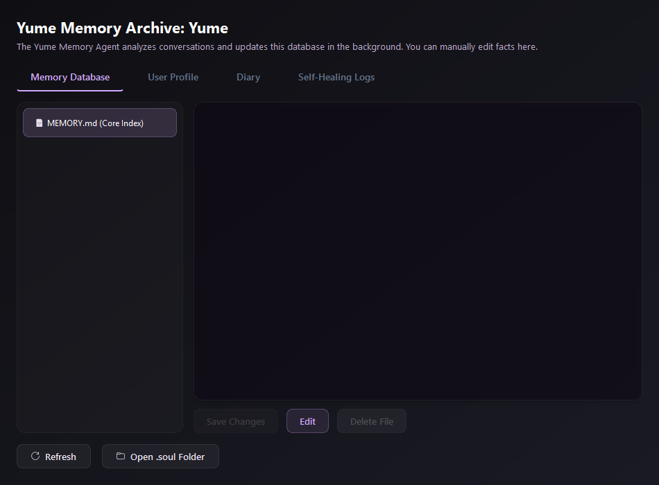

### 🗣️ Voice, calls and speech input
Six speech engines selectable per character, plus voice conversion (RVC), call mode, wake word and echo protection so you can interrupt the AI.

**Echo protection:** *Off*, *Half duplex* (the microphone is muted while the character speaks) or *WebRTC AEC3 (full-duplex echo cancellation)* where the microphone stays open and you can talk over the AI. On the phone the *Echo suppression* switch uses Android's call audio path and the device's echo canceller.

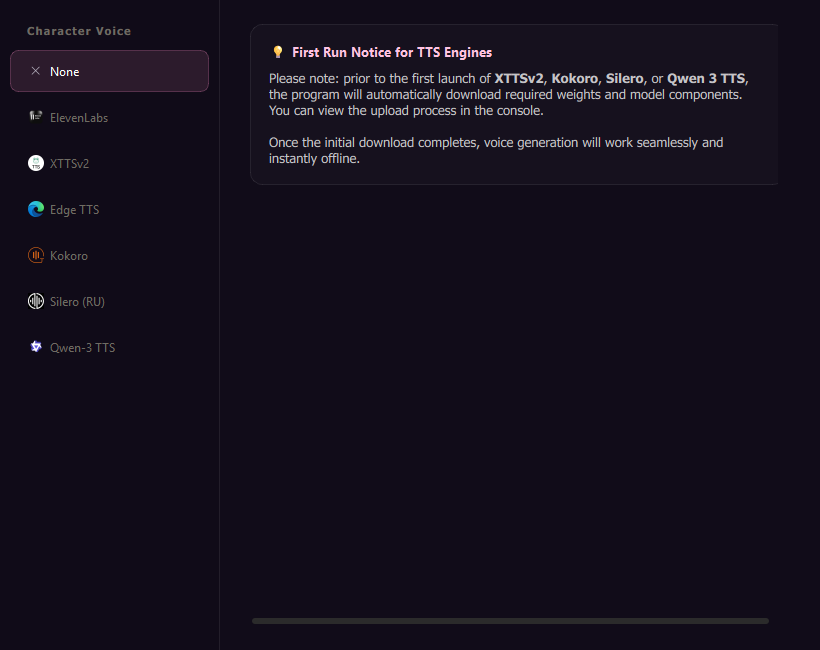

### 🎲 Yume Stage: role-play with an AI game master
Scenes with several characters, world state, dice checks, inventory and dynamic side characters, like a pen-and-paper evening with an AI as game master.

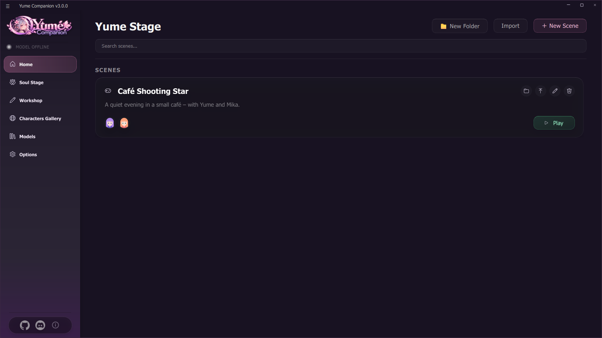

### 🖥️ Desktop companion
An independent figure on your desktop with a (neurohormonal) mood model, screen vision, clipboard reading and tool calls.

### 🛠️ Tools and integrations
The AI can call tools itself: web search, browser agent, PC control, code, files, your own MCP servers, Home Assistant, Spotify and Discord. You enable each permission individually.

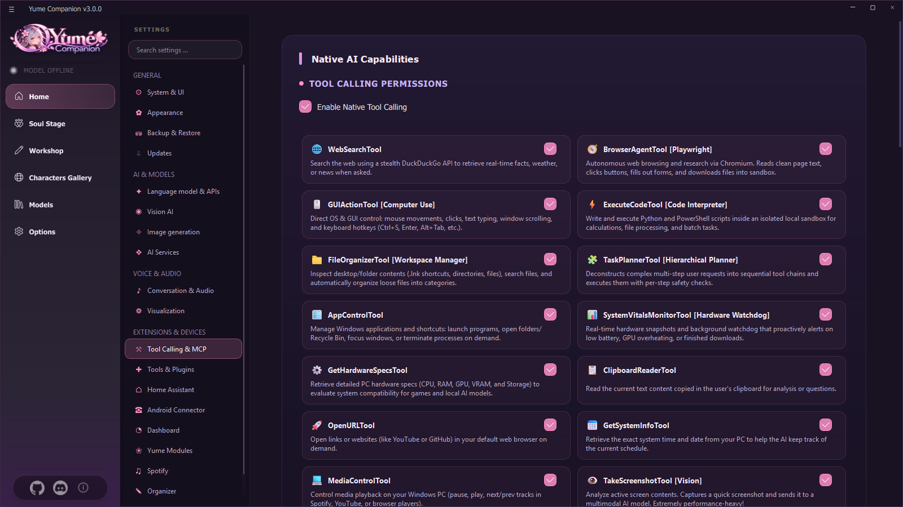

### 📅 Organizer
Calendar, mail (read only), reminders, lists, morning briefing, commute time, birthdays, knowledge base, letters and invoices. Passwords are stored encrypted with Windows data protection.

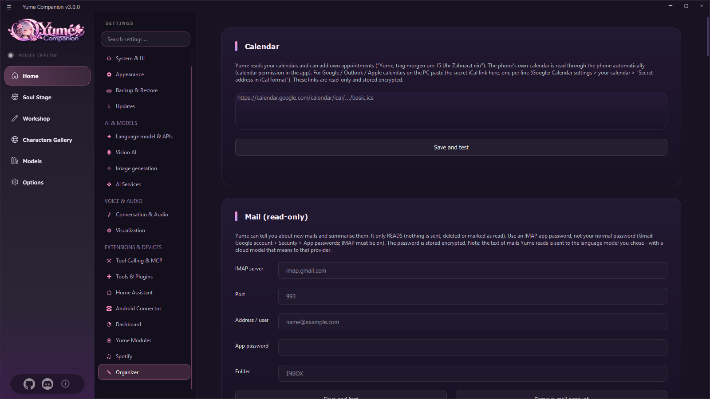

### 📱 Android app
**Replaces the Google Assistant:** set Yume as your default assistant. Long-press the home button or swipe from the corner to open her. When you say the wake word while the home screen or another app is in front, a translucent assistant panel slides up from the bottom, shows what she understood and speaks the answer. With "Only react to my voice" (like Voice Match) she only listens to you.

| Assistant on the home screen | Conversation with wake word and call |
| --- | --- |
| 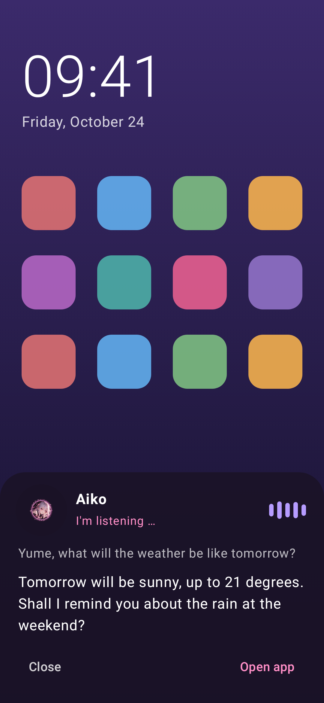 | 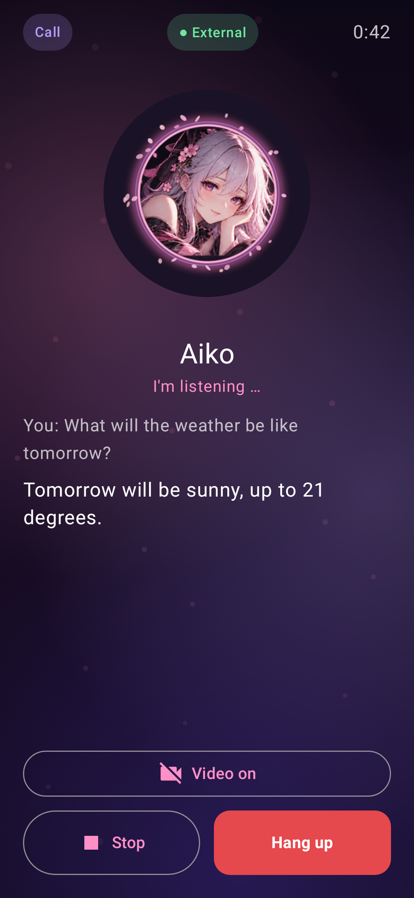 |

More: chat and calls, 3D avatar, phone control by the AI (open and operate apps, calls, contacts, camera … every permission can be switched off), alarm clock, car and wall modes, and an offline emergency mode with a local model.

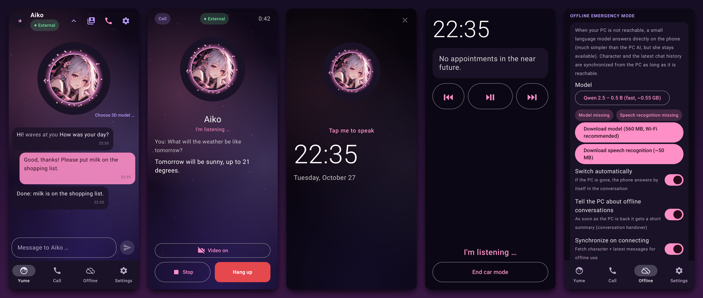

### 🖧 Yume LLM Server
A small Windows program turns a second PC into an AI server: language model, vision, image generation and tool model on their own ports, with installer and model recommendations for your hardware.

| Speech | Vision | Images |
| --- | --- | --- |
|  |  |  |

### 🌐 Web client and dashboard
Chat in your browser (also from your phone on the same Wi-Fi) and a dashboard with CPU, RAM, GPU, tokens per second and context usage.

| Web client on the phone | Dashboard |
| --- | --- |
| 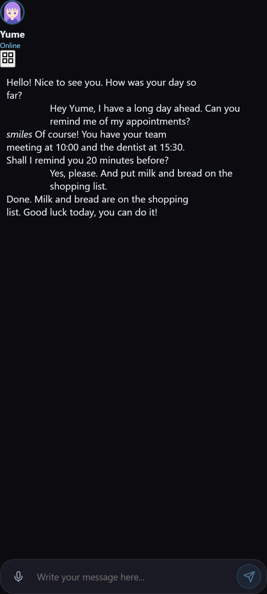 | 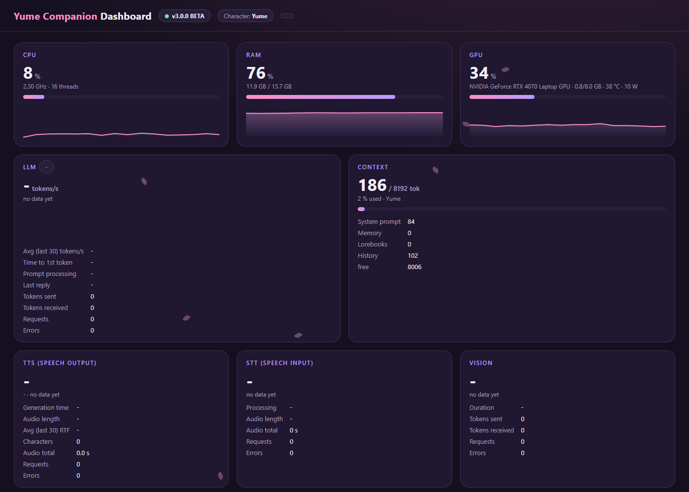 |

## Quick start

1. Download the latest `Yume-Companion-Setup-….exe` from [**Releases**](../../releases) and run it (not as administrator). It sets up Python, PyTorch and all packages (about 10 GB after installation). Windows SmartScreen warns about an unknown publisher because the setup is not signed: *More info → Run anyway*.
2. Start **Yume Companion**. The start page shows three steps: **choose a model → create a character → chat**.
3. For the first conversation you need a language model. Easiest:
   * **Cloud:** *Settings → Language model & APIs* → choose a provider → enter your API key.
   * **Local:** *Models* → download a model (e.g. Qwen3 8B, quantization Q4_K_M) → **load model**.
4. Demo characters can be created with `tools/demo/make_demo_content.py`, or create your own under *Create character*.
5. **Phone:** install `Yume-Companion.apk` (Android 9+; allow installation from unknown sources, the APK is debug-signed), then on the PC *Settings → Android Connector* → start the web server → scan the QR code.

Build from source: [docs/16-entwicklung.md](docs/en/16-entwicklung.md) and `tools\setup_from_source.bat`.

## Documentation

All chapters (with screenshots) are in [`docs/`](docs/en/README.md): installation, every feature, troubleshooting, development and the guide for publishing on GitHub.

| Area | Chapter |
| --- | --- |
| Start | [Installation](docs/en/01-installation.md) · [First steps](docs/en/02-erste-schritte.md) |
| Characters and AI | [Chat and characters](docs/en/03-chat-und-charaktere.md) · [Language models](docs/en/04-sprachmodelle.md) · [Voice and avatars](docs/en/05-stimme-und-avatare.md) · [Memory](docs/en/06-gedaechtnis.md) |
| Experiences | [Yume Stage](docs/en/07-yume-buehne.md) · [Desktop companion](docs/en/08-desktop-begleiter.md) |
| Tools | [Tools and integrations](docs/en/09-werkzeuge-und-integrationen.md) · [Organizer](docs/en/10-organizer.md) |
| Phone and server | [Android app](docs/en/11-android-app.md) · [Yume LLM Server](docs/en/12-llm-server.md) · [Web and dashboard](docs/en/13-web-und-dashboard.md) |
| Operation | [Backup, updates, security](docs/en/14-backup-updates-sicherheit.md) · [Development](docs/en/16-entwicklung.md) |

## System requirements

| | Minimum | Recommended |
| --- | --- | --- |
| System | Windows 10/11 (64 bit) | Windows 11 |
| RAM | 8 GB | 16 GB or more |
| Graphics card | any (cloud models only) | NVIDIA or AMD with 8 GB+ VRAM for local models |
| Storage | 15 GB free | fast NVMe SSD, 40 GB+ for models |
| Phone | Android 9+ (API 28) | Android 12+ (camera, microphone, Wi-Fi) |

## Privacy

* Characters, chats, memory, settings and organizer data stay on your PC. Passwords (mail, Spotify) are stored encrypted with Windows data protection.
* Local models send nothing to the internet. With cloud providers (OpenAI, Anthropic, Gemini …) your chat text goes to that provider.
* The app only fetches what you use: models from Hugging Face, character cards from the gallery, weather (Open-Meteo), places and routes (OpenStreetMap), Spotify, and update information from GitHub.
* More: [Backup, updates, security](docs/en/14-backup-updates-sicherheit.md).

## Community and help

* **Discord:** <https://discord.gg/5RBgNMCPKC>: quick help, show characters and avatars, share wishes.
* **Bugs and feature requests:** as an [issue](../../issues) on GitHub.

## Support the project

Yume Companion is free and open source. If you like it, your support pays for time, testing and new features:

One-time or monthly via <https://ko-fi.com/kreqzxoo>. Contributions, bug reports, characters and a star on GitHub help as well. Thank you! 💜

## License and credits

> **Origin:** Yume Companion is a heavily extended, modified version of [**Soul of Waifu**](https://github.com/jofizcd/Soul-of-Waifu) by *jofizcd* (GPL-3.0). The original author stays credited, see [NOTICE.md](NOTICE.md). This project is **not** the official Soul of Waifu.

* License: **GNU General Public License v3.0** (see [LICENSE](LICENSE)). The source code may be used, modified and redistributed under these terms.
* Original: **Soul of Waifu** by jofizcd – <https://github.com/jofizcd/Soul-of-Waifu>.
* Components used and their licenses: [docs/LIZENZEN_UND_UPLOAD.md](docs/LIZENZEN_UND_UPLOAD.md) (German).
* The sample characters and their images in this repository are self-made and free to use. The two VRM sample models are VRoid Studio samples by the pixiv VRoid Project (see [NOTICE.md](NOTICE.md)).
