

# Yume Companion

**Deine KI-Begleiterin für Windows und Android**
Chatten · Telefonieren · Avatare (Bild, Live2D, 3D-VRM) · Gedächtnis · Rollenspiel-Bühne · Organizer · Handy-Steuerung

**Deutsch** · [English](README.en.md)

**💬 [Komm auf unseren Discord-Server](https://discord.gg/5RBgNMCPKC)**: Fragen, Feedback, Charaktere und Ideen teilen.

[Funktionen](#funktionen-im-detail) · [Welche KIs stecken drin?](#welche-kis-stecken-drin) · [Avatare](#avatare-bild-live2d-vrm) · [Schnellstart](#schnellstart) · [Dokumentation](docs/INDEX.md) · [English](README.en.md)

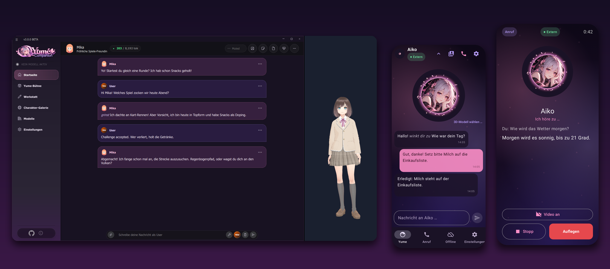

> **Status:** 3.0.0 **Beta**. Vieles funktioniert, manches ist noch rau. Fehler bitte als [Issue](../../issues) melden.
> **Herkunft:** Yume Companion ist eine stark erweiterte, veränderte Fassung von [**Soul of Waifu**](https://github.com/jofizcd/Soul-of-Waifu) von *jofizcd* (GPL-3.0). Der Original-Autor bleibt genannt, siehe [NOTICE.md](NOTICE.md). Dieses Projekt ist **nicht** das offizielle Soul of Waifu.

---

## Inhalt

* [Was ist Yume Companion?](#was-ist-yume-companion)
* [Auf einen Blick](#auf-einen-blick)
* [Welche KIs stecken drin?](#welche-kis-stecken-drin)
* [Avatare: Bild, Live2D, VRM](#avatare-bild-live2d-vrm)
* [Funktionen im Detail](#funktionen-im-detail)
* [Galerie](#galerie)
* [Die Bausteine](#die-bausteine)
* [Schnellstart](#schnellstart)
* [Die Dokumentation](#die-dokumentation)
* [Systemvoraussetzungen](#systemvoraussetzungen)
* [Datenschutz](#datenschutz)
* [Lizenz und Danksagung](#lizenz-und-danksagung)
* [English summary](#english-summary-full-version-readmeenmd)

---

## Was ist Yume Companion?

Yume Companion ist eine Windows-Anwendung, in der KI-Charaktere sich an dich erinnern, auf dich reagieren und überall erreichbar sind: im Chat am PC, als Figur auf deinem Desktop, per Anruf und Chat auf dem Handy, im Rollenspiel und als Assistentin für deinen Alltag. Alles läuft wahlweise **100 % lokal und privat** auf deinem Rechner oder mit Cloud-Modellen deiner Wahl.

## Auf einen Blick

| | |
| --- | --- |
| 💬 **Chat und Sprache** | Text- und Sprachchat, Anrufe mit Wake Word, Datei- und Bildanhänge, Lorebooks, Personas, Werkzeuge |
| 🧠 **Gedächtnis** | Fakten, Gefühle, Benutzerprofil und Tagebuch, mit 4 Modi und automatischen Zusammenfassungen |
| 🎭 **Avatare** | Ausdrucksbilder, **Live2D**, **3D-VRM**; 28 Gefühle steuern Mimik und Bewegung |
| 🗣️ **Stimme** | 6 Sprach-Engines (lokal und Cloud), RVC-Stimmumwandlung, Spracherkennung mit Echo-Schutz (Halbduplex oder Vollduplex per WebRTC AEC3) |
| 🎲 **Yume-Bühne** | Textabenteuer mit KI-Spielleiter, Würfelproben, Inventar, Nebenfiguren, mehreren Charakteren |
| 🖥️ **Desktop-Begleiter** | Figur auf dem Desktop mit Stimmungsmodell, Bildschirm-Sicht und Schnellaktionen |
| 📅 **Organizer** | Kalender, Mail (nur lesen), Erinnerungen, Listen, Morgen-Briefing, Pendelzeit, Geburtstage, Wissensbasis, Briefe und Rechnungen |
| 🛠️ **Werkzeuge** | Websuche, Browser-Agent, PC-Steuerung, Code, Dateien, MCP, Home Assistant, Spotify, Discord, Bildgenerierung |
| 📱 **Android-App** | **Ersetzt den Google Assistant** (Standard-Assistent, Wake Word auf dem Startbildschirm), Chat, Anrufe, 3D-Avatar, Handy-Steuerung durch die KI, Wecker, Auto- und Wandmodus, Offline-Notfallmodus |
| 🖧 **Yume LLM Server** | macht einen zweiten PC zum KI-Server für Sprache, Vision, Bilder und Werkzeuge |
| 🌐 **Web** | Webclient im Browser und Dashboard mit Live-Werten (CPU, GPU, Tokens/s, Kontext) |

## Welche KIs stecken drin?

Yume Companion bündelt mehrere KI-Modelle, die jeweils lokal oder auf einem anderen PC laufen können. Das Sprachmodell lässt sich auch durch einen Cloud-Anbieter ersetzen.

| Aufgabe | Was verwendet wird | Wo es läuft |
| --- | --- | --- |
| **Sprachmodell** (die „Persönlichkeit“) | Beliebige GGUF-Modelle über **llama.cpp** (CUDA, Vulkan, HIP, SYCL oder CPU), Ollama oder ein eigener OpenAI-kompatibler Endpunkt | lokal · anderer PC · Cloud |
| **Cloud-Anbieter** | OpenAI, Anthropic, Google Gemini, DeepSeek, Mistral, OpenRouter, Grok, Qwen, Z.AI, Player2 | Cloud |
| **Vision** (Bilder verstehen) | Kleines separates Vision-Modell, z. B. Qwen2.5-VL 3B; auch für „Bildschirm ansehen“ | lokal · anderer PC |
| **Sprachausgabe (TTS)** | **Qwen3-TTS**, **XTTSv2**, **Kokoro**, **Silero**, **Edge TTS**, **ElevenLabs** | lokal · Cloud |
| **Stimmumwandlung** | **RVC** | lokal |
| **Spracheingabe (STT)** | **Faster-Whisper** mit Silero-VAD, Wake Word, Echo-Schutz: Halbduplex oder Vollduplex-Echoentfernung (WebRTC AEC3) | lokal |
| **Gefühlserkennung** | Klassifikator mit **28 Gefühlen**, steuert Mimik und Bewegung der Avatare | lokal |
| **Gedächtnis** | Zweisprachiges Embedding-Modell (e5, Deutsch/Englisch) plus Agent, der Fakten und Tagebuch pflegt | lokal |
| **Werkzeug-Modelle** | Qwen3 4B / 8B / 14B und Qwen2.5-Coder 7B für Browser-Agent, Planung und Code | lokal · anderer PC |
| **Bildgenerierung** | Automatic1111, ComfyUI, NovelAI, DALL-E 3, FLUX; im LLM-Server auch stable-diffusion.cpp | lokal · anderer PC · Cloud |

Details: [Sprachmodelle](docs/04-sprachmodelle.md) · [Stimme und Avatare](docs/05-stimme-und-avatare.md) · [Werkzeuge](docs/09-werkzeuge-und-integrationen.md)

## Avatare: Bild, Live2D, VRM

Jeder Charakter kann auf vier Arten dargestellt werden. Ein Klassifikator liest jede Antwort und ordnet sie einem von **28 Gefühlen** zu, der Avatar reagiert darauf.

| Art | Beschreibung |
| --- | --- |
| **Ausdrucksbilder** | Eine Datei pro Gefühl (PNG, JPG, GIF). Leichteste Variante, kaum Last für CPU und GPU |
| **Live2D** | `.moc3`-Modelle mit Blinzeln, Posen, Lippensynchronisation; jedem Gefühl lässt sich eine Bewegung zuordnen |
| **VRM (3D)** | Freie 3D-Modelle, z. B. aus VRoid Studio oder VRoid Hub, mit Haar- und Kleiderphysik, Mimik und Blickkontakt |
| **Keine** | Nur die Charakterkarte |

Die Ausdrucksauswahl in der App und die Beispiel-Ausdrücke der Demo-Charaktere:

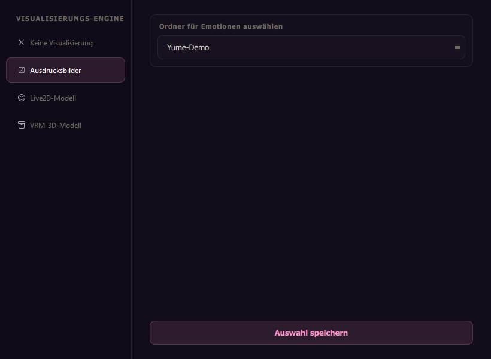

| Ausdrucksbilder | Live2D-Modell | VRM-3D-Modell |
| --- | --- | --- |
|  | 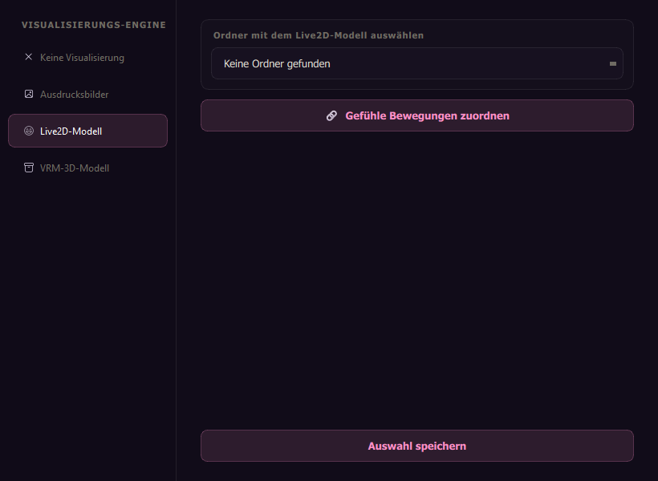 | 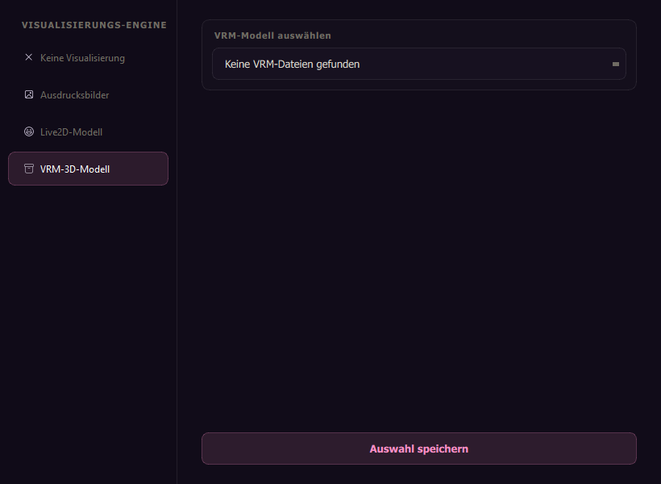 |

So sieht ein **VRM-3D-Avatar** im Chat aus. Mitgeliefert sind zwei freie VRoid-Beispielmodelle (pixiv, Weitergabe erlaubt), die den Demo-Charakteren Mika und Kai zugewiesen sind:

| Mika (VRM „Anime Girl“) | Kai (VRM „Anime Man“) |
| --- | --- |
| 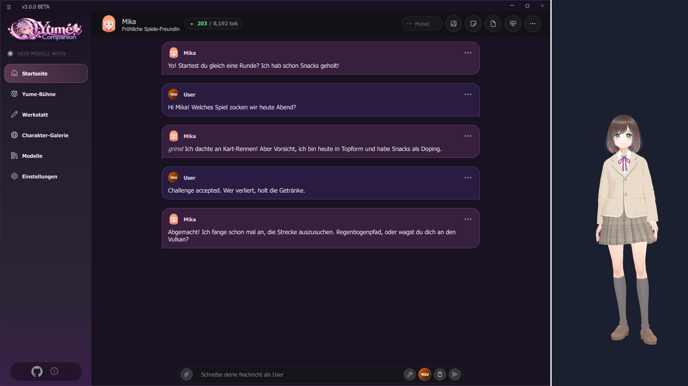 | 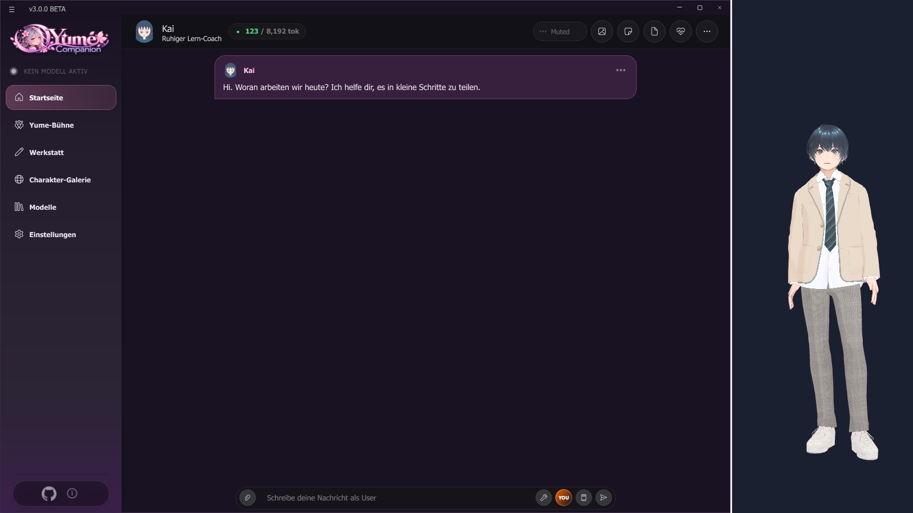 |

> Die zwei VRM-Beispielmodelle liegen in `assets/emotions/vrm/` (Lizenz siehe [NOTICE.md](NOTICE.md)). Live2D-Modelle und weitere VRM-Modelle gehören ihren Urhebern und sind **nicht** im Repository: Eigene oder frei lizenzierte Modelle legst du in `assets/emotions/live2d/` bzw. `assets/emotions/vrm/` ab. Siehe [Kapitel 05](docs/05-stimme-und-avatare.md#55-avatare).

## Funktionen im Detail

### 💬 Chat und Charaktere
Chat mit Nachrichten-Menü (bearbeiten, neu generieren, übersetzen, Bild erzeugen, Sprachnachricht), Autorennotizen, Hintergründe, Personas, System-Prompts und Lorebooks. Charaktere lassen sich per Editor oder KI-Assistent erstellen, als Karten importieren und exportieren.

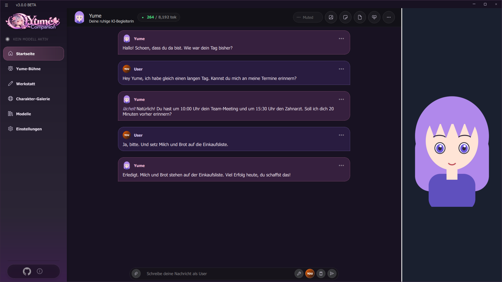

| Charakter-Editor mit KI-Assistent | Lorebook | Personas |
| --- | --- | --- |
| 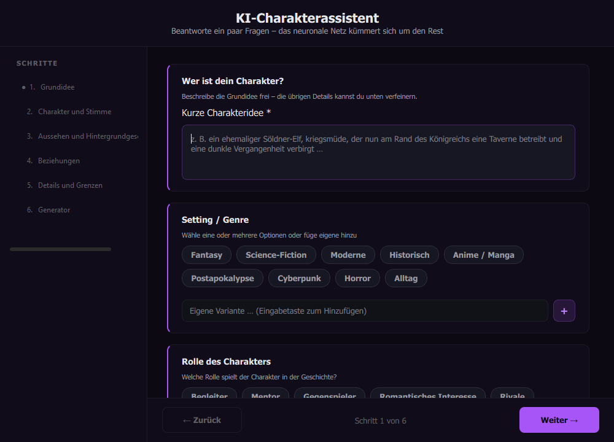 | 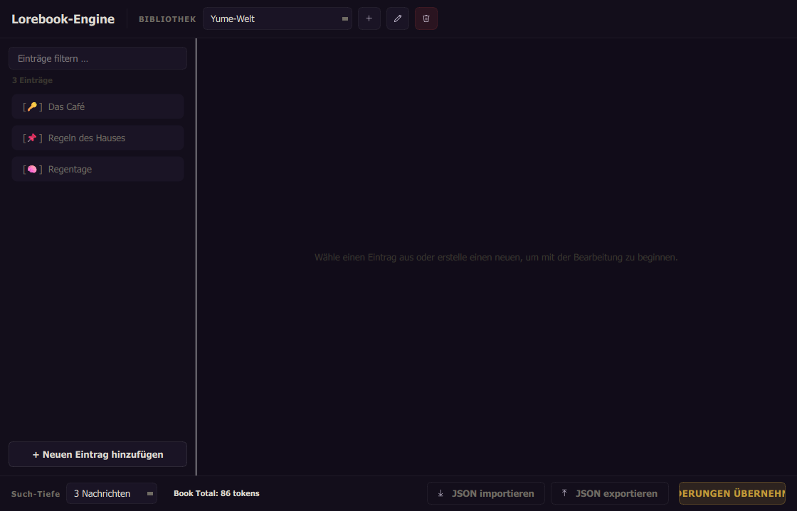 | 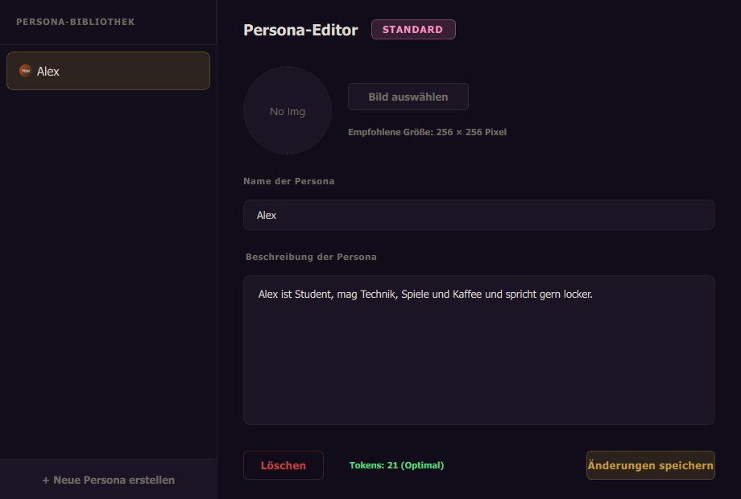 |

→ [Chat und Charaktere](docs/03-chat-und-charaktere.md)

### 🧠 Gedächtnis
Der Charakter merkt sich Fakten über dich, seine eigene Entwicklung und führt ein Tagebuch. Vier Modi von „volle Synchronisation“ bis „nur Tagebuch“ passen sich der Leistung deines PCs an. Du kannst alles ansehen und von Hand korrigieren.

→ [Gedächtnis](docs/06-gedaechtnis.md)

### 🗣️ Stimme, Anrufe und Spracheingabe
Sechs Sprach-Engines pro Charakter wählbar, dazu Stimmumwandlung (RVC), Anrufmodus, Wake Word und Echo-Schutz, damit du der KI ins Wort fallen kannst.

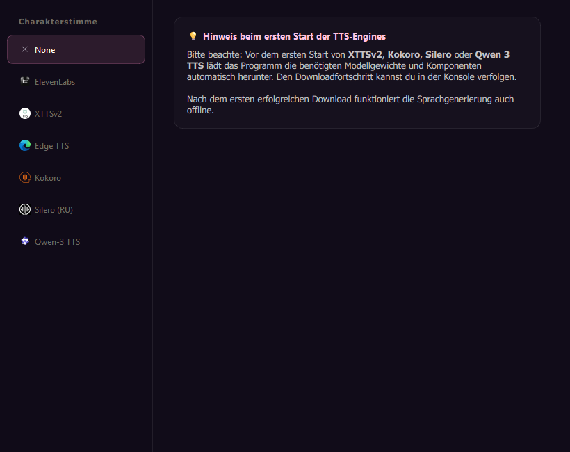

→ [Stimme und Avatare](docs/05-stimme-und-avatare.md)

### 🎲 Yume-Bühne: Rollenspiel mit KI-Spielleiter
Szenen mit mehreren Charakteren, Weltzustand, Würfelproben, Inventar und dynamischen Nebenfiguren, wie ein Pen-and-Paper-Abend mit einer KI als Spielleiter.

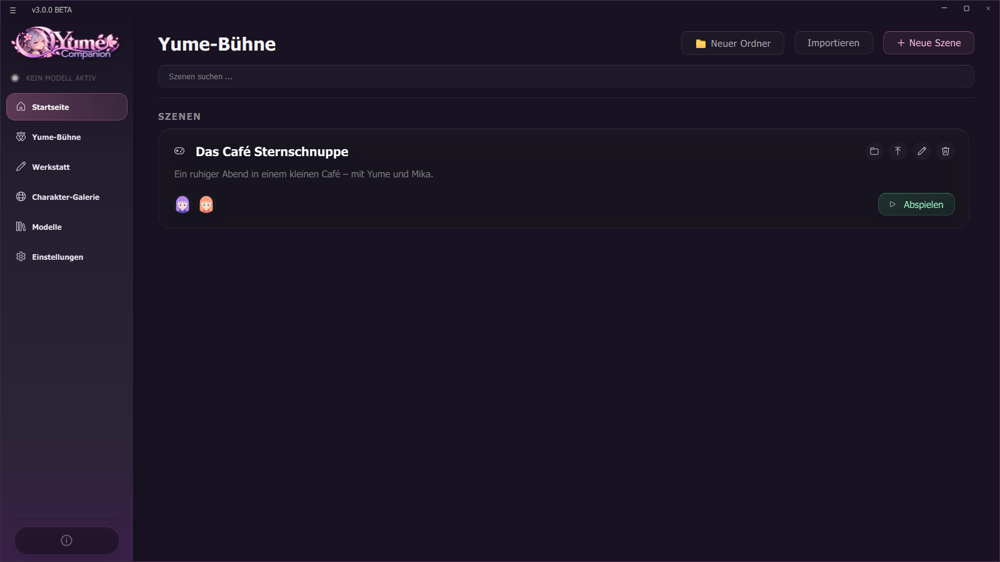

→ [Yume-Bühne](docs/07-yume-buehne.md)

### 🖥️ Desktop-Begleiter
Eine eigenständige Figur auf deinem Desktop mit Stimmungsmodell (neurohormonell), Bildschirm-Sicht, Zwischenablage-Lesen und Werkzeugaufrufen. Über Schnellaktionen am Charakter steuerst du sie.

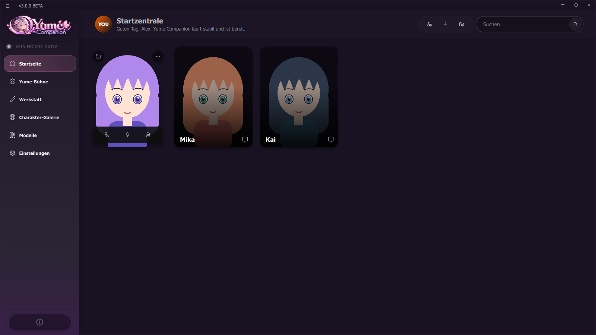

→ [Desktop-Begleiter](docs/08-desktop-begleiter.md)

### 🛠️ Werkzeuge und Integrationen
Die KI kann Werkzeuge selbst aufrufen: Websuche, Browser-Agent, PC-Steuerung, Code, Dateien, eigene MCP-Server, Home Assistant, Spotify und Discord. Jede Berechtigung schaltest du einzeln frei.

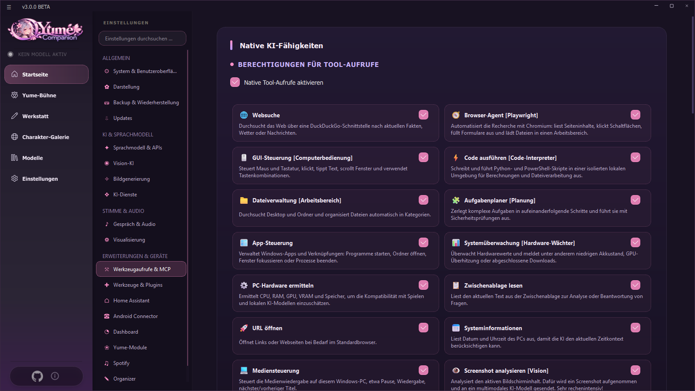

→ [Werkzeuge und Integrationen](docs/09-werkzeuge-und-integrationen.md)

### 📅 Organizer
Kalender, Mail (nur lesen), Erinnerungen, Listen, Morgen-Briefing, Pendelzeit, Geburtstage, Wissensbasis, Briefe und Rechnungen. Passwörter werden mit der Windows-Datenschutz-Funktion verschlüsselt.

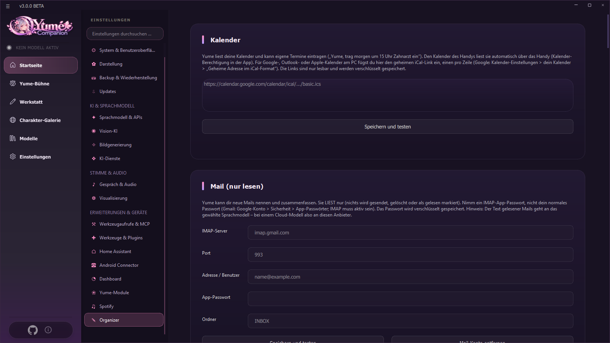

→ [Organizer](docs/10-organizer.md)

### 📱 Android-App
Chat und Anrufe mit Wake Word, 3D-Avatar, Handy-Steuerung durch die KI (Apps bedienen, Anrufe, Kontakte, Kamera …, jedes Recht einzeln abschaltbar), Wecker, Auto- und Wandmodus sowie ein Offline-Notfallmodus mit lokalem Modell.

**Ersetzt den Google Assistant:** Yume lässt sich als Standard-Assistent einrichten. Home-Taste gedrückt halten oder von der Ecke wischen öffnet sie. Sagst du das Wake Word, während der Startbildschirm oder eine andere App vorne ist, schiebt sich ein halbtransparentes Assistenten-Fenster von unten herauf, zeigt was sie verstanden hat und spricht die Antwort. Mit „Nur auf meine Stimme reagieren“ (wie Voice Match) hört sie nur auf dich.

| Assistent auf dem Startbildschirm | Gespräch mit Wake Word und Anruf |
| --- | --- |
| 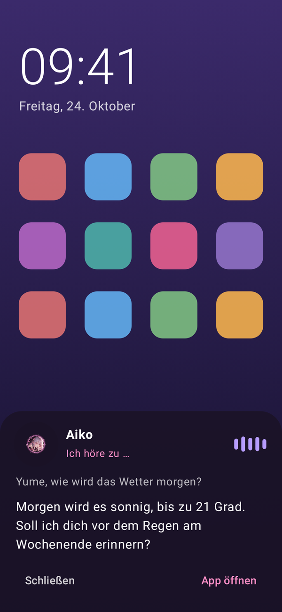 | 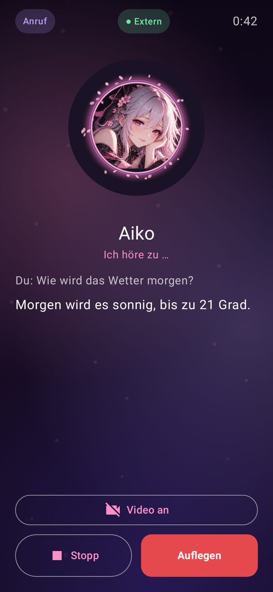 |

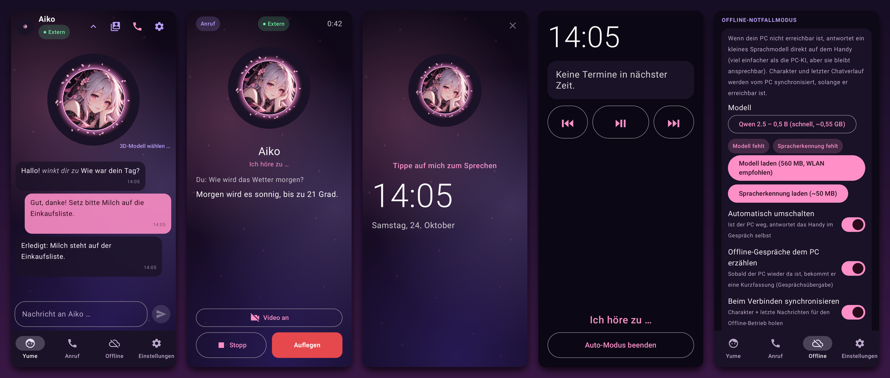

**Echo-Schutz (Vollduplex):** Am PC stehen *Aus*, *Halbduplex* und *WebRTC AEC3 (Vollduplex-Echoentfernung)* zur Wahl, auf dem Handy die *Echo-Unterdrückung* mit Telefon-Audiopfad. Mit Vollduplex kannst du der KI ins Wort fallen. Details: [Echo-Schutz im Detail](docs/05-stimme-und-avatare.md#echo-schutz-anti-echo-im-detail).

→ [Android-App](docs/11-android-app.md) · [Assistent einrichten](docs/11-android-app.md#115-ersatz-für-den-google-assistant)

### 🖧 Yume LLM Server
Ein kleines Windows-Programm macht einen zweiten PC zum KI-Server: Sprachmodell, Vision, Bildgenerierung und Werkzeug-Modell auf eigenen Ports, mit Installer und Modellempfehlung passend zur Hardware.

| Sprache | Vision | Bilder |
| --- | --- | --- |
| 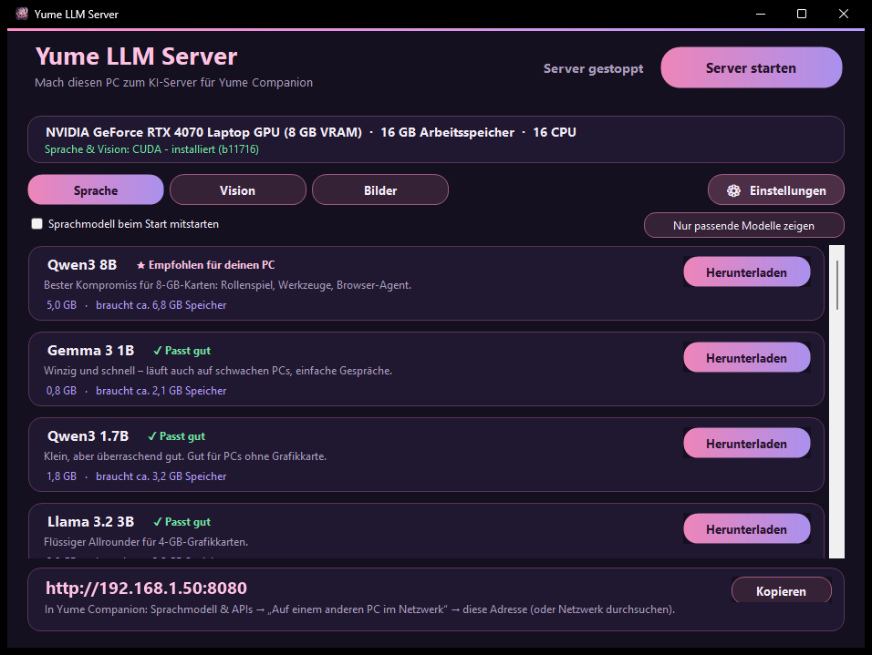 | 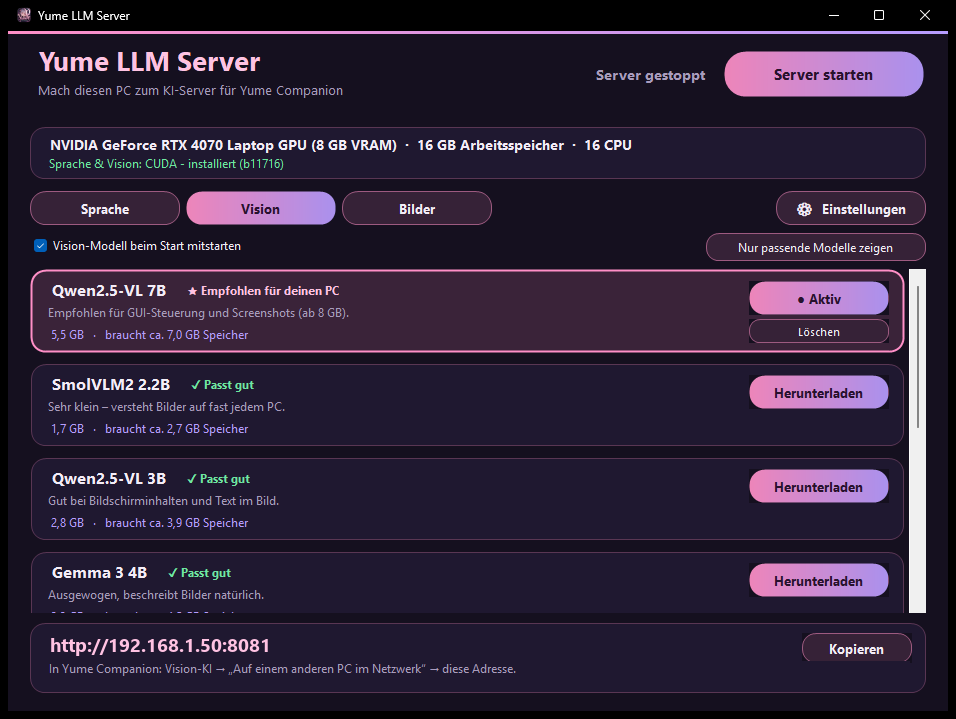 | 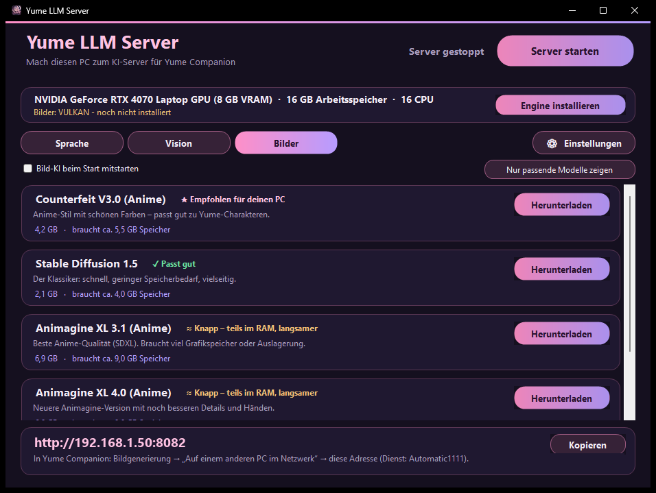 |

→ [Yume LLM Server](docs/12-llm-server.md)

### 🌐 Webclient und Dashboard
Chatten per Browser (auch vom Handy im selben WLAN) und ein Dashboard mit CPU, RAM, GPU, Tokens pro Sekunde und Kontextauslastung.

| Webclient am Handy | Dashboard |
| --- | --- |
| 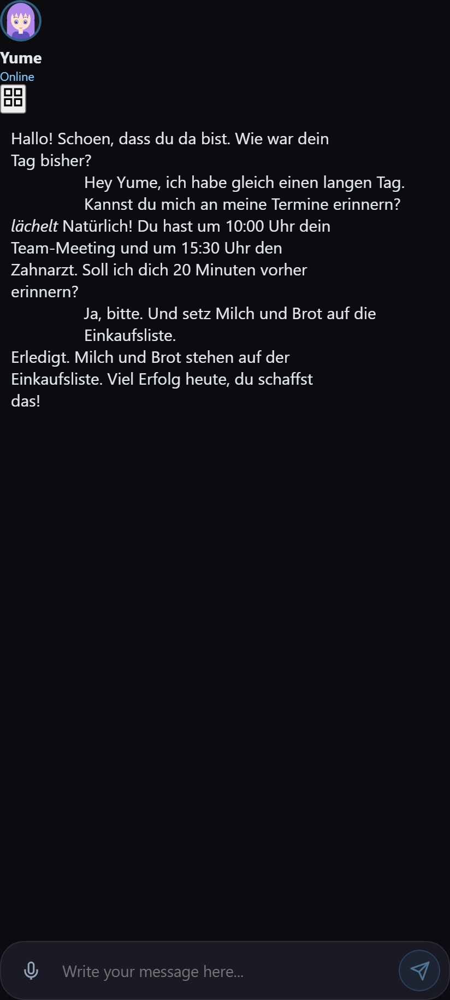 | 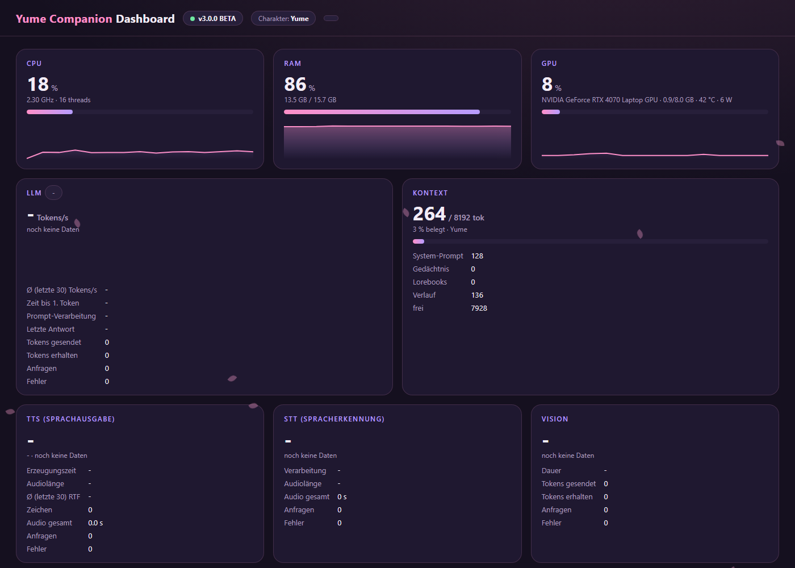 |

→ [Web und Dashboard](docs/13-web-und-dashboard.md)

## Galerie

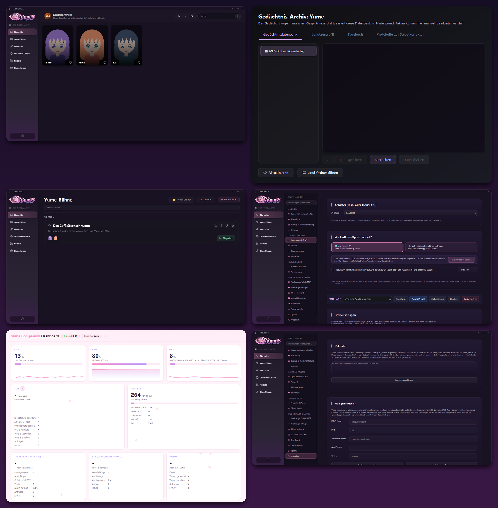

Alle Screens mit Erklärung findest du in der [Dokumentation](docs/INDEX.md).

## Die Bausteine

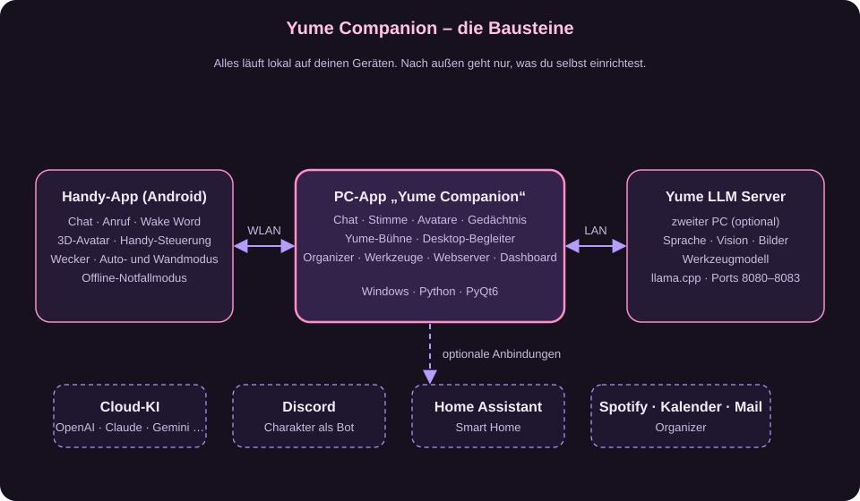

| Baustein | Ordner | Beschreibung |
| --- | --- | --- |
| PC-App | `app/`, `main.py` | Python, PyQt6. Die eigentliche Anwendung. |
| Android-App | `android/` | Kotlin, Jetpack Compose. Verbindet sich mit dem PC. |
| Yume LLM Server | `llm-server/` | Kleines Windows-Programm (C#), startet llama.cpp auf einem zweiten PC. |
| Release-Werkzeuge | `updater/`, `rebrand/` | Setup bauen, Name und Logo ändern. |
| Tests | `tests/` | Tests für den Organizer, Sprache, Werkzeuge u. a. |
| Dokumentation | `docs/` | Diese Anleitung mit Bildern. |

## Schnellstart

1. Lade unter [**Releases**](../../releases) das neueste `Yume-Companion-Setup-….exe` herunter und führe es aus. Es richtet Python, PyTorch und alle Pakete ein (ca. 10 GB nach der Installation).
2. Starte **Yume Companion**. Auf der Startseite erscheinen drei Schritte: **Modell wählen → Charakter erstellen → Chatten**.
3. Für das erste Gespräch brauchst du ein Sprachmodell. Am einfachsten:
   * **Cloud:** *Einstellungen → Sprachmodell & APIs* → Anbieter wählen → API-Schlüssel eintragen.
   * **Lokal:** *Modelle* → ein Modell (z. B. Qwen3 8B, Quantisierung Q4_K_M) herunterladen → **Modell laden**.
4. Beispiel-Charaktere erzeugst du mit `tools/demo/make_demo_content.py` oder legst eigene unter *Charakter erstellen* an.

Ausführlich: [Installation](docs/01-installation.md) · [Erste Schritte](docs/02-erste-schritte.md). Aus dem Quelltext bauen: [Entwicklung](docs/16-entwicklung.md).

## Die Dokumentation

Alles liegt in [`docs/`](docs/INDEX.md):

| Bereich | Anleitung |
| --- | --- |
| Einstieg | [Installation](docs/01-installation.md) · [Erste Schritte](docs/02-erste-schritte.md) |
| Charaktere und KI | [Chat und Charaktere](docs/03-chat-und-charaktere.md) · [Sprachmodelle](docs/04-sprachmodelle.md) · [Stimme und Avatare](docs/05-stimme-und-avatare.md) · [Gedächtnis](docs/06-gedaechtnis.md) |
| Erlebnisse | [Yume-Bühne](docs/07-yume-buehne.md) · [Desktop-Begleiter](docs/08-desktop-begleiter.md) |
| Werkzeuge | [Werkzeuge und Integrationen](docs/09-werkzeuge-und-integrationen.md) · [Organizer](docs/10-organizer.md) |
| Handy und Server | [Android-App](docs/11-android-app.md) · [Yume LLM Server](docs/12-llm-server.md) · [Web und Dashboard](docs/13-web-und-dashboard.md) |
| Betrieb | [Backup, Updates, Sicherheit](docs/14-backup-updates-sicherheit.md) · [Entwicklung](docs/16-entwicklung.md) |
| Veröffentlichen | [Anleitung für GitHub](docs/GITHUB_ANLEITUNG.md) · [Lizenzen](docs/LIZENZEN_UND_UPLOAD.md) |

## Systemvoraussetzungen

| | Minimum | Empfohlen |
| --- | --- | --- |
| System | Windows 10/11 (64 Bit) | Windows 11 |
| RAM | 8 GB | 16 GB oder mehr |
| Grafikkarte | beliebig (nur Cloud-Modelle) | NVIDIA oder AMD mit 8 GB+ VRAM für lokale Modelle |
| Speicher | 15 GB frei | schnelle NVMe-SSD, 40 GB+ für Modelle |
| Handy | Android 9+ (API 28) | Android 12+ (Kamera, Mikrofon, WLAN) |

## Datenschutz

* Charaktere, Chats, Gedächtnis, Einstellungen und Organizer-Daten bleiben auf deinem PC. Passwörter (Mail, Spotify) werden mit der Windows-Datenschutz-Funktion verschlüsselt gespeichert.
* Lokale Modelle senden nichts ins Internet. Mit Cloud-Anbietern (OpenAI, Anthropic, Gemini …) gehen die Chat-Texte an diesen Anbieter.
* Die App holt aus dem Netz nur, was du nutzt: Modelle von Hugging Face, Charakterkarten aus der Galerie, Wetter (Open-Meteo), Orte und Routen (OpenStreetMap), Spotify, und Update-Infos von GitHub.
* Weitere Hinweise: [Backup, Updates, Sicherheit](docs/14-backup-updates-sicherheit.md).

## Community und Hilfe

* **Discord:** <https://discord.gg/5RBgNMCPKC>. Hier bekommst du schnelle Hilfe, kannst Charaktere und Avatare zeigen und Wünsche äußern.
* **Fehler und Funktionswünsche:** als [Issue](../../issues) auf GitHub.

## Projekt unterstützen

Yume Companion ist kostenlos und Open Source. Wenn dir das Projekt gefällt, hilft deine Unterstützung bei Zeit, Tests und neuen Funktionen:

Einmalig oder monatlich über <https://ko-fi.com/kreqzxoo>. Auch Mitarbeit, Fehlermeldungen, Charaktere und ein Stern auf GitHub helfen. Danke! 💜

## Lizenz und Danksagung

* Lizenz: **GNU General Public License v3.0** (siehe [LICENSE](LICENSE)). Der Quelltext darf unter diesen Bedingungen genutzt, verändert und weitergegeben werden.
* Original: **Soul of Waifu** von jofizcd – <https://github.com/jofizcd/Soul-of-Waifu>, Dokumentation: <https://jofizcd.github.io/soul-of-waifu-site/docs/>.
* Verwendete Komponenten und ihre Lizenzen: [docs/LIZENZEN_UND_UPLOAD.md](docs/LIZENZEN_UND_UPLOAD.md).
* Die Beispiel-Charaktere und ihre Bilder in diesem Repository sind selbst erstellt und frei verwendbar.

---

## English summary (full version: [README.en.md](README.en.md))

**Yume Companion** is a Windows desktop app (Python/PyQt6) for AI characters with memory, voice, avatars (expression images, Live2D, VRM 3D), a role-play stage with an AI game master, a desktop companion, an organizer (calendar, mail, lists, routines), and an Android companion app (Kotlin) that can chat, call, and control the phone. The separate **Yume LLM Server** turns a second PC into a llama.cpp server for language, vision, image and tool models.

**AI stack:** local GGUF models via llama.cpp (CUDA/Vulkan/HIP/SYCL) or cloud providers (OpenAI, Anthropic, Gemini, DeepSeek, Mistral, OpenRouter, Grok, Qwen, Z.AI, Player2); six TTS engines (Qwen3-TTS, XTTSv2, Kokoro, Silero, Edge, ElevenLabs) plus RVC; Faster-Whisper speech input with echo cancellation; a 28-emotion classifier driving avatars; vision, tool and image models.

It is a heavily modified fork of [Soul of Waifu](https://github.com/jofizcd/Soul-of-Waifu) by jofizcd (GPL-3.0) and is licensed under **GPL-3.0** as well. The documentation in `docs/` is written in German, with screenshots of every screen.

**Quick start:** download the latest setup from [Releases](../../releases), run it, start the app, pick a model (cloud API key or a local GGUF model from the *Modelle* page), create a character and chat. Build from source: see [docs/16-entwicklung.md](docs/16-entwicklung.md).
