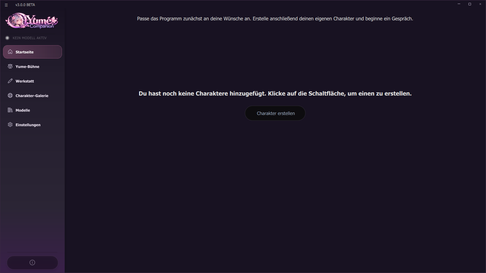

# 01 Installation

Es gibt zwei Wege: das fertige **Setup** (empfohlen) oder die **Installation aus dem Quelltext** (für Entwickler und alle, die den Code selbst prüfen wollen).

## 1.1 Voraussetzungen

| | Minimum | Empfohlen |
| --- | --- | --- |
| System | Windows 10/11, 64 Bit | Windows 11 |
| RAM | 8 GB | 16 GB oder mehr |
| Grafikkarte | beliebig (nur Cloud-Modelle) | NVIDIA (CUDA) oder AMD/Intel (Vulkan) mit 8 GB+ VRAM |
| Speicher | 15 GB frei (Programm ca. 10 GB) | schnelle NVMe-SSD, 40 GB+ für Modelle |
| Internet | für die Installation und für Downloads von Modellen | – |

Wichtig:
* **Nicht als Administrator starten.** Das ändert das Arbeitsverzeichnis und kann Pfade kaputt machen.
* Der Installationsordner sollte **keine Sonderzeichen** enthalten. Von OneDrive-Ordnern wird abgeraten (Synchronisation von Gigabytes).

## 1.2 Weg A: Setup-Installer (empfohlen)

1. Lade unter **Releases** die Datei `Yume-Companion-Setup-<Version>.exe` herunter (ca. 2 GB).
2. Starte sie. Der Assistent fragt:
   * **Zielordner** (Standard: `%LOCALAPPDATA%\Programs\Yume Companion`, ohne Administratorrechte; bei OneDrive-Pfaden warnt er).
   * **Komponenten:** PyTorch **CUDA** (vorgewählt, wenn eine NVIDIA-Karte erkannt wird) oder **CPU**; **FlashAttention-2** (optional, nur CUDA, ca. 250 MB, beschleunigt Qwen3-TTS).
   * Verknüpfungen im Startmenü und optional auf dem Desktop.
3. Danach läuft der Installer (`installer.bat /auto cuda|cpu [flash]`) ohne weitere Fragen in einem Konsolenfenster und lädt PyTorch (ca. 2,5 GB) und alle Pakete. Das dauert je nach Leitung 10 bis 40 Minuten.
4. Am Ende startet das Programm.

Das deutsche Setup stellt die Programmsprache automatisch auf Deutsch.

**Stiller Modus** (für Skripte): `Yume-Companion-Setup.exe /VERYSILENT /DIR="D:\Yume" /INSTALLDEPS=1 /TORCH=cuda /FLASH=0`

## 1.3 Weg B: aus dem Quelltext

Du brauchst: Windows, Git (oder das ZIP von GitHub), Internet und ca. 15 GB Platz.

```bash
git clone https://github.com/Kreqzxoo/Yume-Companion.git C:\Yume-Companion
cd C:\Yume-Companion
tools\setup_from_source.bat
```

Der Pfad darf **keine Leerzeichen** enthalten. Das Skript macht fünf Schritte:

| Schritt | Was passiert |
| --- | --- |
| 1 | lädt Miniconda und installiert es in `app\data` |
| 2 | legt die Python-3.11-Umgebung `sow` an |
| 3 | lädt FFmpeg nach `app\ffmpeg\bin` |
| 4 | lädt die zwei kleinen Modelle (Einbettung und Gefühlserkennung) mit `tools\fetch_models.py` |
| 5 | startet `installer.bat` (PyTorch, PyQt6, Sprach-Engines, Live2D …) |

Danach: `start.bat`. Beispiel-Charaktere ohne eigene Daten erzeugt `app\data\envs\sow\python.exe tools\demo\make_demo_content.py`.

> Der Schritt 5 (`installer.bat`) ist die Installationsroutine des Programms. Fehlgeschlagene Teile stehen am Ende und in `logs\installer.log`.

## 1.4 Erster Start

`start.bat` (oder die Verknüpfung) prüft FFmpeg, aktiviert die Python-Umgebung und startet `main.py`. Ein Konsolenfenster zeigt das Protokoll (zusätzlich in `logs\`). Beim ersten Start fragt die App ggf., ob sie die Echo-Unterdrückung (WebRTC AEC3) installieren soll.



Auf der Startseite stehen drei Schritte: **Modell wählen**, **Charakter erstellen**, **oder entdecken (Charakter-Galerie)**. Weiter mit [02 Erste Schritte](02-erste-schritte.md).

## 1.5 Update

* **Setup:** Das neue Setup einfach drüberinstallieren. `settings.json`, `api.json` und `characters.json` werden nie überschrieben.
* **Quelltext:** `git pull`, danach bei neuen Paketen `installer.bat` erneut ausführen.
* **Prüfen, ob es etwas Neues gibt:** *Einstellungen → Updates* → GitHub-Repository eintragen → **Nach Updates suchen** (siehe [14 Backup, Updates, Sicherheit](14-backup-updates-sicherheit.md)).
* Vorher ein Backup machen (*Einstellungen → Backup & Wiederherstellung*).

## 1.6 Deinstallieren

* Setup-Installation: *Windows-Einstellungen → Apps* → **Yume Companion** → Deinstallieren (entfernt das Programm; bei Bedarf manuell `%LOCALAPPDATA%\YumeCompanion` löschen, dort liegen Organizer-Daten).
* Quelltext: den Ordner löschen.
* Mit **Backup** vorher deine Charaktere sichern.

## 1.7 Wo liegen meine Daten?

| Daten | Ort |
| --- | --- |
| Einstellungen, Charaktere, API-Schlüssel | `app\configuration\` (`settings.json`, `characters.json`, `api.json`) |
| Chats und Gedächtnis | in `characters.json` und im Ordner `.soul\` |
| Yume-Bühne | `.soul_stage\` |
| Organizer (Kalender, Listen, Mail-Zugang …) | `%LOCALAPPDATA%\YumeCompanion\` (Passwörter mit Windows-Datenschutz verschlüsselt) |
| Modelle (lokale Sprachmodelle) | `assets\local_llm\` |
| Protokolle | `logs\` |
| Backups | frei wählbar, Standard `Backups\` |
