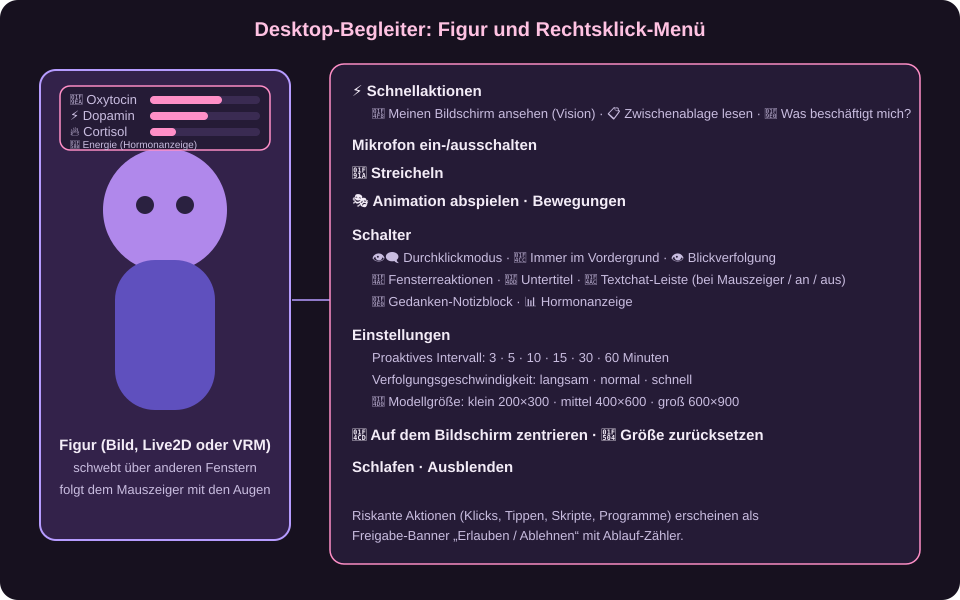

# 08 Desktop-Begleiter

Der **Desktop-Begleiter** ist deine Figur **auf dem Desktop**: rahmenlos, immer sichtbar (wenn du es willst), mit eigener Stimmung, die auf dem Bildschirm und auf deinem Tun reagiert. Er ist kein Chatfenster, sondern eine Mitbewohnerin, die von sich aus etwas sagen kann.

> Die Zeichnung zeigt den Aufbau schematisch. Die Figur selbst erscheint mit deinem Bild, Live2D- oder VRM-Modell.

## 8.1 Starten

1. **Einstellungen → Visualisierung**: *Yume-System aktivieren* und als **Modus** *Yume-Desktop-Begleiter* wählen.
2. Dem Charakter ein Aussehen geben (Bilder, Live2D oder VRM, [Kapitel 05](05-stimme-und-avatare.md)) und eine **Stimme** zuweisen.
3. Auf der Kachel **Anrufen** → Anrufmodus **Yume-Desktop-Begleiter**. Die Figur erscheint über anderen Fenstern.

## 8.2 Das Hormon-Modell

Hinter der Figur arbeitet ein einfaches „Hormonsystem“. Vier Werte zwischen 0 und 1 bestimmen Stimmung, Redefreude und Verhalten:

| Wert | Anzeige | Bedeutung |
| --- | --- | --- |
| **Oxytocin** (Liebe, Bindung) | 🧪 | steigt, wenn du mit ihr sprichst und aktiv bist; sinkt, wenn du länger weg bist (sie wird einsam, unter 0,25) |
| **Dopamin** (Fokus, Interesse) | ⚡ | steigt bei neuen Ereignissen und wenn du sprichst; sinkt langsam |
| **Cortisol** (Stress) | 🔥 | steigt bei unangenehmen Situationen; klingt von selbst ab |
| **Energie** (Vitalität) | 🔋 | wird durch Sprechen und Nachdenken verbraucht und regeneriert sich; bei sehr niedriger Energie **schläft** die Figur und wacht bei genug Erholung wieder auf |

Die Werte beeinflussen den Prompt (Stimmung, Zeit seit dem letzten Wort) und damit, ob sie spricht, schweigt oder nur das Gesicht ändert. Über *Hormonanzeige* im Menü blendest du sie ein.

## 8.3 Wie sie entscheidet

Bei jedem **Ereignis** (du sprichst, ein Programm öffnet sich, Zeit vergeht, ein Timer läuft ab) wählt das Sprachmodell eine **Aktion** und gibt sie als strukturierte Antwort zurück:

| Aktion | Wirkung |
| --- | --- |
| *speak* | spricht laut (auch von sich aus, „proaktiv“) |
| *idle* | bleibt still, passt nur Hormone oder Gefühl an |
| *micro_react* | ändert nur den Gesichtsausdruck |
| *inner_thought* | denkt leise (landet im **Gedanken-Notizblock**) |
| *use_tool* | nutzt ein Werkzeug, z. B. Screenshot, Systeminfo, Websuche |

Ihr Gefühl wählt sie aus: neutral, neugierig, warm, belustigt, besorgt, verspielt, entspannt, müde, melancholisch, begeistert.

## 8.4 Das Rechtsklick-Menü

Rechtsklick auf die Figur öffnet das Menü:

| Eintrag | Funktion |
| --- | --- |
| **⚡ Schnellaktionen** | *Meinen Bildschirm ansehen (Vision)*, *Zwischenablage lesen (Analysieren)*, *Was beschäftigt mich?* |
| **Mikrofon ein/aus** | Spracheingabe für den Begleiter |
| **🤚 Streicheln** | Reaktion der Figur |
| **🎭 Animation abspielen / Bewegungen** | Live2D-Motions und VRM-Animationen |
| **Durchklickmodus** | Klicks gehen durch die Figur hindurch zu den Fenstern dahinter |
| **Immer im Vordergrund** | bleibt über allen Fenstern |
| **Blickverfolgung** | die Augen folgen dem Mauszeiger |
| **Fensterreaktionen** | sie kommentiert Fenster und Programme, die du öffnest |
| **Untertitel** | zeigt Gesprochenes als Text |
| **🧠 Gedanken-Notizblock** | zeigt ihre inneren Gedanken (Titel: „Interne Gedanken des Begleiters“) |
| **Textchat-Leiste** | Eingabezeile *bei Mauszeiger*, *an* oder *aus* |
| **Proaktives Intervall** | wie oft sie von sich aus etwas sagen darf: 3, 5, 10, 15, 30 oder 60 Minuten |
| **Verfolgungsgeschwindigkeit** | langsam, normal, schnell |
| **📐 Modellgröße** | klein 200×300, mittel 400×600, groß 600×900 |
| **📊 Hormonanzeige** | Balken für Oxytocin, Dopamin, Cortisol, Energie |
| **📍 Zentrieren · 🔄 Größe zurücksetzen** | Position und Größe |
| **Schlafen · Ausblenden** | Pause bzw. Figur verstecken |

## 8.5 Werkzeuge (was sie am PC tun kann)

Der Begleiter nutzt dieselben Werkzeuge wie der Chat (siehe [Kapitel 09](09-werkzeuge-und-integrationen.md)):

* **Bildschirm lesen** (Screenshot an ein bildfähiges Modell), **Zwischenablage**, **Systeminfo**, **Hardware**
* **Websuche**, **Browser-Agent** (Playwright: liest Seiten, klickt, füllt Formulare)
* **GUI-Steuerung** (Maus, Tastatur, Scrollen, Tastenkombinationen), **App-Steuerung** (Programme starten, Fenster fokussieren, Prozesse beenden)
* **Code ausführen** (Python/PowerShell in einer abgeschotteten lokalen Umgebung), **Dateiverwaltung**, **Aufgabenplaner**
* **Mediensteuerung** (Pause, nächster Titel), **Systemüberwachung** („Hardware-Wächter“: Akku, GPU-Temperatur, fertige Downloads)
* **Eigene Plugins** im Ordner `app/utils/soul_companion/plugins` (Python-Klasse `Plugin` von `BaseTool`)

**Sicherheit:** Riskante Aktionen (Klicken, Tippen, Skripte, Programmstart) erscheinen als **Freigabe-Banner** „Der Begleiter möchte eine Aktion ausführen“ mit **Erlauben** und **Ablehnen** und laufen nach kurzer Zeit ohne Antwort ab. Jede Werkzeugart kannst du einzeln ausschalten (*Einstellungen → Werkzeugaufrufe & MCP*). Das **Werkzeug-Protokoll** (`logs/tool_log.jsonl`) hält fest, was ausgeführt, genehmigt und wie es ausging; Geheimnisse sind maskiert (abschaltbar).

## 8.6 Tipps

* Ein starkes lokales Modell (8B oder mehr) entscheidet Aktionen und Werkzeuge zuverlässiger; nutze ggf. das [externe Werkzeug-Modell](04-sprachmodelle.md#46-werkzeug-modell-extern).
* Soll sie seltener reden, erhöhe das *Proaktive Intervall* oder schalte *Fensterreaktionen* aus.
* Der Begleiter und der Chat teilen das [Yume-Gedächtnis](06-gedaechtnis.md): Was du im Chat sagst, weiß sie auch auf dem Desktop.
