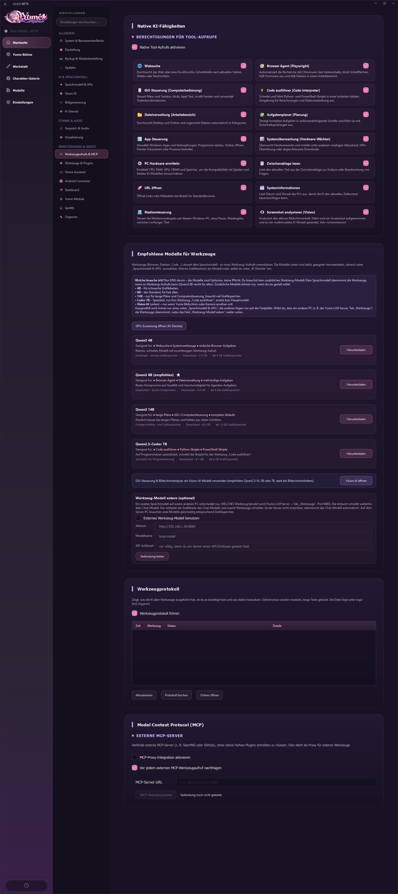
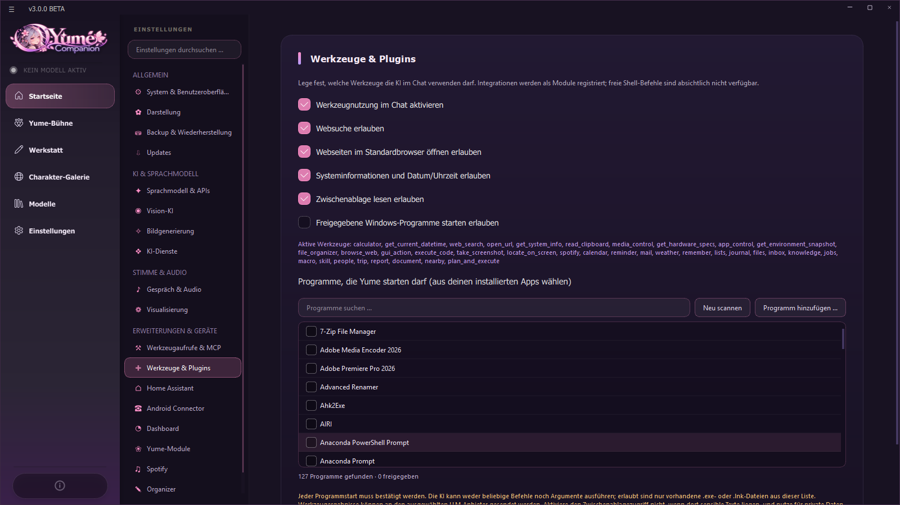
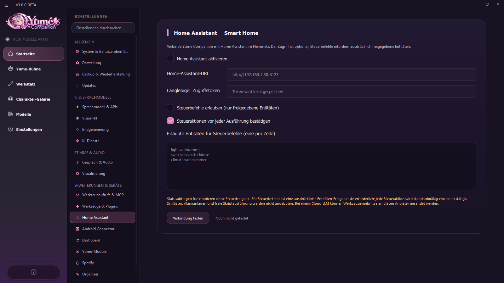
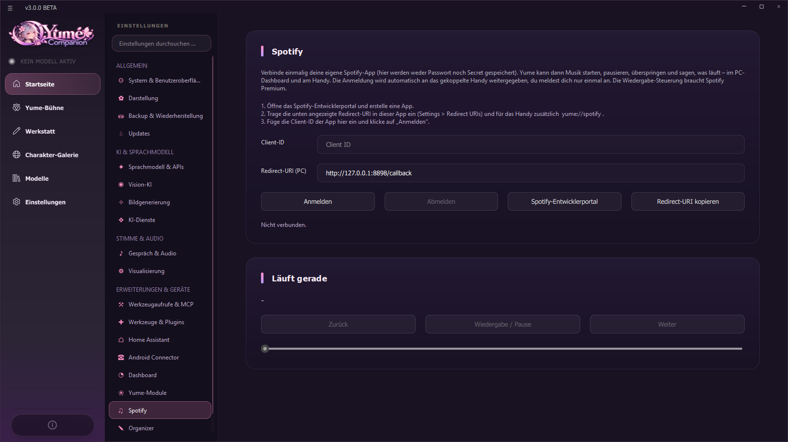
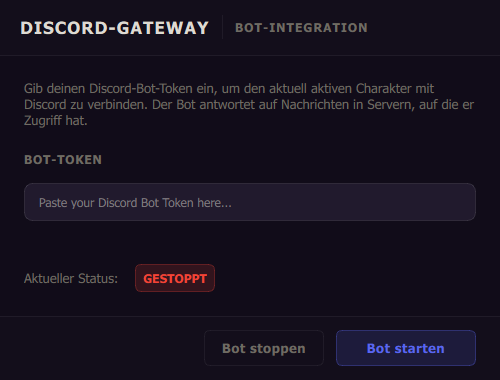
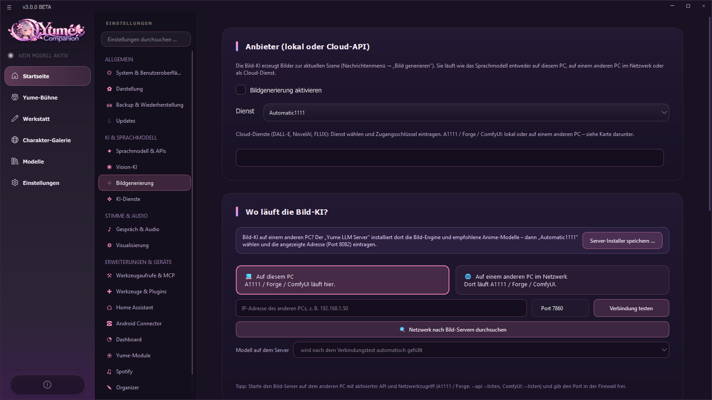
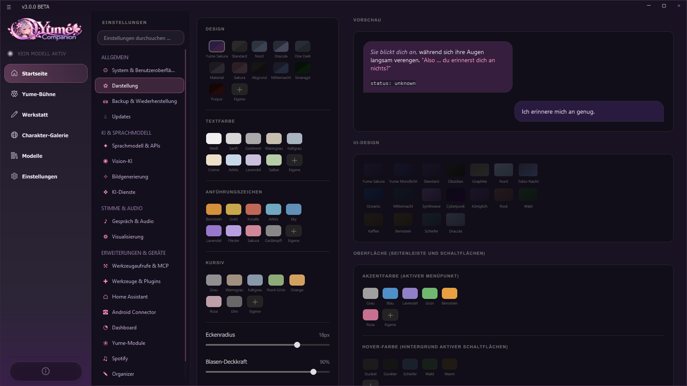

# 09 Werkzeuge und Integrationen

Dieses Kapitel erklärt, was die KI am PC **tun** darf (Werkzeuge), und alle Anbindungen: MCP, Home Assistant, Spotify, Discord, Bildgenerierung, Dashboard und Darstellung.

## 9.1 Werkzeuge (Tool-Aufrufe)

**Einstellungen → Werkzeugaufrufe & MCP.** Mit **Native Tool-Aufrufe aktivieren** darf die KI während einer Antwort Funktionen ausführen. Jede Fähigkeit hat einen eigenen Schalter:

| Werkzeug | Was es kann |
| --- | --- |
| **Websuche** | sucht über DuckDuckGo nach Fakten, Wetter, Nachrichten |
| **Browser-Agent** (Playwright) | automatisiert Chromium: liest Seiten, klickt, füllt Formulare, lädt Dateien in einen Arbeitsbereich |
| **GUI-Steuerung** | Maus, Tastatur, Scrollen, Tastenkombinationen |
| **Code ausführen** | Python- und PowerShell-Skripte in einer isolierten lokalen Umgebung (Berechnungen, Dateien) |
| **Dateiverwaltung** | Desktop und Ordner durchsuchen, Dateien automatisch in Kategorien sortieren |
| **Aufgabenplaner** | zerlegt komplexe Aufgaben in Schritte und führt sie mit Sicherheitsprüfungen aus |
| **App-Steuerung** | Windows-Apps starten, Ordner öffnen, Fenster fokussieren, Prozesse beenden |
| **Systemüberwachung** | Akku, GPU-Überhitzung, abgeschlossene Downloads |
| **PC-Hardware ermitteln** | CPU, RAM, GPU, VRAM, Speicher (Kompatibilität mit Spielen und KI-Modellen) |
| **Zwischenablage lesen** | aktueller Text zur Analyse |
| **URL öffnen** | Links im Standardbrowser |
| **Systeminformationen** | Datum und Uhrzeit |
| **Mediensteuerung** | Pause, Wiedergabe, nächster/vorheriger Titel |
| **Screenshot analysieren** (Vision) | Bildschirm aufnehmen und von einem bildfähigen Modell beschreiben lassen (sehr rechenintensiv) |
| Weitere | Rechner, Kalender, Erinnerungen, Mail, Wetter, Merken, Listen, Tagebuch, Dateien, Eingang, Wissensdatenbank, Jobs, Makros, Skills, Personen, Reisen, Wochenrückblick, Dokumente, Orte in der Nähe, Spotify, Handy (siehe [Organizer](10-organizer.md)) |

**Freigabe:** Riskante Aktionen verlangen deine Bestätigung. Für externe MCP-Werkzeuge gilt: „Vor jedem externen MCP-Werkzeugaufruf nachfragen“ (standardmäßig an).

### Empfohlene Modelle für Werkzeuge
Werkzeuge steuert das Sprachmodell, es muss Werkzeug-Aufrufe unterstützen. **Du brauchst nur eines** der zusätzlichen Modelle, wenn dein Chat-Modell das nicht kann: **Qwen3 4B** (schnell, schwache Grafikkarten), **Qwen3 8B** (empfohlen, Standard für fast alles inklusive Browser-Agent), **Qwen3 14B** (lange Pläne, Computersteuerung), **Qwen2.5-Coder 7B** (Code). Ein **Vision-Modell** brauchst du nur, wenn die KI Bildschirm oder Kamera sehen soll. Jedes Modell lässt sich mit einem Klick herunterladen.

### Werkzeug-Modell extern (optional)
Ein anderer PC (z. B. Tab *Werkzeuge* des [Yume LLM Servers](12-llm-server.md), Port 8083) entscheidet, **welches Werkzeug** benutzt wird; die Antwort schreibt weiter das Chat-Modell. Das entlastet die Grafikkarte. Adresse, Modellname, API-Schlüssel und **Verbindung testen**. Ist der Server nicht erreichbar, übernimmt das Chat-Modell automatisch.

### Werkzeugprotokoll
**Werkzeugprotokoll führen** schreibt nach `logs/tool_log.jsonl`, was die KI ausgeführt hat, ob du es bestätigt hast und was dabei herauskam (Geheimnisse maskiert, lange Texte gekürzt). Knöpfe: *Aktualisieren*, *Protokoll löschen*, *Ordner öffnen*.

## 9.2 Werkzeuge & Plugins (Berechtigungen)

**Einstellungen → Werkzeuge & Plugins** legt fest, was die KI im **Chat** nutzen darf.

* **Werkzeugnutzung im Chat aktivieren** (Hauptschalter), dann einzeln: Websuche, Webseiten öffnen (nur `http://` und `https://`, nie lokale Dateien), Systeminformationen, Zwischenablage lesen (standardmäßig aus, sensibel), **freigegebene Windows-Programme starten**.
* **Programme, die Yume starten darf:** Die App sucht installierte Programme (Startmenü, Desktop, App Paths). Du hakst die erlaubten an, kannst **neu scannen** oder per **Programm hinzufügen …** eine `.exe`/`.lnk` ergänzen. **Jeder Programmstart muss bestätigt werden**; die KI kann weder freie Befehle noch Argumente ausführen.
* Die Zeile **Aktive Werkzeuge** listet alle registrierten Werkzeuge.
* **Datenschutz:** Ergebnisse gehen als Kontext an das gewählte Sprachmodell. Bei Cloud-Modellen können sie den Anbieter erreichen. Aktiviere sensible Werkzeuge nur bewusst.

## 9.3 Model Context Protocol (MCP)

Unten auf der Werkzeug-Seite: **MCP-Proxy-Integration aktivieren**, **MCP-Server-URL** eintragen (z. B. `http://127.0.0.1:8000`), **MCP-Verbindung testen** zeigt die angebotenen Werkzeuge. Externe Werkzeuge (z. B. SearXNG, GitHub) stehen dann im Chat zur Verfügung, ohne Python-Plugins zu schreiben. Auch dafür muss die Chat-Werkzeugnutzung aktiv sein. Gib den Endpunkt nie ungeschützt ins Internet frei und prüfe, was ein MCP-Server darf.

## 9.4 Home Assistant

**Einstellungen → Home Assistant.** Yume kann Zustände abfragen und (nur freigegebene) Geräte steuern.

1. **Home Assistant aktivieren**, **Home-Assistant-URL** eintragen (vom PC aus erreichbar, z. B. `http://192.168.1.20:8123`). Läuft HA in einem Docker-Container, nimm die Adresse und den veröffentlichten Port des Hosts, nicht die interne Docker-Adresse.
2. In HA ein **Langlebiges Zugriffstoken** (Profil → Sicherheit) erstellen und hier eintragen (wird lokal gespeichert).
3. **Verbindung testen**.
4. Für Steuerbefehle zusätzlich **Steuerbefehle erlauben** und die **erlaubten Entitäten** eintragen, eine pro Zeile (z. B. `light.wohnzimmer`, `switch.serverrack`). Optional **Steueraktionen vor jeder Ausführung bestätigen**.

Freigegebene Dienste: Licht, Schalter, Helfer, Lüfter, Szenen, Klima, Abdeckungen und Mediaplayer. **Schlösser, Alarmanlagen, freie Skripte und beliebige Service-Daten sind absichtlich nicht freigegeben.** Damit die KI es im Chat nutzt, muss auch die Werkzeugnutzung aktiv sein.

## 9.5 Spotify

**Einstellungen → Spotify** (PC und Handy teilen **einen** Login).

1. Im **Spotify-Entwicklerportal** eine App anlegen.
2. Die angezeigte **Redirect-URI (PC)** (z. B. `http://127.0.0.1:8898/callback`) dort eintragen, für das Handy zusätzlich `yume://spotify`.
3. Die **Client-ID** der App hier einfügen, **Anmelden**. Es werden weder Passwort noch „Secret“ gespeichert (PKCE).
4. Danach startet, pausiert und überspringt Yume Musik und sagt, was läuft: am PC, im Dashboard und am gekoppelten Handy. Die Wiedergabe-Steuerung braucht **Spotify Premium**.
5. Die Karte *Läuft gerade* zeigt Titel und Regler (Zurück, Wiedergabe/Pause, Weiter).

## 9.6 Discord-Gateway

**Werkstatt → Discord-Gateway** verbindet den **aktuell aktiven Charakter** mit einem Discord-Bot. Der Bot antwortet auf Nachrichten in Servern, auf die er Zugriff hat, und kann Bilder und GIFs mit dem Vision-Modell beschreiben.

1. Im Discord-Entwicklerportal eine Anwendung und einen Bot anlegen, den **Bot-Token** kopieren und die nötigen *Intents* einschalten.
2. Token in das Feld einfügen → **Bot starten**. Status: *GESTOPPT / LÄUFT*.
3. Den Bot per Einladungslink auf deinen Server holen.
4. **Bot stoppen**, wenn du ihn nicht mehr brauchst.

Der Token wird nur in `api.json` auf deinem PC gespeichert. Beachte die Discord-Nutzungsbedingungen.

## 9.7 Bildgenerierung

**Einstellungen → Bildgenerierung** (und Werkstatt → Bildgenerierung). Erzeugt Bilder zur aktuellen Szene über *Nachrichtenmenü → Bild generieren* und für Szenenbilder der Yume-Bühne.

* **Dienst:** *Automatic1111*, *ComfyUI* (auch eigener Workflow), *NovelAI*, *DALL-E 3* oder *FLUX* (API). Bei Cloud-Diensten den Schlüssel eintragen.
* **Wo läuft die Bild-KI?** *Auf diesem PC*, oder *auf einem anderen PC im Netzwerk* (IP-Adresse, Port, **Verbindung testen**, **Netzwerk nach Bild-Servern durchsuchen**, **Modell auf dem Server** wählen). Der **Yume LLM Server** installiert dafür eine Bild-Engine samt empfohlenen Anime-Modellen (Port 8082).
* **Prompt-Ergänzungen:** zusätzlicher Prompt (wird immer angefügt) und negativer Prompt; **Breite, Höhe, Schritte**; **Checkpoint**.
* Die App analysiert die Szene und baut daraus einen „filmischen“ Prompt. Fertige Bilder: *Speichern unter …*, *Neu generieren*, *Im Ordner anzeigen*.
* **Warnung:** Lokales LLM und lokale Bildgenerierung gleichzeitig brauchen viel VRAM.
* Tipp für A1111/Forge: mit `--api --listen` starten; ComfyUI mit `--listen`; Port in der Firewall freigeben.

## 9.8 Dashboard und Android

* **Dashboard:** eine eigene Webseite mit CPU, RAM, GPU, Prozessen, Diensten, Kontextnutzung, Werkzeug-Statistik und Alarmen – siehe [Kapitel 13](13-web-und-dashboard.md).
* **Android Connector:** Handy koppeln, Webserver, Steuerungs-Rechte – siehe [Kapitel 11](11-android-app.md).

## 9.9 Darstellung

**Einstellungen → Darstellung** passt das Aussehen an, mit **Live-Vorschau** einer Chatblase:

* **Design** der Chatblasen (Yume Sakura, Standard, Nord, Dracula, One Dark, Material, Sakura, Abgrund, Mitternacht, Smaragd, Purpur und eigene Farbe).
* **Textfarbe**, **Anführungszeichen**, **Kursiv** (je 10 Voreinstellungen plus eigene Farbe).
* **Eckenradius**, **Blasen-Deckkraft**, **maximale Breite**, **Schriftgröße**.
* **UI-Design** des Fensters (Yume Sakura, Yume Mondlicht, Standard, Obsidian, Graphite, Nord, Tokio-Nacht, Oceanic, Mitternacht, Synthwave, Cyberpunk, Königlich, Rosé, Wald, Kaffee, Bernstein, Schiefer, Dracula) mit **Akzentfarbe**, **Hover-Farbe** und **Textfarbe der Schaltflächen**.
* **Zurücksetzen** und **Speichern**.

## 9.10 Umgebungsgeräusche

Siehe [Kapitel 05](05-stimme-und-avatare.md#56-umgebungsgeräusche-und-hintergründe). Aktivierung unter *Einstellungen → Yume-Module → Umgebungsaudio*.

## 9.11 Lokaler Webserver

*Einstellungen → Yume-Module → Webinterface-Server*: **Server starten/stoppen**, **Im Browser öffnen**, **Mobil-Link kopieren** (Port 8000). Zugriff ist durch einen Token geschützt. Details: [Kapitel 13](13-web-und-dashboard.md).
