# 11 Android-App

Die Handy-App **Yume Companion für Android** ist ein *Client*: Die Rechenleistung (Sprachmodell, Stimme, Gedächtnis) bleibt auf deinem PC. Das Handy bringt Mikrofon, Lautsprecher, Kamera und die Steuerung des Telefons mit. Fällt der PC aus, antwortet ein kleines Notfall-Modell direkt auf dem Handy.

> Die Bilder in diesem Kapitel entstehen ohne Handy: Die App rendert ihre echten Bildschirme am PC (`android/run-unit-tests.ps1`, Datei `DocShotsTest.kt`) mit erfundenen Demo-Daten (Charaktere „Aiko“ und „Mika“, Adresse `192.168.1.50`). Auf dem Handy sehen Schrift und Farben gleich aus.

## 11.1 Voraussetzungen

| | |
| --- | --- |
| Handy | Android **9 oder neuer** (API 28). Empfohlen: Android 12+ |
| Netz | Handy und PC im **selben WLAN** (unterwegs über eine eigene Domain, siehe 11.4) |
| PC | Yume Companion läuft, **Webserver gestartet** (Android Connector) |

## 11.2 APK besorgen und installieren

* **Fertige APK:** unter *Releases* `Yume-Companion.apk` herunterladen, **oder** am PC *Einstellungen → Android Connector → APK für das Handy speichern …*, auf das Handy kopieren (USB, Netzwerkordner, Cloud).
* **Selbst bauen** (siehe [Kapitel 16](16-entwicklung.md)): `android\build-apk.bat` richtet JDK, Android SDK und Gradle bei Bedarf ein und erzeugt die APK in `%LOCALAPPDATA%\YumeAndroidBuild\Yume-Companion.apk` (ca. 78 MB). Lege sie in `tools\android\` des PC-Programms, damit der Knopf „APK für das Handy speichern“ sie anbietet.
* Auf dem Handy die APK öffnen und **Installation aus unbekannten Quellen** erlauben (nur für diese Datei/Quelle).

## 11.3 Koppeln

**Am PC:** *Einstellungen → Android Connector*.

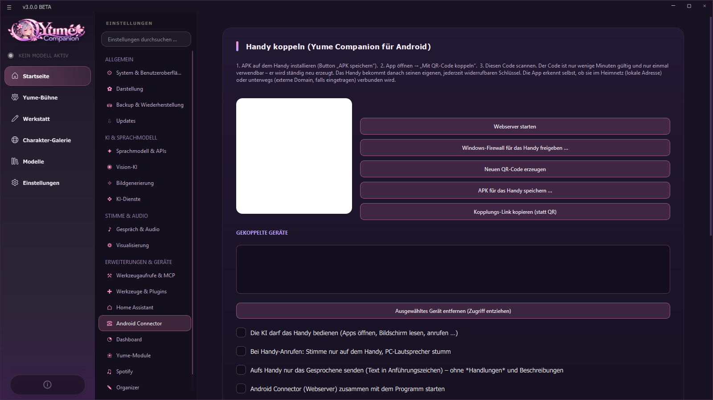

1. **Webserver starten** (Port 8000). Läuft er nicht, warnt die Seite: *„Der Webserver läuft nicht – sonst kann das Handy nicht koppeln.“*
2. **Windows-Firewall für das Handy freigeben …** (Administratorabfrage). Die Seite meldet, wenn die Firewall Verbindungen wahrscheinlich blockiert.
3. Es erscheint ein **QR-Code**. Er ist nur wenige Minuten gültig und **nur einmal verwendbar**; er wird automatisch erneuert („Code gültig noch … s“). Mit **Neuen QR-Code erzeugen** holst du einen frischen.
4. Alternativ **Kopplungs-Link kopieren** (statt QR).

**Am Handy:**

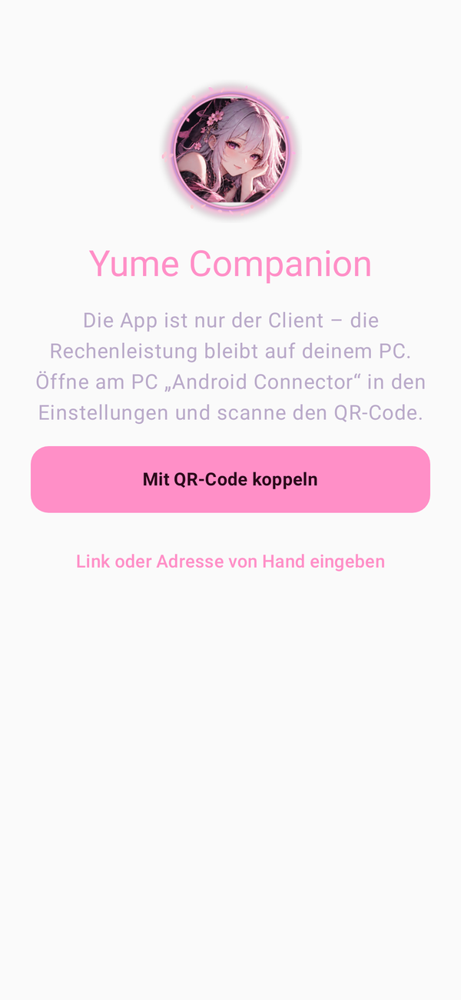

1. App öffnen → **Mit QR-Code koppeln** → QR-Code am PC scannen (Kamera-Erlaubnis).
2. Oder **Link oder Adresse von Hand eingeben** (z. B. `192.168.0.20:8000`).
3. Das Handy bekommt einen **eigenen, jederzeit widerrufbaren Schlüssel**. Am PC siehst du alle **Gekoppelten Geräte** und kannst jedes mit **Ausgewähltes Gerät entfernen (Zugriff entziehen)** sperren. Danach muss es neu gekoppelt werden.
4. Der PC zeigt auch „Letzter Kontakt vom Handy: IP (vor N s)“. Kommt kein Kontakt an, liegt es meist am Netzwerk (WLAN-Isolation, Gast-WLAN, VPN am Handy).

Weitere Schalter am PC (Seite *Android Connector*):

| Schalter | Wirkung |
| --- | --- |
| **Die KI darf das Handy bedienen** | erlaubt Apps öffnen, Bildschirm lesen, anrufen … |
| **Bei Handy-Anrufen: Stimme nur auf dem Handy** | PC-Lautsprecher bleiben stumm |
| **Aufs Handy nur das Gesprochene senden** | ohne *Handlungen* und Beschreibungen (Text in Anführungszeichen) |
| **Android Connector zusammen mit dem Programm starten** | Webserver startet automatisch |

## 11.4 Unterwegs verbinden (optional)

Die App erkennt selbst, ob sie im Heimnetz (lokale Adresse) oder unterwegs (externe Domain) ist. Für unterwegs brauchst du eine **HTTPS-Domain**, die auf den PC-Webserver zeigt, z. B. über einen **Cloudflare Tunnel** auf `http://localhost:8000`. In der App unter *Einstellungen → Verbindung* **Externe Domain** eintragen.

* **Wake-on-LAN** weckt den PC aus dem Standby: *Wake-on-LAN erlauben*, *MAC-Adresse(n) des PCs*, *PC automatisch aufwecken*. Für unterwegs gibt es einen **Aufweck-Webhook**.
* Ein Cloudflare-Fehler **523** heißt: Cloudflare erreicht deinen PC nicht (Tunnel/Port/Dienst prüfen), nicht dass das Modell fehlt.
* Schütze den externen Zugang. Den Web-Token nie öffentlich teilen.

## 11.5 Ersatz für den Google Assistant

Yume kann auf dem Handy den **Google Assistant ersetzen**. Die App meldet sich bei Android als *digitaler Assistent* an (`VoiceInteractionService`). Damit gilt:

* **Home-Taste gedrückt halten** oder **von der Ecke wischen** öffnet Yume statt Google.
* **Wake Word auf dem Startbildschirm:** Sagst du dein Wake Word („Yume …“), während der Startbildschirm oder irgendeine andere App vorne ist, schiebt sich von unten ein **halbtransparentes Assistenten-Fenster** über den Bildschirm. Es zeigt, dass sie zuhört, was sie verstanden hat und was sie antwortet, und sie spricht die Antwort laut.
* Das Fenster bleibt, bis **du** es schließt (*Schließen*, Zurück, Home, Tipp daneben). Es hört nicht dauernd mit: eine Frage, eine Antwort, dann wartet es wieder auf das Wake Word. *App öffnen* springt in die volle App.

*Darstellung nachgestellt: Der Startbildschirm im Hintergrund ist ein Platzhalter, das untere Fenster ist das echte Assistenten-Fenster der App, am PC gerendert.*

**Einrichten:**

1. *Einstellungen → Berechtigungen:* **Über anderen Apps einblenden** erlauben (nötig für das Fenster) und Mikrofon sowie Benachrichtigungen gewähren. Batterie-Optimierung für Yume ausnehmen, damit das Wake Word im Hintergrund hört.
2. *Einstellungen → Berechtigungen → Als Assistent einrichten → Standard-Assistent wählen …* öffnet die Android-Seite „Standard-Apps“. Dort **Digitaler Assistent** auf **Yume Companion** stellen.
3. *Einstellungen → Sprache & Wake Word:* Wake Word einschalten und **Assistenten-Fenster beim Erkennen** aktiv lassen. Mit **Nur auf meine Stimme reagieren** (wie „Voice Match“ beim Google Assistant) reagiert das Wake Word nur auf dich; das läuft komplett auf dem Handy.

Der Name der Android-Einstellung unterscheidet sich je nach Hersteller (Samsung, Xiaomi, Pixel …), meist unter *Einstellungen → Apps → Standard-Apps*.

## 11.6 Die Hauptbildschirme

Unten die Menüleiste: **Yume · Anruf · Offline · Einstellungen**. Beim Start wählst du (oder die App nimmt den Standard) den **Charakter**.

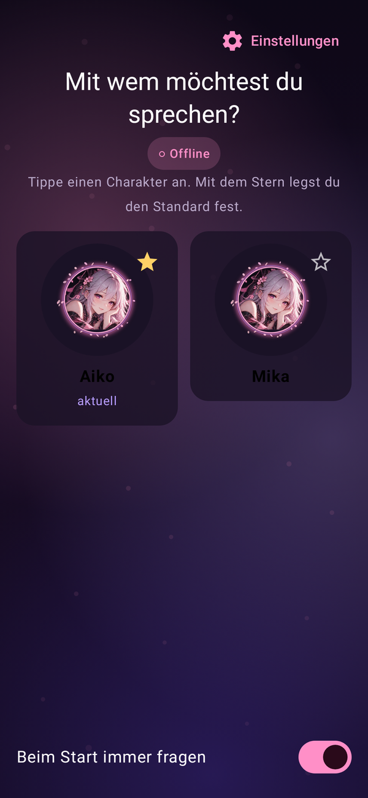

### Yume (Chat)

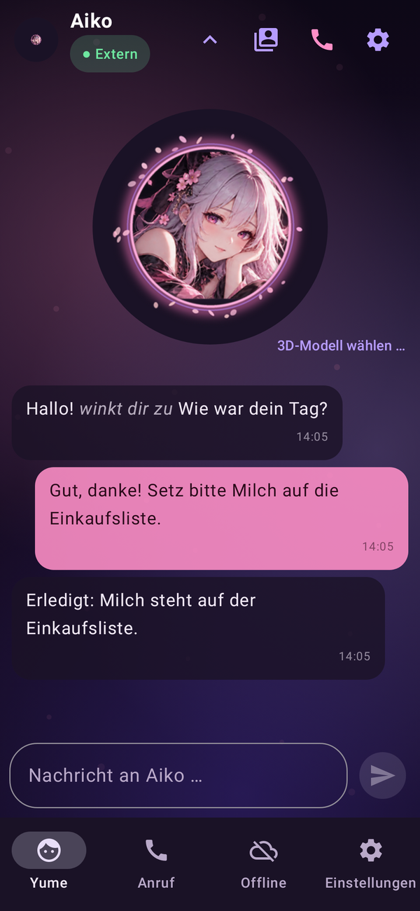

* Kopf: **Charaktername**, Verbindungsanzeige (**Lokal**, **Extern**, **Offline**), Schalter für Charakterliste, Anruf und Einstellungen.
* **Avatar**: ihr Bild atmet leicht. Mit **3D-Modell wählen …** lädst du das VRM-Modell des PC einmalig herunter; danach wird es auf dem Handy selbst animiert (Lippenbewegung, Gefühle, Körper-Animationen; läuft auch ohne PC).
* **Nachrichten** wie in einem Messenger mit Uhrzeit; während sie antwortet, siehst du den Text entstehen. Die Zeile *„✓ Spotify geöffnet“* zeigt live, was die KI gerade am Handy tut.
* Ist der PC nicht erreichbar, bietet die App **PC aufwecken (Wake-on-LAN)**, **Offline-Notfallmodus** und **Erneut versuchen** an:

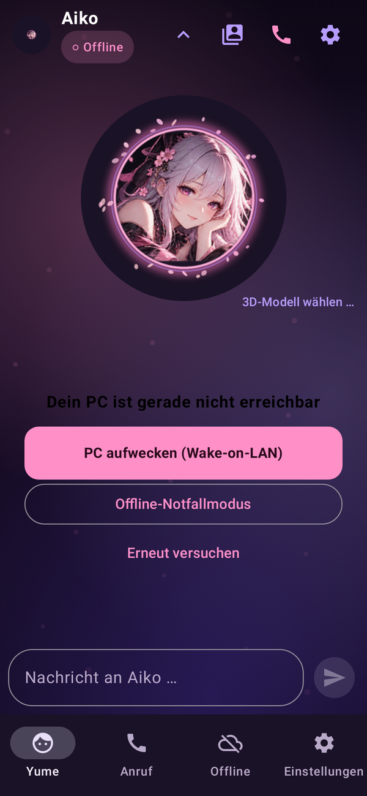

### Anruf

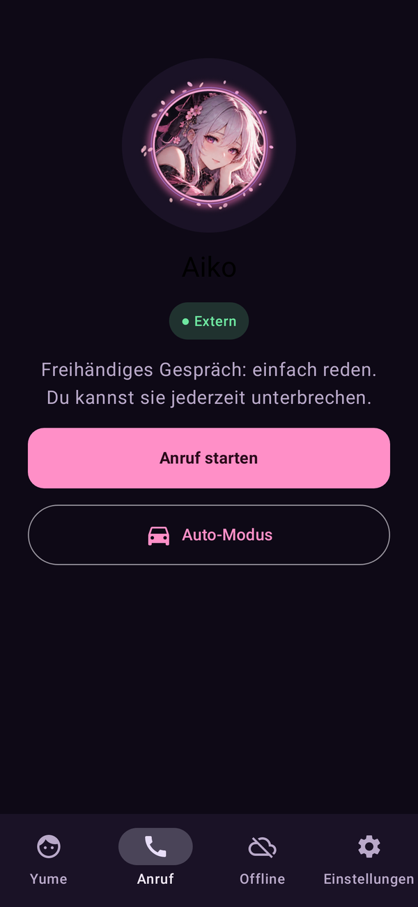

**Anruf starten**: freihändiges Gespräch mit durchgehendem Mikrofon und Sprachaktivitätserkennung. Jeder Satz geht an den PC, sie antwortet mit ihrer PC-Stimme. Du kannst sie **jederzeit unterbrechen**. Im Gespräch zeigt die App, was sie gehört hat und was sie antwortet:

* **Videoanruf:** Die Handykamera erscheint klein im Anruf; mit jedem Satz geht das neueste Kamerabild an den PC, dessen Vision-Modell es beschreibt. Sie sieht also einen Moment pro Satz, keinen Dauer-Videostrom.
* **Auto-Modus** (Knopf unten): freihändig, große Bedienelemente, Benachrichtigungen werden vorgelesen (siehe 11.10).

### Offline (Notfallmodus)

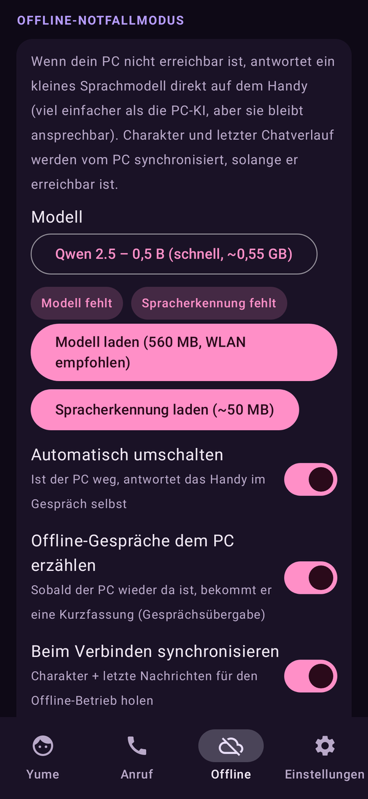

Wenn der PC fehlt, antwortet ein **kleines Sprachmodell direkt auf dem Handy** (viel einfacher als die PC-KI). Du lädst einmalig **Modell** (z. B. *Qwen 2.5 – 0,5 B*, ca. 560 MB, WLAN empfohlen) und **Spracherkennung** (ca. 50 MB). Schalter: **Automatisch umschalten** (PC weg → Handy antwortet selbst), **Offline-Gespräche dem PC erzählen** (Kurzfassung nach der Rückkehr), **Beim Verbinden synchronisieren** (Charakter und letzte Nachrichten holen). Stürzt ein Modell auf deinem Handy ab, markiert die App es als „abgestürzt“ und nutzt es nicht mehr. Einen Absturzbericht zeigt dieser Bildschirm ebenfalls.

## 11.7 Einstellungen am Handy

Die Seite *Einstellungen* ist in Abschnitte gegliedert.

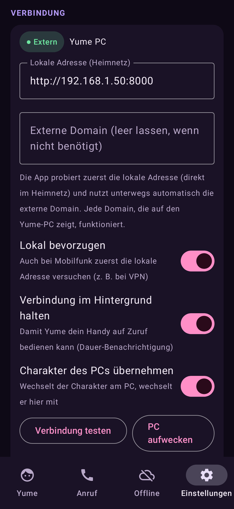

### Verbindung
**Lokale Adresse (Heimnetz)**, **Externe Domain**, **Lokal bevorzugen** (auch bei Mobilfunk zuerst die lokale Adresse, z. B. mit VPN), **Verbindung im Hintergrund halten** (Dauer-Benachrichtigung, damit der PC das Handy erreicht), **Charakter des PCs übernehmen**, **Verbindung testen**, **PC aufwecken**, **Mit neuem PC / Gerät verbinden**, **Nur Kopplung lösen …**. Dazu die Wake-on-LAN-Felder:

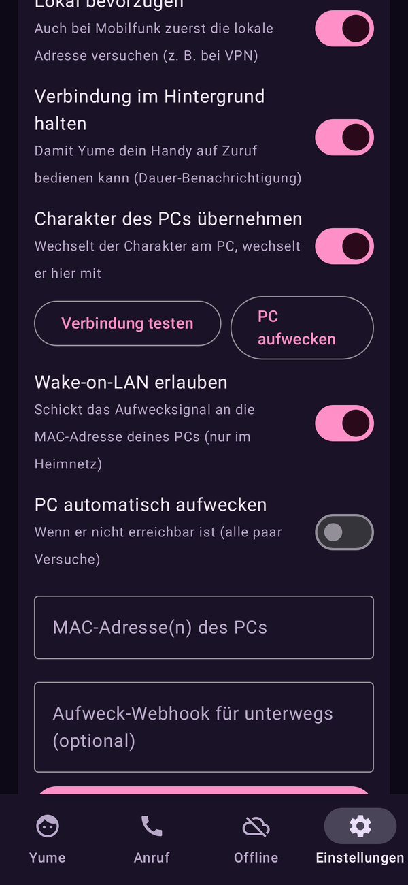

### App-Sprache
Die App gibt es auf **Deutsch und Englisch**. Standard ist **Automatisch**: ein deutsches Handy zeigt Deutsch, jedes andere Englisch. Unter *Einstellungen → App-Sprache* stellst du sie fest ein. Die Sprache gilt für alle Menüs, die Meldungen, die Handy-Befehle (z. B. „turn the flashlight on“, „set a timer for 10 minutes“, „interpreter French“) und die Standard-Sätze des Wake Words.

### Sprache & Wake Word
Das Wake Word („Hey Yume“) lauscht im Hintergrund **offline** (Vosk) ohne Konto.

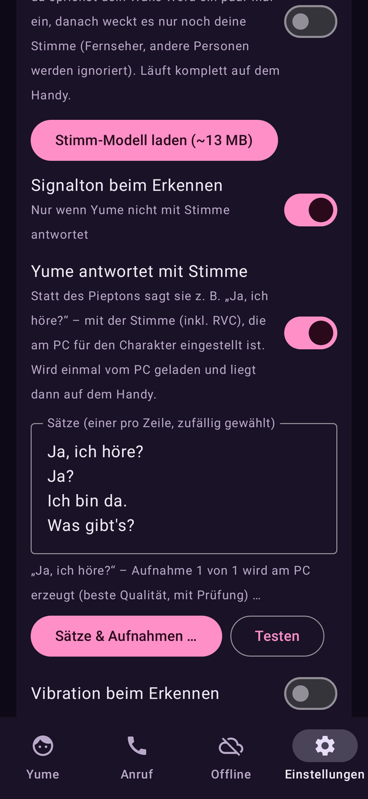

| Einstellung | Bedeutung |
| --- | --- |
| **Sprache der Erkennung** | Deutsch oder Englisch; je ein Sprachmodell zum Laden (ca. 40–50 MB). Englische Namen erkennt das englische Modell viel besser |
| **Wake Word aktiv** | Mikrofon lauscht im Hintergrund (auch per Schnelleinstellungs-Kachel und App-Schalter) |
| **Wake Words** | mehrere, Komma getrennt; auch Fehlhörer werden toleriert („hai jume“) |
| **Empfindlichkeit** | höher = reagiert schneller, aber öfter fälschlich |
| **Wake Word testen …** | zeigt, was erkannt wird und ob es aufwecken würde; Tippen auf einen Fehlhörer macht ihn zu einem weiteren Wake Word |
| **Nur auf meine Stimme reagieren** | Sprecher-Modell (ca. 13 MB, Vosk) merkt sich deinen Stimmabdruck; Fernseher und andere Personen werden ignoriert. Läuft komplett auf dem Handy; ein Komfortfilter, **kein Sicherheitsmerkmal** |
| **Stimmen unterscheiden / Gast anlernen** | weitere Personen mit Namen anlernen |
| **Signalton / Vibration / Assistenten-Fenster beim Erkennen** | wie sie sich meldet |
| **Yume antwortet mit Stimme** | Statt Piepton sagt sie z. B. „Ja, ich höre?“ mit **ihrer PC-Stimme** (inkl. RVC). Die Sätze werden am PC in bester Qualität erzeugt, mit Spracherkennung geprüft und aufs Handy geladen; pro Satz mehrere Aufnahmen, die du anhörst, wählst, löschst, exportierst oder durch eigene Audiodateien ersetzt |
| **Nur beim Laden lauschen** | spart Akku |

### Gespräch

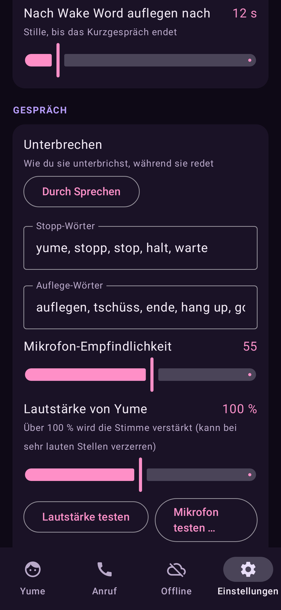

**Stopp-Wörter** (unterbrechen sie), **Auflege-Wörter** (beenden den Anruf), **Lautstärke testen**, **Mikrofon testen …** (zeigt live, was die Spracherkennung sieht; der Balken ist deine Stimme, die Linie die Schwelle der Empfindlichkeit), **Unterbrechen** (*Durch Sprechen*, *Nur mit Stopp-Wort* oder *Aus*), **Echo-Unterdrückung** (Vollduplex: Telefon-Audiopfad plus der Echo-Unterdrücker des Handys, sodass du ins Wort fallen kannst; Erklärung der Verfahren in [Kapitel 05](05-stimme-und-avatare.md#echo-schutz-anti-echo-im-detail)), **Lautsprecher**, **Bildschirm anlassen im Gespräch**.

### Handy-Steuerung durch die KI

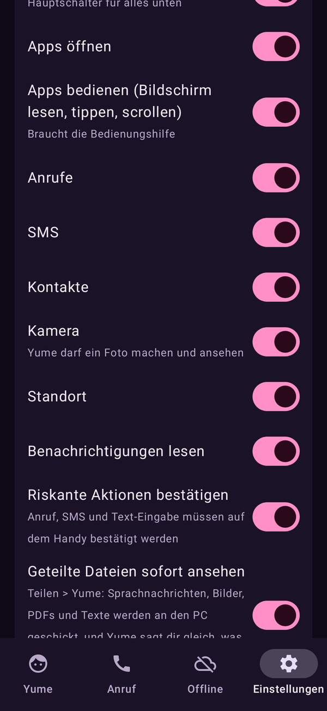

Die KI am PC darf dein Handy bedienen. Alles ist einzeln abschaltbar:

* **Steuerung erlauben** (Hauptschalter) · **Apps öffnen** · **Apps bedienen** (Bildschirm lesen, tippen, scrollen, zurück/Home, Screenshot; über den Bedienungshilfen-Dienst) · **Anrufe** · **Kontakte** · **Kamera** · **Standort** · **Benachrichtigungen lesen**.
* **Riskante Aktionen bestätigen**: Anruf, SMS und Texteingabe fragt das Handy **selbst per Benachrichtigung**; mit gesetzter **PIN** erscheint stattdessen ein Eingabefeld in der Benachrichtigung.
* **Messenger-Antworten:** „Antworte ich bin gleich da“ beantwortet die letzte Nachricht (letzte 10 Minuten) über die Antwortfunktion des Messengers, nach Rückfrage am Handy.
* **Geteilte Dateien sofort ansehen** (Teilen → Yume, siehe [Organizer](10-organizer.md#1015-eingang-teilen--yume)).
* **Sicherheits-PIN (optional, 4–8 Ziffern):** zusätzlich zur Bestätigung muss eine PIN eingegeben werden (*PIN speichern* / *PIN entfernen*).
* **Screenshot nach jedem Schritt** (die KI sieht, was sie getan hat, über das Vision-Modell am PC), mit **Screenshot-Qualität** (Standard 60 %) und **-Größe** (Standard 1280 px).

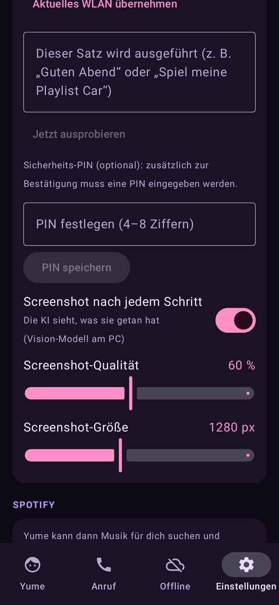
* **Protokoll:** unten sieht man, was Yume am Handy getan hat (bleibt auf dem Handy; *Leeren*).

### Anrufschutz (Spam-Schutz)

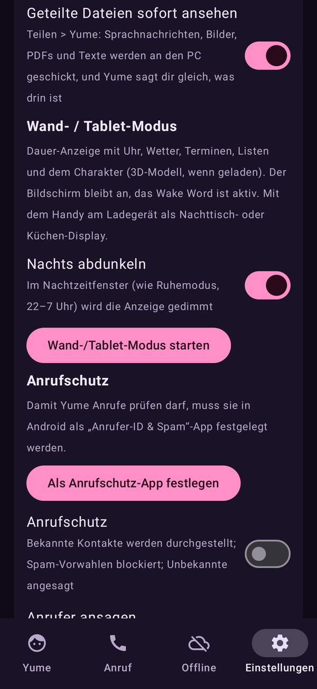

Als **Anrufschutz-App** festgelegt, entscheidet Yume bei jedem eingehenden Anruf: **bekannte Kontakte** werden durchgelassen und der Name freihändig angesagt; **Unbekannte** werden nach Vorwahl blockiert (z. B. `0900`), nachts lautlos gestellt oder angesagt. Einstellungen: *Anrufer ansagen*, *Unbekannte nachts lautlos*, *Blockierte Vorwahlen*. Antworten per Sprache ist für normale Apps nicht möglich: Yume blockiert, stellt lautlos und sagt dir Bescheid.

### Ruhemodus
*Ruhemodus nachts* (von HH:MM bis HH:MM, Standard 22–7 Uhr): leisere Stimme (Lautstärkefaktor), der PC antwortet ruhig und kurz.

### Automatisierung

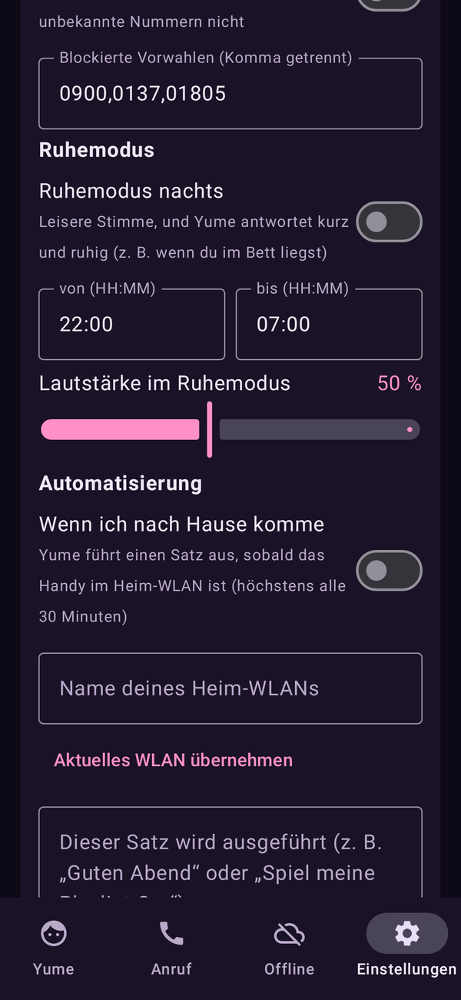

**„Wenn ich nach Hause komme“**: Sobald das Handy dein **Heim-WLAN** betritt (Name eintragen oder **Aktuelles WLAN übernehmen**; braucht Standort-Berechtigung), führt Yume **einen Satz** aus, als hättest du ihn gesagt (z. B. „Guten Abend“ oder „Spiel meine Playlist Car“). **Jetzt ausprobieren** testet ihn.

### Spotify

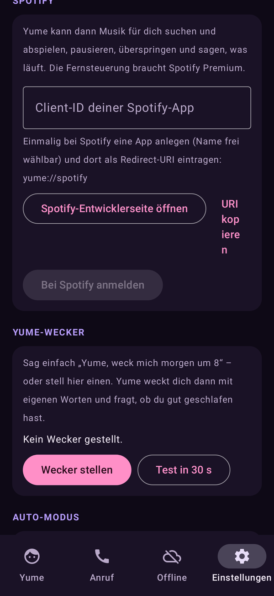

Client-ID deiner Spotify-App eintragen, **Bei Spotify anmelden** (PKCE; kein Secret). **Handy und PC teilen einen Login**: Wer angemeldet ist, reicht ihn an den anderen weiter. Yume sucht und startet Musik, pausiert, überspringt und sagt, was läuft (Premium nötig). Läuft Spotify nicht, startet sie die App und wartet.

### Yume-Wecker
„Weck mich morgen um 8“: Das Handy klingelt (als echter Wecker, genau auch im Ruhezustand). **Yume weckt dich mit selbst erfundenen Worten** (vom PC in ihrer Stimme) und fragt, wie du geschlafen hast. Ohne PC sagt die Handy-Stimme ein kurzes „Guten Morgen“. Nach Neustart/Update werden die Wecker neu gesetzt. *Wecker stellen*, *Test in 30 s*, *Löschen*.

### Auto-Modus

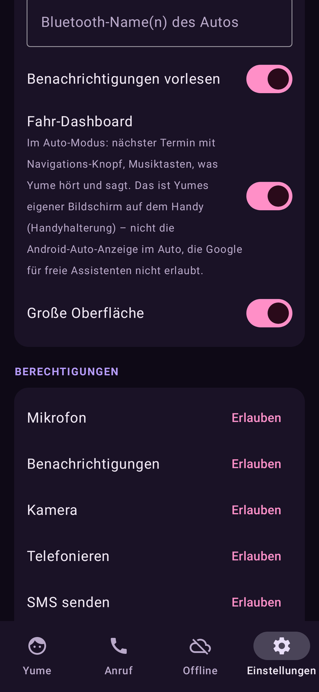

**Auto-Modus jetzt starten**, **Automatisch starten** (wenn das Handy mit dem **Bluetooth-Namen deines Autos** verbunden wird), **Benachrichtigungen vorlesen**, **Fahr-Dashboard**, **Große Oberfläche**. Das ist Yumes **eigener Bildschirm**, nicht Android Auto (Google erlaubt dort keine freien Assistenten):

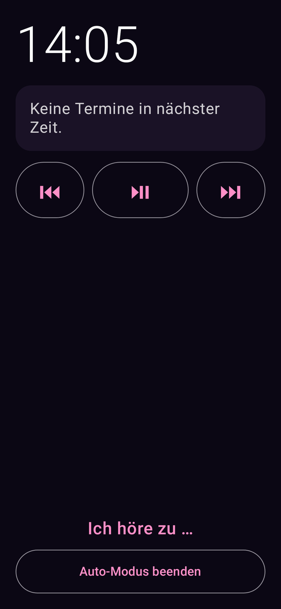

Nächster Termin mit **Navigieren**-Knopf, Musiktasten und „Ich höre zu …“; Yume hört weiter per Sprache.

### Wand- und Tablet-Modus

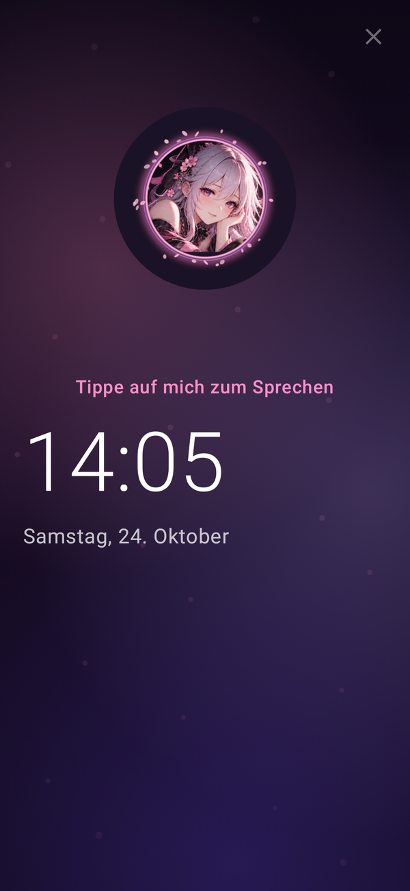

Für ein Tablet an der Wand oder ein Handy im Dock: große **Uhr und Datum**, **Wetter, Termine, Erinnerungen, Listen, Geburtstage, Musik, Mails** und der Charakter (3D-Modell, wenn geladen). Sie hört das Wake Word; **Tippe auf mich zum Sprechen**. *Nachts abdunkeln*. Starten über **Wand-/Tablet-Modus starten**.

### Berechtigungen und Assistenten-Rolle

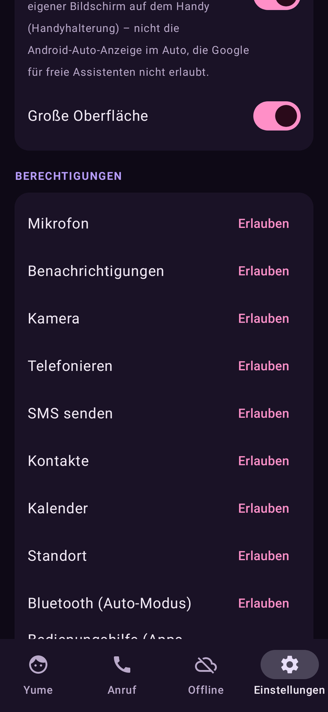

Die Liste zeigt jede nötige Berechtigung mit Knopf zum Gewähren. Die App nutzt: Internet/Netz, Mikrofon, Kamera, Benachrichtigungen, Überlagerung (Assistenten-Fenster), Telefon, SMS, Kontakte, Kalender, Standort, Bluetooth, Autostart, Vibration, Wecker, Batterie-Optimierung ausnehmen.

**Als Assistent einrichten:** Yume ersetzt den Google Assistant: *Home-Taste gedrückt halten* oder *Wisch von der Ecke* öffnet sie. Hört sie das Wake Word, während eine andere App vorne ist, gleitet ein **halbtransparentes Assistenten-Fenster** von unten herauf: Es zeigt, dass sie zuhört, was sie verstanden hat und was sie antwortet. Es bleibt, bis **du** es schließt (*Schließen*, Zurück, Home, Tipp daneben). Es lauscht nicht dauernd: eine Frage, eine Antwort, dann wartet es wieder aufs Wake Word. Braucht „Über anderen Apps einblenden“.

### Charaktere und Start, Hintergrund, Avatar

* **Beim Start Charakter wählen**, **Standard-Charakter** (bei „immer fragen“ aus: leiser Start mit dem Standard).
* **Hintergrund:** animierter Nachthimmel mit **schwebenden Blütenblättern**, das Hintergrundbild des PCs oder ein **eigenes Bild**.
* **Avatar anzeigen (3D / Live2D)**, **Körper-Animationen zu Gefühlen**, **3D-Modell wählen**, **Stimme im Chat**.

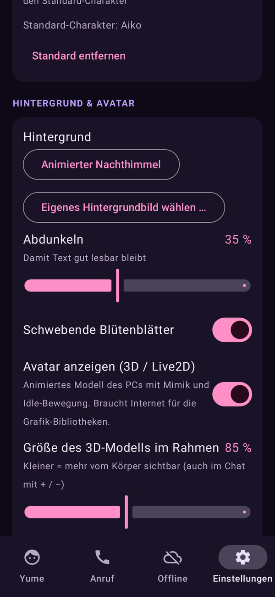

### Zurücksetzen

**App zurücksetzen …** stellt den Zustand einer Neuinstallation her (Kopplung, Einstellungen, Wecker, Spotify-Login, Chat-Zwischenspeicher). Große Downloads (3D-Modelle, Sprachmodelle, Offline-KI) bleiben, außer du wählst *auch löschen*. **Nur Kopplung lösen** ist die kleinere Variante.

## 11.8 Dolmetscher-Modus

„Dolmetscher Englisch“ startet ihn, „Dolmetscher aus“ beendet ihn. Alles, was du sagst oder tippst, übersetzt das **Sprachmodell des PC**, und das Handy **spricht** die Übersetzung in der anderen Sprache (eine Richtung: deine Sprache → Zielsprache).

## 11.9 Schnellbefehle ohne PC

Kurze Befehle klappen auch **ohne PC und ohne Sprachmodell**: Musik, Taschenlampe, Apps öffnen, Timer, Wecker, Lautstärke, Navigation, Benachrichtigungen vorlesen, Uhrzeit, Akku, Anrufe.

## 11.10 Auto-Modus beim Fahren

Siehe oben. Sobald die Bluetooth-Verbindung zum Auto steht, wechselt die App in den Auto-Modus (freihändiger Anruf). Android erlaubt den Start des Mikrofons nur aus einer sichtbaren App; deshalb fragt eine Benachrichtigung mit einem Tipp nach, wenn die App nicht vorne ist.

## 11.11 Datenschutz am Handy

* Alle Handy-Aktionen laufen **nur**, wenn du sie freigibst, und lassen sich je einzeln abschalten.
* Wake Word, Sprecher-Erkennung und Offline-KI laufen **auf dem Handy**, ohne Konto.
* Das Handy-Protokoll bleibt auf dem Handy.
* Der Gerätetoken ist am PC einzeln widerrufbar.

## 11.12 Eigene APK bauen

Siehe [Kapitel 16](16-entwicklung.md). Die App ist Open Source (`android/`, GPL-3.0 empfohlen). Abhängigkeiten: Jetpack Compose, AndroidX, CameraX, OkHttp, Vosk, MediaPipe GenAI, ML Kit Barcode (Apache-2.0; ML Kit hat eigene Nutzungsbedingungen). Details: [LIZENZEN_UND_UPLOAD.md](LIZENZEN_UND_UPLOAD.md).
