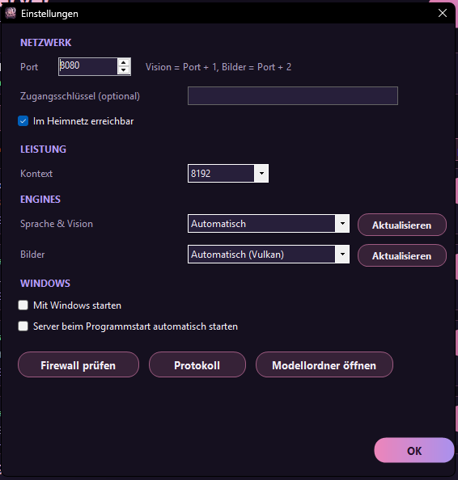

# 12 Yume LLM Server

Der **Yume LLM Server** macht einen **zweiten PC** (oder einen starken Zweitrechner im Haus) zum **KI-Server** für Yume Companion. Auf diesem PC laufen dann Sprachmodell, Vision-Modell, Bild-KI und ein Werkzeug-Modell; dein Haupt-PC bleibt frei für Programm, Stimme und Avatare.


Das Programm ist eine kleine Windows-Anwendung (C#, benötigt nur das bei Windows mitgelieferte .NET Framework 4, ca. 300 KB; die Engines lädt es bei Bedarf). Quelltext: `llm-server/src/YumeLlmServer.cs`. Die Oberfläche ist deutsch oder englisch (nach Windows-Sprache).

## 12.1 Installation auf dem zweiten PC

1. `Yume-LLM-Server-Setup-<Version>.exe` ausführen (ca. 3 MB, ohne Administratorrechte; Standardordner `%LOCALAPPDATA%\Programs\Yume LLM Server`). Das Setup legt Startmenü-/Desktop-Verknüpfung an. Du bekommst es unter **Releases**, oder von Yume Companion aus: *Sprachmodell & APIs → Auf einem anderen PC im Netzwerk → Server-Installer speichern …* (USB-Stick oder Netzwerkordner).
2. Programm starten. Beim ersten Start prüft es **Grafikkarte, VRAM, RAM und CPU** und zeigt sie oben an (z. B. „NVIDIA GeForce RTX 4070 Laptop GPU (8 GB VRAM) · 16 GB Arbeitsspeicher · 16 CPU“).
3. **Engine installieren** (llama.cpp): Das Programm lädt die passende Version selbst und installiert bei Bedarf die Visual-C++-Laufzeit. Mögliche Varianten: **CPU**, **Vulkan** (AMD/Intel/NVIDIA) und **CUDA 12.4 / 13.4** (NVIDIA; nach Treiberversion). *Automatisch* wählt das Beste.
4. Ein **Modell** wählen und herunterladen (siehe 12.2).
5. **Server starten.** Beim ersten Start fragt das Programm, ob es die **Windows-Firewall** für die Ports freigeben darf (Administratorabfrage). Nur so erreicht dein Haupt-PC den Server.

Danach zeigt die Fußzeile die Adresse, die du in Yume Companion einträgst (z. B. `http://192.168.1.50:8080`) und einen **Kopieren**-Knopf.

## 12.2 Die vier Reiter

| Reiter | Dienst | Port | Zweck |
| --- | --- | --- | --- |
| **Sprache** | llama.cpp (Chat-Modell) | 8080 (einstellbar) | die Antworten des Charakters |
| **Vision** | llama.cpp mit *mmproj* | Port + 1 (8081) | Bilder beschreiben (Screenshots, Fotos) |
| **Bilder** | stable-diffusion.cpp (Automatic1111-kompatibel) | Port + 2 (8082) | KI-Bilder für Yume Companion |
| **Werkzeuge** | llama.cpp (kleines Modell) | Port + 3 (8083) | entscheidet, welches Werkzeug benutzt wird (optional) |

Jeder Reiter listet **Modelle** mit Größe und „braucht ca. X GB Speicher“. Die Bewertung passt zu *deinem* PC:

| Hinweis | Bedeutung |
| --- | --- |
| ★ Empfohlen für deinen PC | beste Wahl für deine Hardware |
| ✓ Passt gut | läuft komplett im Grafikspeicher |
| ≈ Knapp – teils im RAM, langsamer | wird teilweise ausgelagert |
| ✗ Zu groß für deinen PC – sehr langsam | nur mit Warnung ladbar |

*Nur passende Modelle zeigen* / *Zu große Modelle anzeigen (N)* filtert die Liste. Pro Modell: **Herunterladen** (mit Fortschritt und Abbrechen), danach **Auswählen**, **● Aktiv**, **Löschen**. Die Dateien liegen in `%LOCALAPPDATA%\YumeLLMServer\models` (Knopf *Modellordner öffnen*).


**Modellkatalog (Auswahl):**

* **Sprache:** Gemma 3 1B, Qwen3 1.7B, Llama 3.2 3B, Qwen3 4B, Gemma 3 4B (hohe Qualität), Llama 3.1 8B, Gemma 2 9B, **Qwen3 8B**, Gemma 3 12B, Qwen3 14B, Phi-4 14B, Mistral Small 3.2 24B, Gemma 3 27B, Qwen3 30B-A3B (MoE), Qwen3 32B, Llama 3.3 70B, Qwen2.5 72B und weitere.
* **Vision:** SmolVLM2 2.2B, Qwen2.5-VL 3B/7B/32B/72B, Gemma 3 4B/12B/27B.
* **Bilder:** Counterfeit V3.0 (Anime), Stable Diffusion 1.5, Animagine XL 3.1/4.0 u. a.
* **Werkzeuge:** Qwen3 4B/8B/14B, Qwen2.5-Coder 7B.

Hinweis: Modelle haben eigene Lizenzen (z. B. Gemma Terms of Use, Llama Community License). Das Programm lädt sie von Hugging Face; die Verantwortung für die Nutzung trägst du.

Beide Server (Sprache + Vision) laufen **gleichzeitig**: Bei wenig Grafikspeicher kleinere Modelle oder nur eines von beiden nehmen. Mit den Haken *Sprachmodell / Vision-Modell / Bild-KI / Werkzeug-Modell beim Start mitstarten* legst du fest, was **Server starten** hochfährt.

## 12.3 Einstellungen



| Bereich | Einstellung | Bedeutung |
| --- | --- | --- |
| **Netzwerk** | **Port** | Basisport (Standard 8080; Vision = +1, Bilder = +2, Werkzeuge = +3) |
| | **Zugangsschlüssel (optional)** | wird als `--api-key` an llama.cpp übergeben; in Yume Companion bei „Zugangsschlüssel“ eintragen |
| | **Im Heimnetz erreichbar** | an = bindet an alle Adressen (`0.0.0.0`), aus = nur dieser PC |
| **Leistung** | **Kontext** | Größe des Kontextfensters (Standard 8192) |
| **Engines** | **Sprache & Vision** | *Automatisch*, CPU, Vulkan oder CUDA; **Aktualisieren** installiert die gepinnte Version neu |
| | **Bilder** | *Automatisch (Vulkan)*, CPU … ; **Aktualisieren** |
| **Windows** | **Mit Windows starten** | Autostart |
| | **Server beim Programmstart automatisch starten** | startet die Dienste sofort |
| Knöpfe | **Firewall prüfen** | prüft/legt die Regel an (Administratorabfrage) |
| | **Protokoll** | zeigt das Server-Protokoll |
| | **Modellordner öffnen** | |

Einstellungen stehen in `%LOCALAPPDATA%\YumeLLMServer\settings.ini`. Der Zugangsschlüssel liegt dort im Klartext: Datei nicht weitergeben.

**Infobereich der Taskleiste:** Beim Schließen läuft der Server **im Hintergrund** weiter („Rechtsklick auf das Symbol zum Beenden“). Statusanzeige: *Server gestoppt*, *Modell wird geladen …*, *Server läuft*, *Der Server wurde unerwartet beendet* (Details im Protokoll). Es läuft immer nur **eine Instanz**.

## 12.4 Mit Yume Companion verbinden

Am Haupt-PC:

| Was | Wo in Yume Companion | Adresse |
| --- | --- | --- |
| Chat-Modell | *Einstellungen → Sprachmodell & APIs → Auf einem anderen PC im Netzwerk* | `192.168.1.50` oder `http://192.168.1.50:8080` |
| Vision | *Einstellungen → Vision-KI → Auf einem anderen PC* | `…:8081` |
| Bilder | *Einstellungen → Bildgenerierung → Auf einem anderen PC im Netzwerk* (Dienst **Automatic1111**) | `…:8082` |
| Werkzeug-Modell | *Einstellungen → Werkzeugaufrufe & MCP → Werkzeug-Modell extern* | `…:8083` |

**Tipp:** Statt die IP zu tippen, klickst du **Netzwerk automatisch durchsuchen** (in jeder Karte) und wählst den gefundenen Server. Mit **Verbindung testen** erkennt die App das Modell automatisch.

Schalter *Charaktere nutzen jetzt den entfernten PC*: Alle Charaktere mit „Lokales LLM“ laufen dann über den Server. Wechselst du zurück, nutzen sie wieder das lokale llama.cpp.

## 12.5 Sicherheit

* Der Server hat **ohne Zugangsschlüssel keinen Login**. Betreibe ihn nur im **vertrauenswürdigen Heimnetz**, nie direkt im Internet (kein Port-Forwarding).
* Die Windows-Firewall-Regel sollte auf das **private Netzwerk** beschränkt sein.
* Für Zugriff von außen nutze ein VPN statt einer Portfreigabe.

## 12.6 Selbsttest und Fehlersuche

* Auf der Kommandozeile: `YumeLLMServer.exe --selftest cpu` (oder `sd`, `sdvulkan`) lädt die Engine und prüft sie; das Ergebnis steht in `%LOCALAPPDATA%\YumeLLMServer\selftest.log`.
* `YumeLLMServer.exe --exit` beendet eine laufende Instanz (nutzt auch das Setup beim Aktualisieren).
* Erreicht dein Haupt-PC den Server nicht: Firewall-Regel, richtige IP, gleiches Netz (kein Gast-WLAN), Server wirklich *läuft* (grüner Punkt), Port nicht belegt.
* „Modell passt nicht komplett in den Grafikspeicher“: llama.cpp lagert dann Teile in den RAM aus; das ist deutlich langsamer. Kleineres Modell oder kleinerer Kontext wählen.

## 12.7 Selbst bauen

```powershell
cd llm-server
powershell -ExecutionPolicy Bypass -File ".\Build Yume LLM Server.ps1" -Version 1.1.0
```

Das Skript kompiliert mit dem `csc.exe` aus dem .NET Framework (kein SDK nötig) nach `llm-server\build\YumeLLMServer.exe`. Ist **Inno Setup 6** installiert, entsteht zusätzlich `llm-server\dist\Yume-LLM-Server-Setup-<Version>.exe`, das auch nach `tools\server\Yume-LLM-Server-Setup.exe` kopiert wird (so bietet Yume Companion es zum Speichern an). Mit `-NoInstaller` entsteht nur die Exe.

Lizenz-Hinweis: Das Programm lädt **llama.cpp** und **stable-diffusion.cpp** (MIT) zur Laufzeit nach und liefert sie nicht mit.

Der Yume LLM Server selbst ist **proprietär** (Copyright (c) 2026 Kreqzxoo, alle Rechte vorbehalten, siehe `llm-server/LICENSE`): privat nutzen ist erlaubt, Weitergeben oder Ändern nur mit schriftlicher Erlaubnis des Autors.
