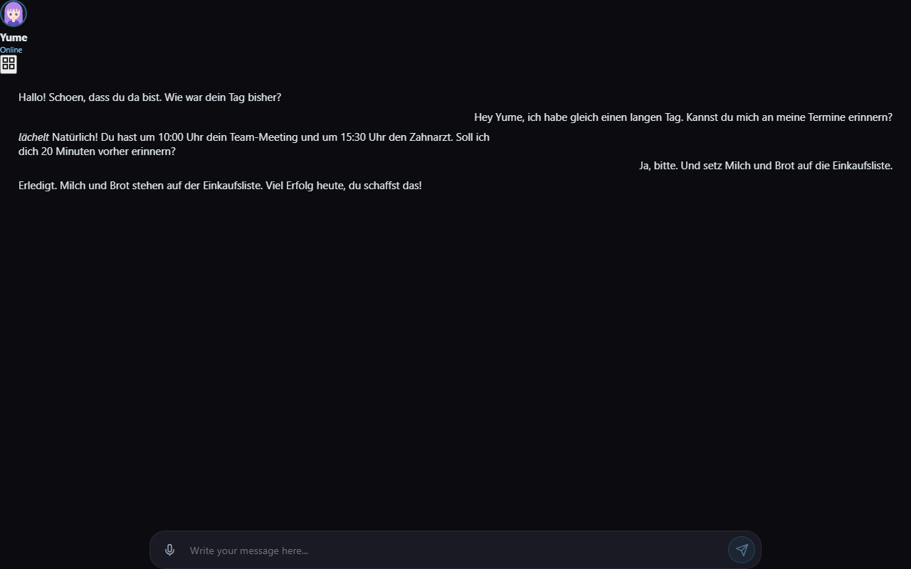
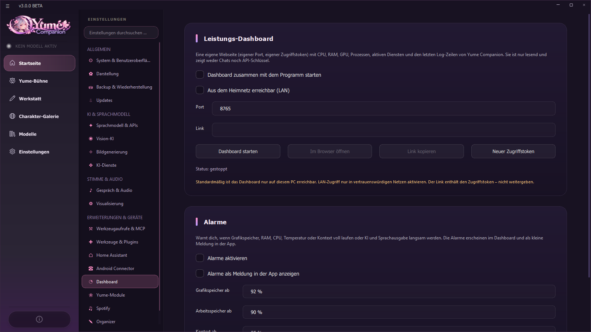
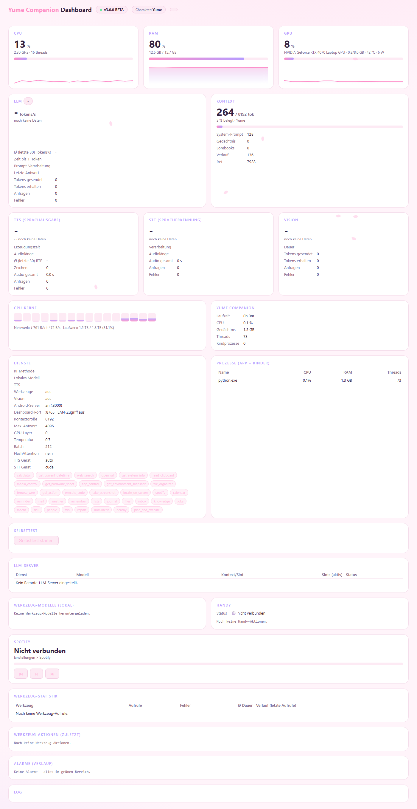

# 13 Web und Dashboard

Yume Companion hat zwei eingebaute Webseiten: den **Webclient** (Chat im Browser, auch für Handy und Tablet) und das **Leistungs-Dashboard** (Zahlen und Status). Beide laufen nur, solange du sie startest, haben je einen **eigenen Port und Token** und sind standardmäßig nur auf diesem PC erreichbar.

## 13.1 Der Webclient (Port 8000)

Der **lokale Webserver** gehört zum Android Connector (siehe [Kapitel 11](11-android-app.md)). Du startest ihn unter **Einstellungen → Yume-Module → Webinterface-Server → Server starten** oder unter *Android Connector*. Mit **Im Browser öffnen** (am PC) bzw. **Mobil-Link kopieren** (fürs Handy) öffnest du ihn. Der Link enthält den **Zugriffs-Token**.

Der Webclient bietet:

* **Chat** mit dem aktiven Charakter: Verlauf, neue Nachrichten und **Generierung stoppen**. (Bearbeiten, Löschen, Neu generieren und Varianten stellt der Server ebenfalls bereit, siehe 13.3; die Weboberfläche selbst nutzt davon nur einen Teil.)
* **Charakter-Bibliothek** zum Wechseln des Charakters.
* **Spracheingabe** (Mikrofon-Knopf): die Aufnahme wird am PC mit Whisper erkannt.
* **Avatar** mit **Live2D-Animationen** (Gefühle und Bewegungen) und Hintergrund des Charakters.

> Der Webclient ist die Weboberfläche des Originals (Soul of Waifu), erweitert um die Handy-Anbindung. Die vollständige, native Handy-Oberfläche ist die [Android-App](11-android-app.md).

### Sicherheit
* Zugriff nur mit **Token** (`?token=…`, Header oder Cookie). Teile den Link nie öffentlich.
* Einen neuen Token erzeugt *Einstellungen → Android Connector*; danach müssen Geräte neu koppeln.
* Der Server lauscht auf allen Netzwerkkarten (`0.0.0.0`, Port 8000), damit das Handy ihn erreicht. Für Zugriff von außen nutze einen **Tunnel** (z. B. Cloudflare Tunnel) oder VPN, keine offene Portfreigabe.
* Ist die **Windows-Firewall** nicht freigegeben, meldet der Android-Connector das.

## 13.2 Das Dashboard (Port 8765)

**Einstellungen → Dashboard.** Eine eigene Webseite mit CPU, RAM, GPU, Prozessen, Diensten und den letzten Log-Zeilen. **Sie ist nur lesend und zeigt weder Chats noch API-Schlüssel.**

| Einstellung | Bedeutung |
| --- | --- |
| **Dashboard zusammen mit dem Programm starten** | Autostart |
| **Aus dem Heimnetz erreichbar (LAN)** | sonst nur `127.0.0.1`; LAN nur in vertrauenswürdigen Netzen. Der Link enthält den Token |
| **Port** | Standard 8765 (darf nicht der Port des Android-Servers sein) |
| **Dashboard starten / Im Browser öffnen / Link kopieren / Neuer Zugriffstoken** | Bedienung |
| **Alarme** | Warnungen, wenn **Grafikspeicher** (ab 92 %), **Arbeitsspeicher** (ab 90 %), **Kontext** (ab 85 %), **GPU-Temperatur** (ab 85 °C) oder **CPU** (ab 95 %) kritisch werden, oder wenn KI/Sprachausgabe/Erkennung langsam werden bzw. der Festplattenplatz knapp wird. Erscheinen im Dashboard und optional als kleine **Meldung in der App** |

### Was das Dashboard zeigt

| Kachel | Inhalt |
| --- | --- |
| **CPU, RAM, GPU** | Auslastung, Verlauf, Temperatur, Leistungsaufnahme |
| **LLM** | Tokens pro Sekunde, Zeit bis zum ersten Token, Prompt-Verarbeitung, letzte Antwort, gesendete/erhaltene Tokens, Anfragen, Fehler |
| **Kontext** | belegt / gesamt, aufgeteilt in System-Prompt, Gedächtnis, Lorebooks, Verlauf und frei |
| **TTS / STT / Vision** | Erzeugungszeit, Echtzeitfaktor (RTF), Audiolänge, Zeichen, Anfragen, Fehler |
| **CPU-Kerne** | jeder Kern; Netzwerk und Laufwerk |
| **Yume Companion** | Laufzeit, CPU, Speicher, Threads, Kindprozesse |
| **Dienste** | KI-Methode, Modell, TTS, Werkzeuge, Vision, Android-Server, Ports, Kontextgröße, GPU-Layer, Temperatur, Batch, FlashAttention, Geräte; die **aktiven Werkzeuge** als Schilder |
| **Prozesse (App + Kinder)** | Name, CPU, RAM, Threads |
| **Selbsttest** | prüft alles und nennt in Klartext, was fehlt |
| **LLM-Server** | entfernte Server (Dienst, Modell, Kontext/Slot, Slots aktiv, Status) |
| **Werkzeug-Modelle** | lokal geladene Werkzeug-Modelle |
| **Handy** | gekoppelte Handys und deren letzte Aktionen |
| **Spotify** | Titel, Fortschritt, Tasten (Zurück, Wiedergabe/Pause, Weiter) |
| **Werkzeug-Statistik** | Aufrufe, Fehler, mittlere Dauer pro Werkzeug |
| **Werkzeug-Aktionen (zuletzt)** | was die KI ausgeführt hat |
| **Alarme (Verlauf)** | frühere Warnungen |
| **Log** | letzte Zeilen des Programmprotokolls (Geheimnisse maskiert) |

### Zugriff und Schnittstellen
Das Dashboard antwortet nur mit gültigem Token (`?token=…`, Kopfzeile `X-Dashboard-Token` oder Cookie). Schnittstellen (nur lesen, JSON): `/api/metrics`, `/api/stats`, `/api/status`, `/api/extra`, `/api/alerts`, `/api/toollog`, `/api/logs`, `/api/selftest`; einzig `/api/spotify/control` schaltet Musik.

## 13.3 Schnittstellen des Webservers (für Entwickler)

Der Webserver (FastAPI) auf Port 8000 bietet u. a.:

| Pfad | Zweck |
| --- | --- |
| `GET /` , `GET /api/ping` | Webclient bzw. Lebenszeichen (ohne Token) |
| `POST /api/pair` | Kopplung mit Einmal-Code → Gerätetoken |
| `GET/DELETE /api/mobile/devices` | gekoppelte Geräte |
| `GET /api/mobile/bootstrap`, `/api/mobile/health` | Startdaten fürs Handy |
| `GET /api/characters`, `POST /api/character/switch` | Charakterliste und Wechsel |
| `GET /api/history/{name}`, `/api/sync/{name}` | Verlauf bzw. Offline-Synchronisation |
| `PATCH/DELETE /api/messages/{id}`, `POST …/regenerate`, `…/variant` | Nachrichten bearbeiten |
| `POST /api/generation/stop` | Generierung stoppen |
| `POST /api/voice/stt` | Spracherkennung (Whisper) |
| `GET /api/avatar/{name}`, `/api/avatar/models`, `/api/avatar/model`, `/api/avatar_config/{name}` | Avatare, VRM-Modelle |
| `GET /api/wake_phrase` | Weck-Phrase und Antwortsätze |
| `POST /api/transcribe`, `/api/translate` | Transkription, Übersetzung |
| `POST /api/vision/describe` | Bild beschreiben |
| `POST /api/inbox`, `/api/inbox/text` | „Teilen → Yume“ |
| `GET /api/kiosk` | Daten für den Wandmodus |
| `GET/POST /api/spotify/…` | Spotify-Zugang und Steuerung |
| WebSocket | Chat-Ereignisse und Handy-Befehle (Rolle `phone`) |

Alle Pfade außer `/`, `/api/ping`, `/api/pair` und statischen Dateien verlangen den Token. Die Schnittstellen sind **nicht** als stabile öffentliche API zugesichert und können sich in der Beta ändern.
