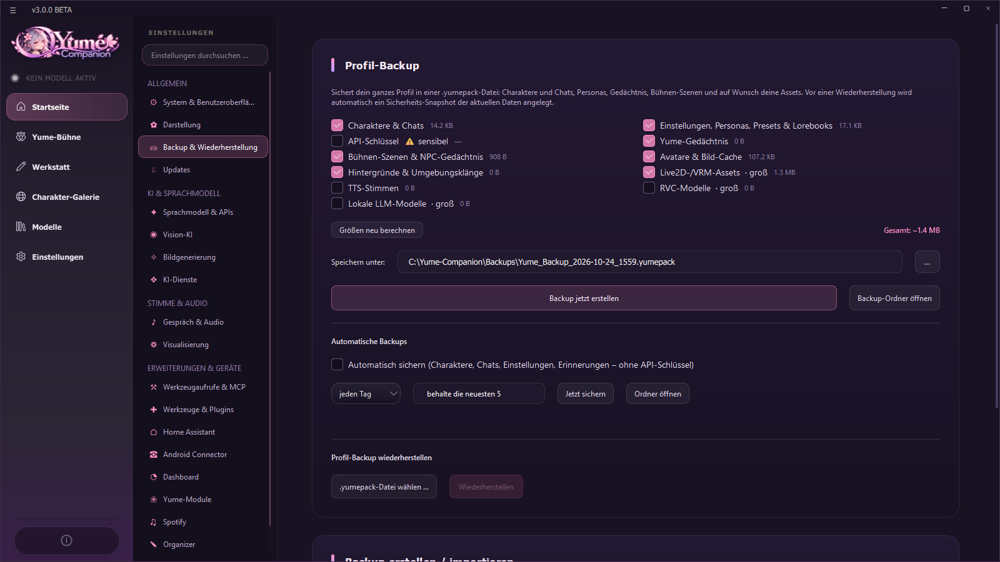
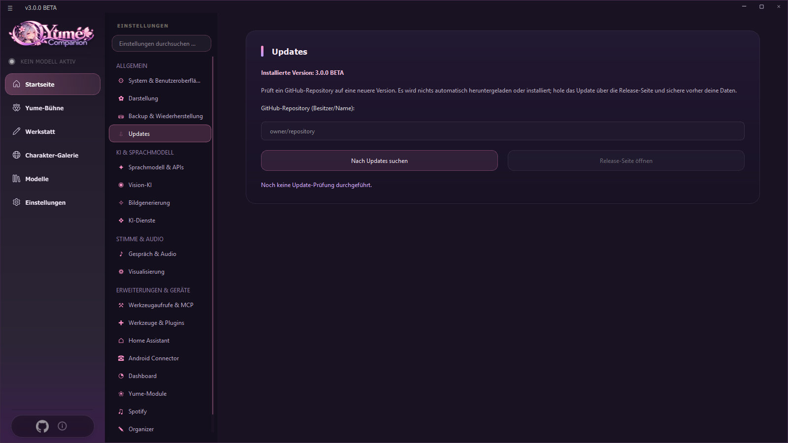

# 14 Backup, Updates, Sicherheit

## 14.1 Backup und Wiederherstellung

**Einstellungen → Backup & Wiederherstellung.** Das **Profil-Backup** sichert dein ganzes Profil in **einer Datei** (`.yumepack`).

| Option | Inhalt |
| --- | --- |
| **Charaktere & Chats** | immer dabei (kann nicht abgewählt werden) |
| **Einstellungen, Personas, Presets & Lorebooks** | Programmeinstellungen, Personas, Presets, Lorebooks |
| **API-Schlüssel** ⚠ sensibel | nur auf ausdrücklichen Wunsch; die App warnt: „Das Backup enthält deine API-Schlüssel. Datei privat halten.“ |
| **Yume-Gedächtnis** | Ordner `.soul` |
| **Bühnen-Szenen & NPC-Gedächtnis** | Yume-Bühne |
| **Avatare & Bild-Cache**, **Hintergründe & Umgebungsklänge** | kleine Assets |
| **Live2D-/VRM-Assets**, **RVC-Modelle**, **TTS-Stimmen**, **Lokale LLM-Modelle** | groß, nur auf Wunsch (Größen werden angezeigt) |

* **Größen neu berechnen** zeigt die Gesamtgröße. **Speichern unter** wählt Ziel und Name (Standard `Backups\Yume_Backup_<Datum>.yumepack`). **Backup jetzt erstellen**. **Backup-Ordner öffnen**.
* **Automatische Backups:** *Automatisch sichern (Charaktere, Chats, Einstellungen, Erinnerungen – ohne API-Schlüssel)* alle **1, 3 oder 7 Tage**, die **neuesten N** (2–30) bleiben erhalten (`Backups\auto`). **Jetzt sichern** und **Ordner öffnen**. Die Karte zeigt „Letztes automatisches Backup: … · N gespeichert“.
* **Wiederherstellen:** *.yumepack-Datei wählen …* → **Wiederherstellen**. Vor dem Zurückspielen legt die App einen **Sicherheits-Snapshot** an (`.soul_stage/backups`); schlägt die Wiederherstellung fehl, wird er automatisch zurückgespielt. Danach ist ein **Neustart** nötig. Ältere Backups (`.sowpack`, `.zip` aus Version 2.5) lassen sich ebenfalls einspielen.
* Die zweite Karte *Backup erstellen / importieren* (ZIP) sichert Konfiguration inklusive Zusatzdaten und kann alte **Backup-Ordner** importieren.
* Die Organizer-Daten (`%LOCALAPPDATA%\YumeCompanion`: Termine, Listen, Personen, Tagebuch …) sind im Profil-Backup enthalten (die **Wissensdatenbank-Indizes** nicht, sie lassen sich neu bauen). Passwörter dort sind Windows-verschlüsselt und nur auf diesem Konto lesbar.

> **Wichtig:** Backups mit API-Schlüsseln und Chats sind **privat**. Nie hochladen, nie in einen GitHub-Release legen. Die `.gitignore` des Projekts schließt `*.yumepack`, `*.sowpack` und `Backups/` aus.

## 14.2 Updates

### Prüfen
**Einstellungen → Updates:** GitHub-Repository als `Besitzer/Name` eintragen (oder die volle URL), **Nach Updates suchen**. Die App vergleicht die installierte Version (`VERSION.txt`) mit dem neuesten Release (auch Beta-Versionen) und meldet *Neue Version verfügbar*. Beim Programmstart prüft sie das ebenfalls im Hintergrund und zeigt dann ein Fenster mit dem Knopf **Herunterladen und installieren**.

**Herunterladen und installieren:** Die App fragt einmal nach, lädt dann das Setup des Releases herunter (mit Fortschrittsanzeige, abbrechbar) und prüft seine **SHA-256-Prüfsumme**. Nur wenn sie stimmt, wird das Setup gestartet und Yume Companion beendet; deine Charaktere, Chats und Einstellungen bleiben erhalten. Stimmt etwas nicht (Adresse gehört nicht zum Repository, Prüfsumme fehlt oder weicht ab, falsche Größe, keine Programmdatei), wird die Datei gelöscht und **nichts installiert**. Das Setup selbst läuft wie gewohnt als Assistent, du bestätigst dort noch einmal. Wer lieber selbst herunterlädt, nutzt **Release-Seite öffnen**.

Mögliche Meldungen: *Repository nicht gefunden (oder privat)*, *Das Repository hat noch keine Releases oder Tags*, *GitHub-Limit erreicht*, *GitHub nicht erreichbar*.

### Downloads prüfen und Windows-Warnungen
- **Prüfsumme (SHA-256):** Zu jeder Datei im Release steht die Prüfsumme (GitHub zeigt sie neben der Datei, im Release-Text steht sie auch). In PowerShell prüfst du sie mit `Get-FileHash Yume-Companion-Setup-….exe -Algorithm SHA256`. Die beiden Werte müssen **genau gleich** sein; sonst die Datei löschen und neu laden. Das Update-Programm der App macht diese Prüfung selbst.
- **Quelltext:** Die PC-App ist quelloffen (GPL-3.0). Das Setup wird aus einer sauberen Kopie dieses Quelltexts gebaut. Android-App und LLM Server sind kostenlos, ihr Quelltext ist sichtbar.
- **Windows meldet „Der Computer wurde durch Windows geschützt“ (SmartScreen):** Das Setup ist noch **nicht digital signiert**. Ein Zertifikat kostet Geld und das Projekt wird von einer Privatperson entwickelt. Wenn die Prüfsumme stimmt und du die Datei von der offiziellen GitHub-Seite geladen hast: *Weitere Informationen → Trotzdem ausführen*. Wer das nicht möchte, wartet auf die signierte Version.
- **Windows 11 mit „Smart App Control“** blockiert unsignierte Programme ganz, dann lässt sich das Setup nicht starten. Dafür ist eine Signatur nötig, an der gearbeitet wird (siehe [Signieren und Virenscanner](SIGNIERUNG.md)).
- **Virenscanner schlägt an:** Besonders unsignierte Setups, die Pakete nachladen und Programme starten, lösen Fehlalarme aus. Prüfe die Prüfsumme; stimmt sie, ist es die Datei aus dem Release. Bitte melde den Fehlalarm dem Hersteller (Anleitung in [Signieren und Virenscanner](SIGNIERUNG.md)) und schreibe es als [Issue](https://github.com/Kreqzxoo/Yume-Companion/issues), damit wir es dokumentieren.

### Prüfung beim Programmstart
Beim Start fragt das Programm das **Update-Repository aus der Branding-Datei** (`app/configuration/branding.json`, Feld `update_repo`) ab. Ist dort nichts eingetragen, wird das Original-Repository `jofizcd/Soul-of-Waifu` geprüft (ein älterer Original-Stand wird nie als Update angeboten). **Trage nach der Veröffentlichung dein Repository dort ein** (Rebrand-Programm, Feld *Update-Repository*, siehe [Kapitel 16](16-entwicklung.md)), damit alle Nutzer deine Updates sehen.

### Installieren
* **Setup-Installation:** neues Setup drüberinstallieren (Einstellungen bleiben).
* **Update-Setup:** Das *Yume Release Tool* kann ein kleines **Update-Setup** erzeugen, das nur geänderte Dateien und neue Python-Pakete (`requirements_extra.txt`) einspielt.
* **Quelltext:** `git pull`, bei neuen Paketen `installer.bat`.

### Engines aktualisieren
llama.cpp aktualisierst du getrennt unter *Sprachmodell & APIs → Hardware und Backend* ([Kapitel 04](04-sprachmodelle.md)); der LLM-Server hat einen eigenen Engine-Updater ([Kapitel 12](12-llm-server.md)).

## 14.3 Sicherheit auf einen Blick

| Thema | Was gilt |
| --- | --- |
| **Wo liegen Geheimnisse?** | `api.json` (API-Schlüssel, Tokens), `settings.json` (Web- und Dashboard-Token, Zugangsdaten für Integrationen), `%LOCALAPPDATA%\YumeCompanion` (verschlüsselt). Nie weitergeben |
| **Netzwerk** | Webserver (8000) und Dashboard (8765) sind per **Token** geschützt. Dashboard standardmäßig nur lokal. LLM-Server hat ohne Schlüssel keinen Login: nur im Heimnetz |
| **Werkzeuge** | riskante Aktionen verlangen Bestätigung; Programmstart nur aus deiner Liste; Skills nur nach Code-Freigabe; Home Assistant nur freigegebene Entitäten, keine Schlösser/Alarmanlagen |
| **Handy** | jede Steuerfunktion einzeln abschaltbar; riskante Aktionen werden am Handy bestätigt (optional mit PIN); Geräte-Token einzeln widerrufbar |
| **Mail** | nur lesen (IMAP), App-Passwort statt Hauptpasswort |
| **Cloud-Modelle** | Chat-Texte und Werkzeugergebnisse gehen an den Anbieter |
| **Backups** | enthalten Chats, ggf. Schlüssel: privat halten |
| **Protokolle** | `logs/` kann Pfade und Systemdaten enthalten. Vor dem Teilen prüfen |

## 14.4 Was die App aus dem Netz lädt

Nur, was du nutzt oder einschaltest:

| Zweck | Ziel |
| --- | --- |
| Modelle (GGUF, Whisper, TTS, Vision, Einbettung) | Hugging Face |
| llama.cpp-Engines | GitHub (`ggml-org/llama.cpp`) |
| Empfehlungen, Charaktere, Lorebooks, Szenarien der Galerie | GitHub-Daten des Originals (`jofizcd/sow-data`), Chub |
| Update-Prüfung | GitHub-API |
| Wetter | Open-Meteo |
| Orte, Routen, Adressen | OpenStreetMap (Nominatim, OSM-Routing, Overpass) |
| Websuche | DuckDuckGo |
| Musik | Spotify |
| Cloud-KI, Sprachsynthese, Bild-KI | der von dir gewählte Anbieter |
| Chromium für den Browser-Agent | Playwright-Download |

## 14.5 Rechtliches und Verantwortung

* Yume Companion steht unter **GPL-3.0** und kommt **ohne jede Gewährleistung**.
* **Inhalte:** Du bist für die Inhalte verantwortlich, die du erzeugst, importierst und teilst. Nutze nur Modelle, Stimmen, Bilder und Charaktere, an denen du die Rechte hast. Stimmen echter Personen nicht ohne deren Einwilligung klonen.
* **Alters- und Jugendschutz:** Die App enthält einen NSFW-Schalter. Beachte die Gesetze deines Landes und die Regeln der Dienste (Discord, Anbieter).
* Lizenzen der verwendeten Komponenten: [LIZENZEN_UND_UPLOAD.md](LIZENZEN_UND_UPLOAD.md).
