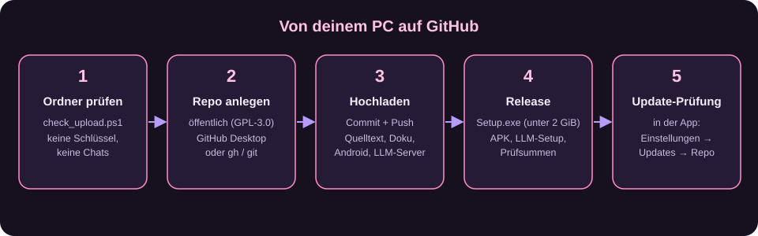

# Yume Companion auf GitHub veröffentlichen – Schritt für Schritt

Diese Anleitung bringt dein Projekt sicher auf GitHub: Quelltext, Releases (Installer, APK) und die Update-Prüfung in der App.
Sie ist für Einsteiger gedacht. Nimm dir Zeit für Abschnitt 3 (Prüfung): Dort entscheidet sich, ob versehentlich Passwörter oder private Chats öffentlich werden.



> **Kurz gesagt:** Ordner prüfen → leeres Repo anlegen → Dateien hochladen → Release mit Installer und APK anlegen → in der App das Repo eintragen.

---

## Inhalt

1. [Was auf GitHub gehört und was nicht](#1-was-auf-github-gehört-und-was-nicht)
2. [Vorbereitung (einmalig)](#2-vorbereitung-einmalig)
3. [Ordner prüfen](#3-ordner-prüfen)
4. [Repository anlegen und hochladen](#4-repository-anlegen-und-hochladen) (Variante A: GitHub Desktop, Variante B: Kommandozeile)
5. [Release mit Installer, APK und LLM-Server](#5-release-mit-installer-apk-und-llm-server)
6. [Repository hübsch machen](#6-repository-hübsch-machen)
7. [Update-Prüfung in der App einrichten](#7-update-prüfung-in-der-app-einrichten)
8. [Später: neue Version veröffentlichen](#8-später-neue-version-veröffentlichen)
9. [Notfall: Geheimnis wurde hochgeladen](#9-notfall-geheimnis-wurde-hochgeladen)
10. [Abschluss-Checkliste](#10-abschluss-checkliste)

---

## 1. Was auf GitHub gehört und was nicht

| Auf GitHub (Quelltext) | Als Release-Datei anhängen | Niemals hochladen |
| --- | --- | --- |
| `app/`, `main.py`, `installer.bat`, `start.bat` | `Yume-Companion-Setup-x.y.z.exe` (ca. 2 GB) | `api.json`, `settings.json`, `characters.json` |
| `android/` (Quelltext der Handy-App) | `Yume-Companion.apk` (ca. 78 MB) | Chats, Gedächtnis (`.soul`, `.soul_stage`), Backups |
| `llm-server/` (Quelltext) | `Yume-LLM-Server-Setup-x.y.z.exe` (ca. 3 MB) | API-Schlüssel, Bot-Tokens, Passwörter |
| `docs/`, `tests/`, `tools/`, `updater/`, `rebrand/` | | Modelle (`.gguf`, `.pth`), fremde 3D-Modelle, Stimmen |
| `LICENSE`, `NOTICE.md`, `.gitignore` | | die Python-Umgebung `app/data` (ca. 9 GB) |

Warum so? GitHub erlaubt pro Datei im Quelltext höchstens **100 MB** und pro Release-Datei höchstens **2 GiB**. Installer und APK gehören deshalb in ein *Release*, nicht in den Quelltext.

**Lizenz (wichtig):** Yume Companion ist eine veränderte Fassung von *Soul of Waifu* (jofizcd, GPL-3.0). Deshalb muss auch dein Projekt unter **GPL-3.0** stehen und der Quelltext öffentlich sein, sobald du Installer weitergibst. Die Datei `LICENSE` (GPL-3.0) und `NOTICE.md` (nennt den Original-Autor und deine Änderungen) liegen schon im Projekt. Entferne sie nicht. Details: [LIZENZEN_UND_UPLOAD.md](LIZENZEN_UND_UPLOAD.md).

---

## 2. Vorbereitung (einmalig)

### 2.1 GitHub-Konto
1. Auf <https://github.com/signup> registrieren (kostenlos), E-Mail bestätigen.
2. Zwei-Faktor-Anmeldung aktivieren: Profilbild → *Settings* → *Password and authentication* → *Two-factor authentication*.

### 2.2 Deine E-Mail-Adresse schützen (empfohlen)
Jeder Commit enthält eine E-Mail-Adresse und ist öffentlich lesbar. Nutze die anonyme GitHub-Adresse:
1. *Settings* → *Emails* → Haken bei **Keep my email addresses private** und **Block command line pushes that expose my email**.
2. Dort steht deine Adresse der Form `12345678+deinname@users.noreply.github.com`. Kopiere sie.
3. In der Kommandozeile (oder im Terminal von GitHub Desktop):

```bash
git config --global user.name "Dein Name oder Spitzname"
git config --global user.email "12345678+deinname@users.noreply.github.com"
```

> Auf diesem PC ist noch eine normale E-Mail-Adresse als Git-Adresse eingetragen. Ändere sie vor dem ersten Commit mit den Befehlen oben, sonst steht sie später öffentlich in der Historie.

### 2.3 Werkzeuge
* **Git für Windows**: ist installiert (`git --version` zeigt die Version).
* **GitHub Desktop** (grafisch, für Einsteiger): ist installiert. Alternative: <https://desktop.github.com>.
* Optional **GitHub CLI** (`gh`): `winget install GitHub.cli`. Nur nötig für Variante B und für Releases per Befehl.

---

## 3. Ordner prüfen

Arbeite **nicht** im laufenden Arbeitsordner. Dieses Projekt enthält deshalb schon eine bereinigte Kopie (`Yume-Companion-GitHub`): ohne Python-Umgebung, ohne Modelle, ohne deine Einstellungen, Charaktere und Chats. Die Beispiel-Charaktere (Yume, Mika, Kai) und ihre Bilder sind selbst erfunden.

### 3.1 Automatische Prüfung

```powershell
powershell -ExecutionPolicy Bypass -File tools\dev\check_upload.ps1
```

Das Skript sucht nach:
* privaten Dateien (`api.json`, `settings.json`, `characters.json`, Backups, Logs, Gedächtnis),
* verbotenen oder zu großen Dateien (`.gguf`, `.pth`, `.vrm`, `.exe`, `.apk`, über 100 MB),
* Schlüsseln und Tokens im Text (OpenAI, Google, GitHub, Discord …) und Benutzerpfaden wie `C:\Users\deinname`.

Es muss `Alles in Ordnung: keine Funde.` melden. Jeder Fund ist rot markiert und nennt Datei und Grund.

### 3.2 Von Hand gegenprüfen
* Öffne `docs/LIZENZEN_UND_UPLOAD.md`, Abschnitt 4 („Was nicht ins öffentliche Repo darf“).
* Suche im Ordner nach deinem Namen, deiner Adresse und deiner Domain (Windows-Suche im Explorer oder `Strg+Umschalt+F` in VS Code).
* Prüfe, dass kein Bild eines Screenshots echte Namen, Chats, IP-Adressen oder Tokens zeigt (die mitgelieferten Bilder sind mit Demo-Daten gemacht).

---

## 4. Repository anlegen und hochladen

### Variante A: mit GitHub Desktop (empfohlen für Einsteiger)

1. **GitHub Desktop** öffnen → *Sign in to GitHub.com* → im Browser bestätigen.
2. Menü *File* → **Add local repository…** → den Ordner `Yume-Companion-GitHub` wählen.
   Meldet das Programm „This directory does not appear to be a Git repository“, klicke auf **create a repository** und bestätige:
   * *Name*: `Yume-Companion`
   * *Description*: `KI-Begleiterin für Windows und Android – Chat, Stimme, Avatare, Gedächtnis, Organizer`
   * *Git ignore*: **None** (die Datei `.gitignore` gibt es schon) · *License*: **None** (`LICENSE` gibt es schon)
3. Links erscheint die Liste aller Dateien („Changed files“). **Prüfe sie**: Es dürfen keine `.gguf`, `.exe`, `.apk`, `api.json`, `settings.json` oder `logs` darin vorkommen. Taucht etwas auf, steht es nicht in der `.gitignore`: abbrechen und Abschnitt 3 wiederholen.
4. Unten links: *Summary* `Erste Veröffentlichung` → **Commit to main**.
5. Oben: **Publish repository**.
   * Haken bei **Keep this code private** **entfernen** (öffentlich, wegen GPL; privat geht zum Testen auch, dann später unter *Settings → General → Danger Zone → Change visibility* umstellen).
   * **Publish repository**.
6. Fertig: *Repository* → *View on GitHub* öffnet die Seite.

### Variante B: Kommandozeile

Im Projektordner:

```bash
git init -b main
git add .
git status
```

Prüfe die Ausgabe von `git status` (keine privaten Dateien). Dann:

```bash
git commit -m "Erste Veröffentlichung"
```

Repository auf GitHub anlegen und hochladen mit der GitHub CLI:

```bash
gh auth login
gh repo create Yume-Companion --public --source=. --remote=origin --push --description "KI-Begleiterin für Windows und Android"
```

Ohne CLI: auf <https://github.com/new> ein **leeres** Repo `Yume-Companion` anlegen (ohne README, ohne `.gitignore`, ohne Lizenz) und dann:

```bash
git remote add origin https://github.com/Kreqzxoo/Yume-Companion.git
git push -u origin main
```

Beim ersten Push öffnet sich ein Anmeldefenster (Browser). Ein Passwort gibt es bei GitHub nicht mehr; Git verwendet die Anmeldung über den Browser.

### 4.1 Dateien über 100 MB
Der Push wird abgelehnt (`file exceeds GitHub's file size limit`), wenn eine Datei größer als 100 MB ist. Das ist normalerweise ein Zeichen, dass etwas hochgeladen werden sollte, das nicht hinein gehört (Modell, Installer). Ausnahme: die zwei mitgelieferten Modelle `app/utils/e5-small-en-ru/model.safetensors` (171 MB) und `app/utils/emotions/detector/pytorch_model.bin` (255 MB) stehen bewusst **nicht** im Repo (siehe `.gitignore`). Die App lädt das Einbettungsmodell bei Bedarf selbst herunter; den Emotions-Detektor kopierst du aus dem Setup (siehe [Entwicklung](16-entwicklung.md)).

Wenn du sie doch im Repo haben willst, nutze **Git LFS**:

```bash
git lfs install
git lfs track "*.safetensors" "*.bin"
git add .gitattributes
```

Hinweis: Das kostenlose GitHub-Kontingent für LFS ist klein (1 GB Speicher, 1 GB Traffic pro Monat).

---

## 5. Release mit Installer, APK und LLM-Server

Ein *Release* ist eine Version mit Download-Dateien. Hier gehören die gebauten Dateien hin.

### 5.1 Dateien bereitstellen
| Datei | Woher |
| --- | --- |
| `Yume-Companion-Setup-3.0.0-beta.exe` | Mit dem **Yume Release Tool** (`updater\Yume Release Tool.bat`) bauen – siehe [Entwicklung](16-entwicklung.md) |
| `Yume-Companion.apk` | `android\build-apk.ps1` ausführen (siehe [Android-App](11-android-app.md)) |
| `Yume-LLM-Server-Setup-1.1.0.exe` | `llm-server\Build Yume LLM Server.ps1` (siehe [LLM-Server](12-llm-server.md)) |

**Größe prüfen:** Eine Release-Datei darf höchstens **2 GiB (2048 MiB)** groß sein. Das Setup der Beta ist knapp darunter (ca. 1983 MiB). Wird es größer, teile es: ein Setup ohne optionale Komponenten, oder ein Archiv in Teile (z. B. mit 7-Zip „Aufteilen in Volumes“ zu 1900 MB).

Berechne für jede Datei eine Prüfsumme, damit Nutzer sie nachprüfen können:

```powershell
Get-FileHash .\Yume-Companion-Setup-3.0.0-beta.exe -Algorithm SHA256
```

### 5.2 Release anlegen (Weboberfläche)
1. Auf der Repo-Seite rechts **Releases** → **Create a new release** (oder `https://github.com/Kreqzxoo/Yume-Companion/releases/new`).
2. **Choose a tag** → `v3.0.0-beta` eintippen → *Create new tag on publish*.
3. *Release title*: `Yume Companion 3.0.0 Beta`.
4. Beschreibung: nutze die Vorlage in `docs/RELEASE_VORLAGE.md` (Änderungen, Installation, Prüfsummen, Hinweis auf den Quelltext).
5. Dateien in das Feld **Attach binaries** ziehen (Upload großer Dateien dauert; Fenster offen lassen).
6. Haken **Set as a pre-release** (bei Beta) → **Publish release**.

### 5.3 Release per Kommandozeile (Alternative)
```bash
gh release create v3.0.0-beta "Yume-Companion-Setup-3.0.0-beta.exe" "Yume-Companion.apk" "Yume-LLM-Server-Setup-1.1.0.exe" ^
  --title "Yume Companion 3.0.0 Beta" --notes-file docs/RELEASE_VORLAGE.md --prerelease
```

### 5.4 GPL: Quelltext passend zum Release
Wer den Installer bekommt, muss den passenden Quelltext bekommen. Das ist erfüllt, wenn der Tag `v3.0.0-beta` auf genau den Commit zeigt, aus dem du den Installer gebaut hast. GitHub hängt automatisch „Source code (zip)“ an jedes Release.

---

## 6. Repository hübsch machen

1. **About** (Zahnrad rechts oben auf der Repo-Seite): Beschreibung, Webseite (falls vorhanden), **Topics**: `ai-companion`, `roleplay`, `llm`, `llama-cpp`, `pyqt6`, `android`, `kotlin`, `vrm`, `live2d`, `text-to-speech`, `whisper`, `german`.
2. **README**: Die Datei `README.md` ist die Startseite. Bilder liegen unter `docs/images`; Pfade sind relativ und funktionieren auf GitHub automatisch.
3. **Social Preview** (*Settings → General → Social preview*): ein Bild 1280×640 px (z. B. das Logo aus `assets/custom_branding`).
4. **Issues** einschalten (*Settings → General → Features*). Vorlagen für Fehlermeldungen liegen in `.github/ISSUE_TEMPLATE`.
5. **Sicherheit** (*Settings → Code security*): *Secret scanning* und *Push protection* einschalten. GitHub warnt dann, falls doch ein Schlüssel hochgeladen wird.
6. **Lizenz**: GitHub erkennt die `LICENSE` automatisch und zeigt „GPL-3.0 license“ an.
7. **Branch-Schutz** (optional): *Settings → Branches → Add rule* für `main`.

---

## 7. Update-Prüfung in der App einrichten

Die App kann prüfen, ob es auf GitHub eine neuere Version gibt (sie lädt nichts automatisch herunter).

1. App starten → **Einstellungen → Updates**.
2. Bei *GitHub-Repository* `Kreqzxoo/Yume-Companion` eintragen (oder die volle GitHub-URL).
3. **Nach Updates suchen**. Die App vergleicht die installierte Version mit dem neuesten *Release* (bzw. Tag) und zeigt „Neue Version verfügbar“ samt Knopf **Release-Seite öffnen**.

Damit das klappt:
* Der Tag muss mit der Versionsnummer in `VERSION.txt` vergleichbar sein (z. B. `v3.0.0` oder `v3.0.1`).
* Das Repository muss öffentlich sein. Bei einem privaten Repo meldet die App „nicht gefunden“.
* **Wichtig für alle Nutzer:** Die Prüfung **beim Programmstart** liest das Repository aus `app/configuration/branding.json` (Feld `update_repo`). Ist es leer, fragt sie das Original `jofizcd/Soul-of-Waifu`. Trage dein Repository deshalb **vor dem Bauen des Setups** dort ein: `rebrand\SoW-Rebrand.bat` → Links → *Update-Repository* → `Kreqzxoo/Yume-Companion` → Speichern (siehe [Entwicklung](16-entwicklung.md#167-branding-name-logo-links)). Die Seite *Einstellungen → Updates* (manuelle Prüfung) hat ein eigenes Feld.

---

## 8. Später: neue Version veröffentlichen

1. Änderungen am Code machen und testen (`tests\run_tests.ps1`).
2. `VERSION.txt` und `CHANGELOG.md` anpassen.
3. Prüfen: `tools\dev\check_upload.ps1 -UseGit`.
4. Commit und Push (GitHub Desktop: *Commit to main*, dann *Push origin*; Kommandozeile: `git add . && git commit -m "…" && git push`).
5. Installer und APK neu bauen, **neues Release** mit neuem Tag (`v3.0.1`) anlegen.
6. Nutzer sehen das Update in der App (Abschnitt 7).

Versionsnummern: `Hauptversion.Nebenversion.Fehlerkorrektur` (z. B. `3.0.1`). Betas: `3.0.0-beta`, `3.0.0-beta2` usw.

---

## 9. Notfall: Geheimnis wurde hochgeladen

Ein einmal öffentlicher Schlüssel gilt als **verbrannt**. Reihenfolge:
1. **Sofort den Schlüssel sperren/erneuern**: OpenAI/OpenRouter/Anthropic/Gemini: im jeweiligen Dashboard den Key löschen und einen neuen anlegen. Discord: Developer Portal → *Bot* → *Reset Token*. Yume-Webtoken: in der App unter *Einstellungen → Android Connector* neues Token erzeugen und das Handy neu koppeln.
2. Datei aus dem Repo entfernen und `.gitignore` ergänzen.
3. Historie bereinigen (sonst bleibt der Schlüssel in alten Commits): am einfachsten das Repo löschen und neu anlegen, solange es noch klein ist. Alternativ `git filter-repo` verwenden.
4. Danach `check_upload.ps1` erneut ausführen.

---

## 10. Abschluss-Checkliste

- [ ] `check_upload.ps1` meldet keine Funde
- [ ] `git config user.email` ist die noreply-Adresse
- [ ] `LICENSE` (GPL-3.0) und `NOTICE.md` liegen im Hauptordner
- [ ] README nennt das Original (Soul of Waifu, jofizcd) mit Link
- [ ] Repository ist öffentlich (wegen GPL)
- [ ] Release mit Installer, APK, LLM-Server-Setup und Prüfsummen
- [ ] Tag zeigt auf den Commit, aus dem gebaut wurde
- [ ] Secret scanning + Push protection sind aktiv
- [ ] In der App ist das Update-Repository eingetragen
