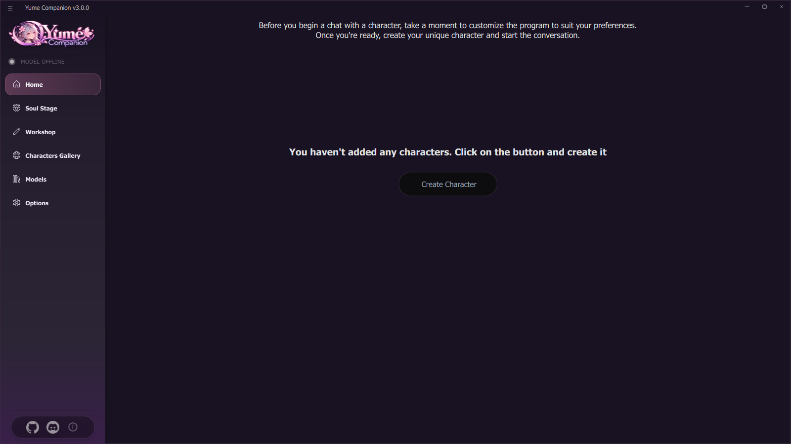

# 01 Installation

There are two ways: the ready-made **setup** (recommended) or **installing from source** (for developers and anyone who wants to check the code).

## 1.1 Requirements

| | Minimum | Recommended |
| --- | --- | --- |
| System | Windows 10/11, 64 bit | Windows 11 |
| RAM | 8 GB | 16 GB or more |
| Graphics card | any (cloud models only) | NVIDIA (CUDA) or AMD/Intel (Vulkan) with 8 GB+ VRAM |
| Storage | 15 GB free (program about 10 GB) | fast NVMe SSD, 40 GB+ for models |
| Internet | for the installation and for downloading models | – |

Important:
* **Do not run as administrator.** That changes the working directory and can break paths.
* The installation folder should **not contain special characters**. OneDrive folders are discouraged (gigabytes of synchronization).

## 1.2 Way A: setup installer (recommended)

1. Download `Yume-Companion-Setup-<version>.exe` from **Releases** (about 2 GB).
2. Run it. The wizard asks for:
   * **Target folder** (default: `%LOCALAPPDATA%\Programs\Yume Companion`, no administrator rights needed; it warns about OneDrive paths).
   * **Components:** PyTorch **CUDA** (preselected if an NVIDIA card is detected) or **CPU**; **FlashAttention-2** (optional, CUDA only, about 250 MB, speeds up Qwen3-TTS).
   * Shortcuts in the Start menu and optionally on the desktop.
3. Afterwards the installer (`installer.bat /auto cuda|cpu [flash]`) runs without further questions in a console window and downloads PyTorch (about 2.5 GB) and all packages. Depending on your connection this takes 10 to 40 minutes.
4. At the end the program starts.

The German setup sets the program language to German automatically.

**Silent mode** (for scripts): `Yume-Companion-Setup.exe /VERYSILENT /DIR="D:\Yume" /INSTALLDEPS=1 /TORCH=cuda /FLASH=0`

## 1.3 Way B: from source

You need: Windows, Git (or the ZIP from GitHub), internet and about 15 GB of space.

```bash
git clone https://github.com/Kreqzxoo/Yume-Companion.git C:\Yume-Companion
cd C:\Yume-Companion
tools\setup_from_source.bat
```

The path must **not contain spaces**. The script does five steps:

| Step | What happens |
| --- | --- |
| 1 | downloads Miniconda and installs it into `app\data` |
| 2 | creates the Python 3.11 environment `sow` |
| 3 | downloads FFmpeg to `app\ffmpeg\bin` |
| 4 | downloads the two small models (embedding and emotion detection) with `tools\fetch_models.py` |
| 5 | starts `installer.bat` (PyTorch, PyQt6, speech engines, Live2D …) |

Afterwards: `start.bat`. Demo characters without personal data are created by `app\data\envs\sow\python.exe tools\demo\make_demo_content.py`.

> Step 5 (`installer.bat`) is the program's installation routine. Failed parts are listed at the end and in `logs\installer.log`.

## 1.4 First start

`start.bat` (or the shortcut) checks FFmpeg, activates the Python environment and starts `main.py`. A console window shows the log (also saved in `logs\`). On the first start the app may ask whether it should install echo cancellation (WebRTC AEC3).



The start page shows three steps: **choose a model**, **create a character**, **or discover (character gallery)**. Continue with [02 First Steps](02-erste-schritte.md).

## 1.5 Updating

* **Setup:** just install the new setup over the old one. `settings.json`, `api.json` and `characters.json` are never overwritten.
* **Source:** `git pull`, then run `installer.bat` again if there are new packages.
* **Checking for something new:** *Settings → Updates* → enter the GitHub repository → **Check for updates** (see [14 Backup, Updates, Security](14-backup-updates-sicherheit.md)).
* Make a backup first (*Settings → Backup & Restore*).

## 1.6 Uninstalling

* Setup installation: *Windows Settings → Apps* → **Yume Companion** → Uninstall (removes the program; delete `%LOCALAPPDATA%\YumeCompanion` manually if you want, the organizer data lives there).
* Source: delete the folder.
* Use **Backup** beforehand to save your characters.

## 1.7 Where is my data?

| Data | Location |
| --- | --- |
| Settings, characters, API keys | `app\configuration\` (`settings.json`, `characters.json`, `api.json`) |
| Chats and memory | in `characters.json` and in the folder `.soul\` |
| Yume Stage | `.soul_stage\` |
| Organizer (calendar, lists, mail access …) | `%LOCALAPPDATA%\YumeCompanion\` (passwords encrypted with Windows data protection) |
| Models (local language models) | `assets\local_llm\` |
| Logs | `logs\` |
| Backups | freely selectable, default `Backups\` |
