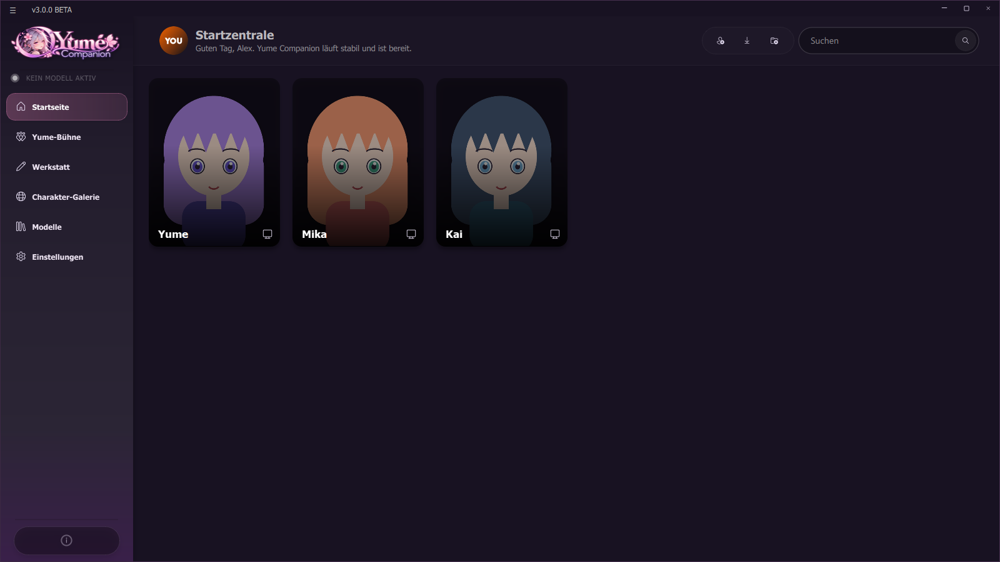
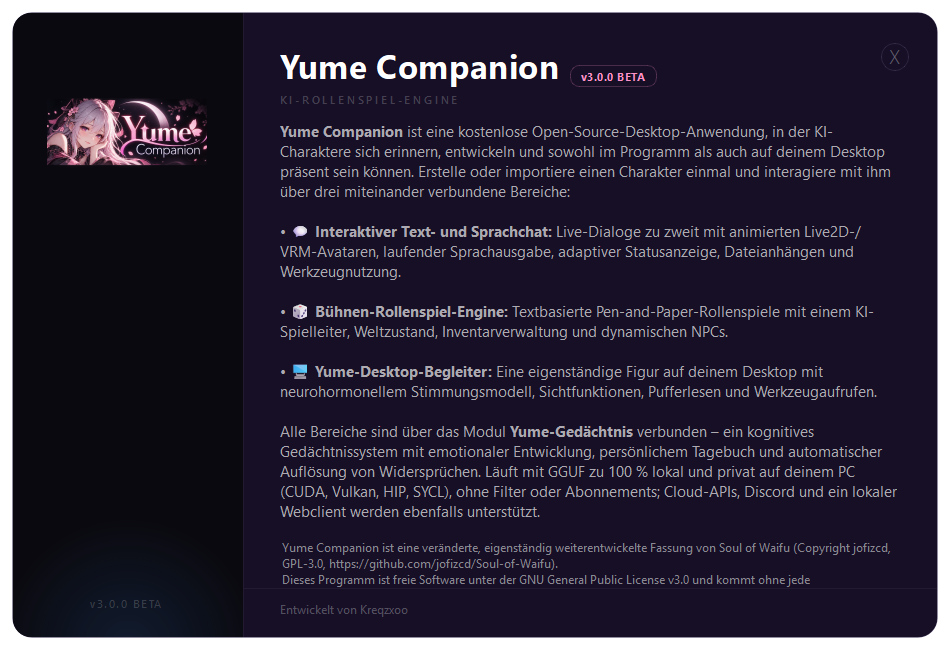
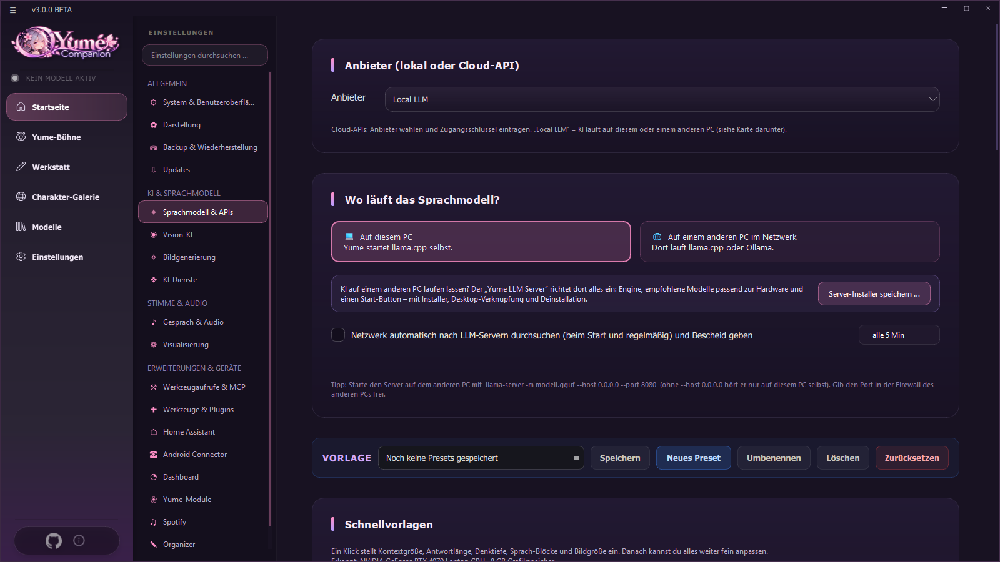
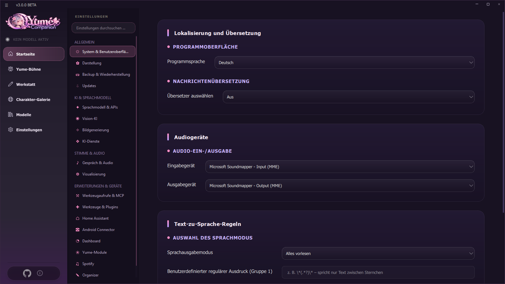

# 02 First Steps

From an empty program to your first conversation in ten minutes.

## 2.1 The interface

**Sidebar on the left** (top to bottom):

| Entry | Purpose |
| --- | --- |
| Display **NO MODEL ACTIVE / MODEL LOADING / MODEL READY / GENERATING** | State of the local language model (llama.cpp) |
| **Home** | Your characters as tiles ("start center") |
| **Yume Stage** | Role-play with an AI game master ([Chapter 07](07-yume-buehne.md)) |
| **Workshop** | Character editor, lorebooks, personas, system prompts, Discord gateway, image generation |
| **Character gallery** | Ready-made character cards from the internet |
| **Models** | Search, load and start local language models |
| **Settings** | Everything else (19 sections) |
| ⓘ at the bottom | "About Yume Companion" with version, author and links |

Clicking ⓘ opens the About dialog with the version, a short description of the three areas, the license note (GPL-3.0, based on Soul of Waifu) and the author name:

**Bar at the top of the start page:** greeting with your persona name, three icons (create character · import character card · new folder) and the character search field. You can also simply **drag a `.png` or `.json` card into the window** to import it.

**Window buttons** at the top right: minimize, maximize, close. The window can be resized from all edges.

## 2.2 Step 1: choose a language model

Without a language model no character can answer. Two ways:

### Way 1: cloud provider (fastest, no strong graphics card needed)
1. **Settings → Language model & APIs**.
2. Under **Provider** choose the service (OpenAI, Anthropic, Google Gemini, DeepSeek, Mistral, OpenRouter, Grok, Qwen, Z.AI, Player2 or your own OpenAI-compatible endpoint).
3. Enter the **API key** (stored only locally in `api.json`) and, if needed, the model name.
4. Later, in the **character**, choose the same provider as the *conversation method* (see 2.3).

> **Privacy:** With cloud providers your messages go to that provider. This also applies to tool results (e.g. mails that were read), which are sent along as context.

### Way 2: local model (private, offline)
1. Sidebar → **Models**.
2. In the **Recommended** or **Popular** tab choose a model. Rule of thumb: *Q4_K_M* files have the best balance of quality and size; an 8B model needs about 5 GB of storage.
3. **Download** → choose the quantization → wait.
4. In **My models** start the model with **Load model**. The display at the top left changes to *MODEL LOADING … → MODEL READY*.

If you have a **second PC** as a server: [Chapter 12 (Yume LLM Server)](12-llm-server.md).

## 2.3 Step 2: create a character

**Home → "Create character" icon** or **Workshop → Character editor**.

Required at minimum: **Name** and **First message**. For good results also add a description and personality. Or let the **AI assistant** write the fields (see [Chapter 03](03-chat-und-charaktere.md#ai-assistant)). Then choose the provider under **Conversation method** (e.g. *Local LLM*, *Remote LLM* or a cloud service) and click **Create character**.

Alternatively:
* **Import a character card** (`.png` with embedded data or `.json`, "TavernAI/SillyTavern" format and Soul of Waifu cards).
* **Character gallery**: browse cards and take them over with **Add to list**.
* Sample characters (Yume, Mika, Kai) via `tools/demo/make_demo_content.py`.

## 2.4 Step 3: chat

Click the character's tile. The chat opens:

| Area | Meaning |
| --- | --- |
| Header left | Name, title and **token counter** ("264 / 16,384 tok": this much of the context window is used) |
| Header right | Audio background, chat background, author's notes, summary, memory, more (character settings) |
| Messages | Every message has **⋯** with edit, regenerate, delete, translate, create image, play voice message |
| Input line at the bottom | Attachment (image/document), tools on/off, switch persona, force memory now, send |

Write a message and send it with **Enter**. Asterisks such as `*smiles*` are shown in italics as an action.

Continue: [03 Characters and Chat](03-chat-und-charaktere.md) · [05 Voice and Avatars](05-stimme-und-avatare.md)

## 2.5 Changing the program language

**Settings → System & user interface → Program language** (English, Russian, German). After the change the program asks for a restart.

On the same page: **Message translation** (Google/Yandex, target language, mode "both / user message / character message"), **audio devices** (input/output) and **text-to-speech rules** (speech output mode, e.g. "Read quotes only" or your own regular expression). At the bottom your PC data (RAM, graphics card) is shown, which the app uses for its recommendations.
