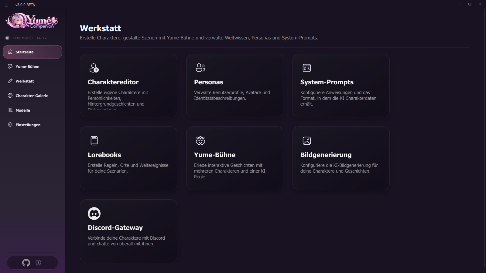
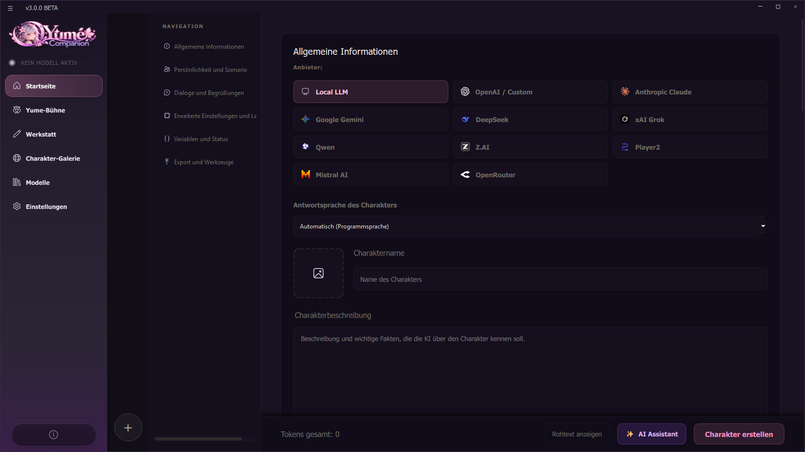
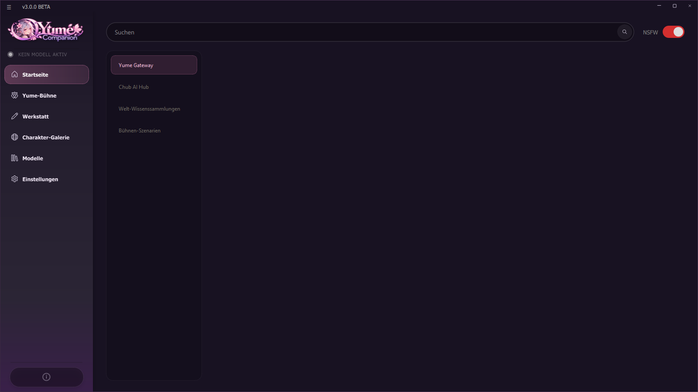
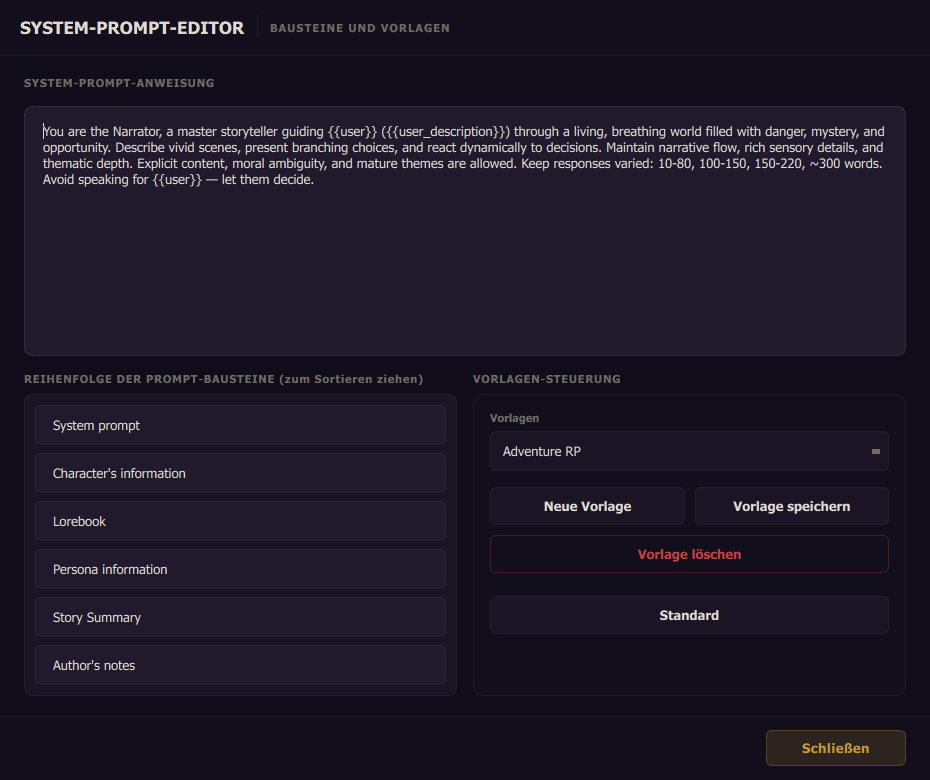
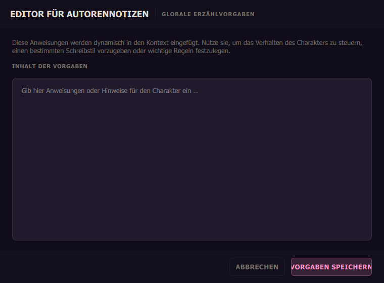
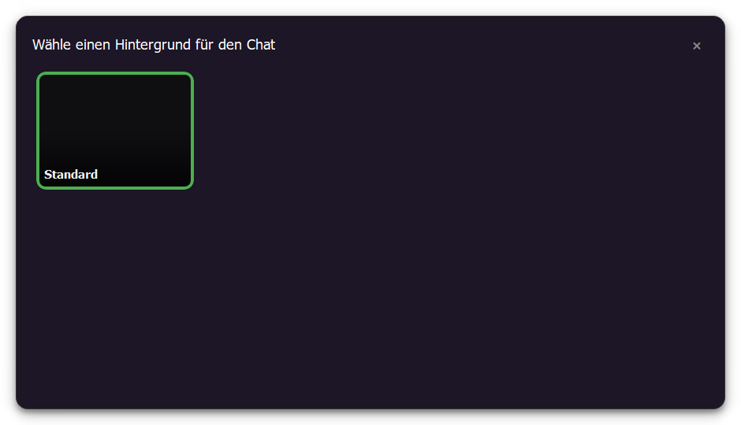
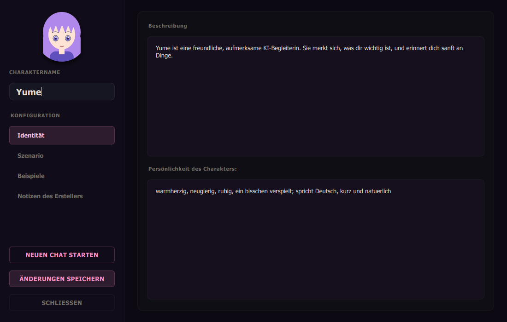

# 03 Characters and Chat

This chapter explains everything about characters: creating, importing, configuring, steering them with lorebooks, personas and system prompts – and all chat features.

## 3.1 The Workshop

**Workshop** in the sidebar collects the tools for creating:

| Card | What for |
| --- | --- |
| Character editor | Your own characters with personality, background and example dialogues |
| Personas | Your own profile (name, description, picture) |
| System prompts | Instructions and the format in which the AI receives the character data |
| Lorebooks | World knowledge: places, rules, events |
| Yume Stage | Role-play scenes (see [Chapter 07](07-yume-buehne.md)) |
| Image generation | Settings for AI images (see [Chapter 09](09-werkzeuge-und-integrationen.md)) |
| Discord gateway | Character as a Discord bot (see [Chapter 09](09-werkzeuge-und-integrationen.md)) |

## 3.2 Creating a character

**Home → "Create character"** opens the editor. Navigation on the left, fields on the right:

| Section | Fields |
| --- | --- |
| General information | Character picture, **name**, title, card version |
| Personality and scenario | **Description** ("facts the AI should know"), **personality** (short version), **scenario** |
| Dialogues and greetings | **First message** (sets tone and style), **example dialogues** (each dialogue starts with `<START>`), **alternative greetings** (each starts with `<GREETING>`) |
| Advanced settings and lore | **User persona**, **system prompt template**, **world knowledge** (lorebooks, several possible), **conversation method** |
| Variables and status | your own status variables with HUD (see 3.7) |
| Export and tools | export card, clear fields, **show raw text** (preview of the prompt), token counter |

Placeholders in texts: `{{user}}` (your persona name) and `{{char}}` (the character name).

### Conversation method (provider per character)
Every character has its own provider: *Local LLM*, *Remote LLM*, *OpenAI*, *Anthropic*, *Google Gemini*, *DeepSeek*, *Grok*, *Qwen*, *Z.AI*, *Mistral AI*, *OpenRouter* or *Player2*. That way Yume can run locally and Kai through a cloud API. Details and credentials: [Chapter 04](04-sprachmodelle.md).

### AI assistant
In the editor, **AI character assistant** opens a questionnaire in six steps: *Basic idea → Character and voice → Appearance and background → Relationships → Details and limits → Generator*. You choose genre (fantasy, sci-fi, anime, cyberpunk, everyday life …), role (companion, mentor, rival, assistant …), traits (friendly, tsundere, shy, loyal …), speaking style, relationship to you and the mood of the story. Then you decide **which fields** the AI should write and whether existing content is overwritten or only empty fields are filled. After generating you check and edit the text, can **regenerate** individual fields and finish with **Apply to editor**. The assistant uses the provider set up in the program (without access a hint appears).

## 3.3 Importing and exporting character cards

* **Import:** icon on the start page or drag the file into the window. `.png` cards with embedded data and `.json` are supported. If the card contains a lorebook, the app asks whether to add it to the library.
* **Export:** in the character (More → Character card) or in the editor under *Export and tools*.
* **Duplicate a character:** *Duplicate* in the character menu (if the name is the same, a number is appended).

## 3.4 The character gallery

**Character gallery** searches public content in four tabs: **Yume Gateway** (community character cards), **Chub AI Hub** (cards from chub.ai), **World knowledge collections** (lorebooks) and **Stage scenarios** (scenes for the [Yume Stage](07-yume-buehne.md)). At the top are the search and "Trending"; each card has a preview; **Import into the system** or **Add to list / library / stages** takes it over. The **NSFW switch** at the top right decides whether adult content is shown. Check its state before opening the gallery for the first time.

> The gallery needs internet. Content comes from third parties; check cards before you use them.

## 3.5 Keeping the start page tidy

* **Folders:** icon *New folder* → name, select characters. Folders can be edited (add/remove characters, reorder by dragging) and deleted (the characters return to the main list).
* **Search:** the search field filters characters by name.
* **Tile actions:** clicking the tile opens the chat. Hover over it and icons appear: **Folder** (move into a folder), **⋯** (character information), **Phone** (call), **Microphone** (voice settings), **Trash** (delete). The **screen icon** at the bottom right opens the *facial expressions* (avatar selection).

## 3.6 Personas, system prompts, lorebooks, author notes

### Personas (Workshop → Personas)
A persona describes **you**: name, description, picture (256×256 recommended). You can create several, set one as **default** and quickly **switch** in the chat with the persona icon at the bottom.

### System prompts (Workshop → System prompts)
The system prompt tells the model how to behave. The editor has three parts: the **prompt text**, the **order of the building blocks** (drag to sort: the model usually pays more attention to content at the end, so put important personality last) and the **template controls** (new template, save, delete, *default*). You choose the template per character.

### Lorebooks (Workshop → Lorebooks)
A lorebook is a reference book: when you mention a keyword, the app inserts the matching entry into the prompt automatically. The **lorebook engine** has:

* **Library** (several lorebooks), filter entries, **search depth** (how many recent messages are checked), token counter, import/export JSON, rename, delete.
* **Trigger types:** *Keywords* (with exclusion terms), *Semantic* (the AI recognizes the described situation), *Always on*, *Random* (probability), *Chain* (entry is unlocked after a parent entry, with delay), *Scenario* (only in a range of messages).
* **Insertion:** *Passive* or *Active*.
* **Timed effects:** *Sticky* (stays active for N messages), *cooldown*, *delay*, *probability*.

### Author notes
Global narrative guidelines that are inserted dynamically into the context (e.g. writing style or rules). In the chat via the notes icon at the top right.

## 3.7 Variables and HUD

With **Add custom variable** you define values the character tracks during the conversation (ID, display name, data type, HUD icon, minimum, maximum, default value, prompt template such as `[Trust: {value}/100]`). Ready-made templates save work: romance (affection/trust), RPG (HP, mana, gold, inventory), Tamagotchi, horror survival, detective, and anime types (yandere, shonen, maid, chuunibyou, tsundere, kuudere, dandere, himedere). **Save/delete template** for your own sets.

## 3.8 The chat in detail

### Header bar
* **Name, title and token counter**: usage of the context window.
* **Audio background** (icon "Muted"): choose ambient sounds and volume (only if the module is active, see [Chapter 09](09-werkzeuge-und-integrationen.md#910-ambient-sounds)).
* **Chat background:** choose a picture for the chat.
* **Author's notes · Summary · Memory · More** (see below).

### Messages
The **⋯** menu of each message:

| Action | Description |
| --- | --- |
| Edit | Change the text (e.g. correct mistakes) |
| Regenerate | new answer variant; use **◀ ▶** to flip through the variants |
| Continue from this message | everything after it is discarded |
| Delete | single or several messages |
| Translate | into the target language |
| Generate image | creates an image for the scene (if image generation is active) |
| Play voice message | hear the saved speech output again |

Which entries appear depends on the message (e.g. "Regenerate" only on character answers, "Generate image" only when image generation is active).

When tools are used, the chat shows "uses *tool* …" and, with reasoning models, a collapsible **THINKING PROCESS**.

### Input line
* **Attachment** (paper clip): image or document, up to a maximum number per message; files that are too large are skipped. Images are described by the vision model if your chat model cannot understand images ([Chapter 04](04-sprachmodelle.md#44-vision)).
* **Tools** (wrench): switches tools such as calculator, date/time and web search on or off for this chat.
* **Switch persona** (round icon with "YOU").
* **Force memory now:** triggers the memory update immediately.
* **Send** with the Enter key; **Shift+Enter** makes a line break. While generating there is **Stop**.

### More: character settings
The **⋯** icon opens the character settings with the sections *Identity, Scenario, Examples, Creator's notes* as well as **Start new chat**, **Save changes** and the chat management.

### Chat management
Every character can have several **chats**: create, rename, delete, **export** and **import** (file format `.sowchat`). When importing a chat from another character the app asks; with the same chat ID you choose *overwrite* or *create new*.

### Summary (story memory)
Long chats are condensed automatically so that the context window does not overflow. In the **story memory editor** you see the current memory text, whether it reaches up to message N, edit the **instruction** for the summary and can **summarize now** or **clear** the memory. More in [Chapter 06](06-gedaechtnis.md).

### Quick persona switch and shortcuts
The *Switch persona* menu shows all personas. The arrow at the bottom right jumps to the newest message.
