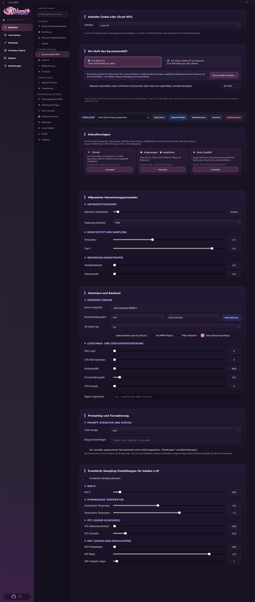
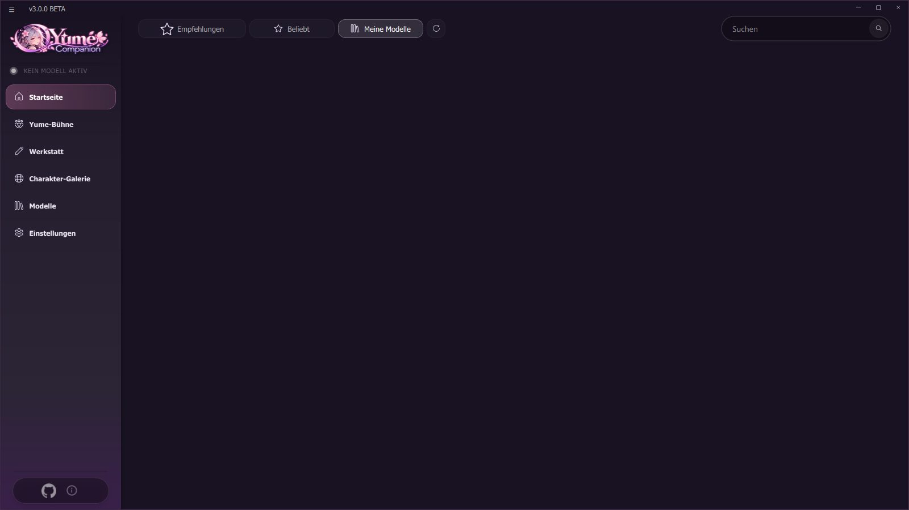
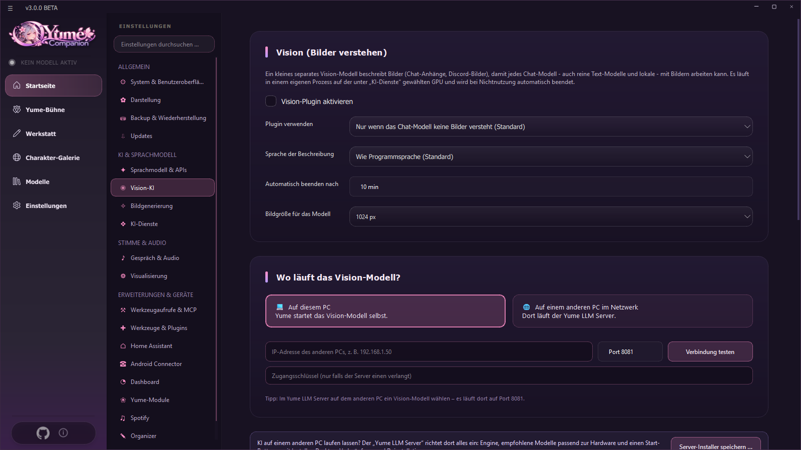
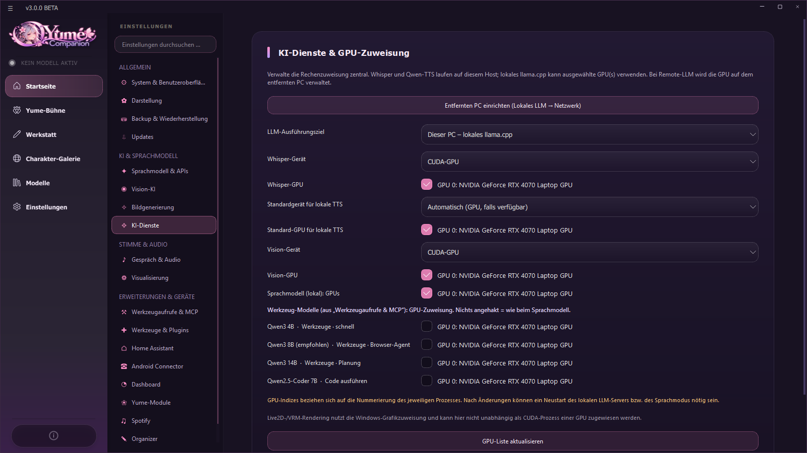
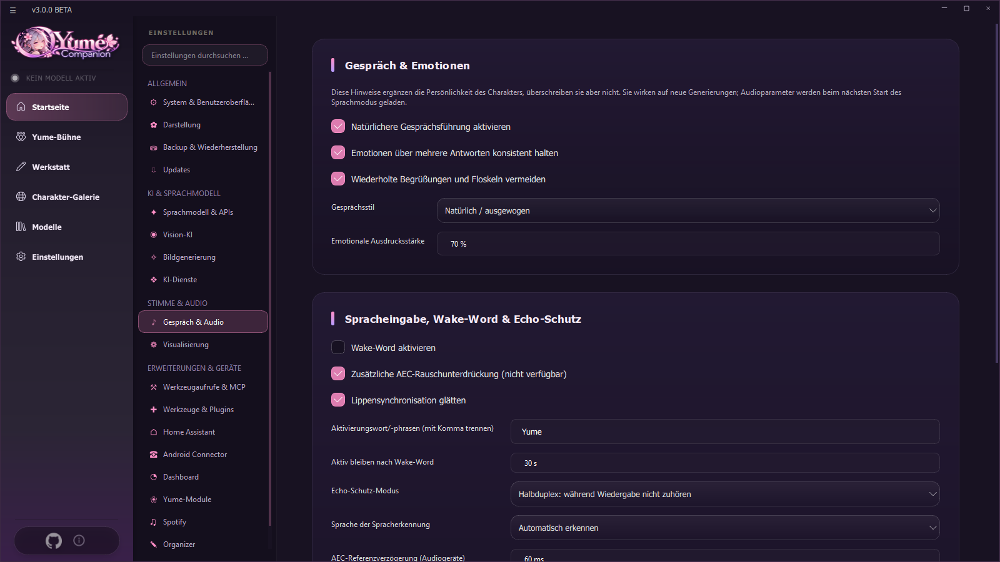

# 04 Language Models

The language model ("LLM") writes your characters' answers. Yume Companion can run it **on this PC**, **on a second PC in your home network** or **at a cloud provider**. You choose the way per character ([conversation method](03-chat-und-charaktere.md#conversation-method-provider-per-character)) and can switch it globally.

## 4.1 Overview of the three ways

| Way | Advantage | Disadvantage |
| --- | --- | --- |
| **Local** (llama.cpp in the app) | private, offline, free | needs graphics card/RAM; large models are slow |
| **Other PC** (Remote LLM, e.g. [Yume LLM Server](12-llm-server.md), Ollama, llama.cpp) | strong hardware offloaded, your PC stays free | second computer in the same network needed |
| **Cloud** (OpenAI, Anthropic, Gemini, DeepSeek, Grok, Qwen, Z.AI, Mistral, OpenRouter, Player2, custom endpoint) | very good models, no hardware | cost, messages go to the provider |

## 4.2 Settings → Language model & APIs

The page is divided into cards (top to bottom):

### Provider (local or cloud API)
Choose the **provider** and enter credentials: API key (for Mistral/OpenAI/OpenRouter/Anthropic/Gemini/DeepSeek/Grok/Qwen/Z.AI), optionally a **custom endpoint URL** (for OpenAI-compatible services) and the **model**. The keys are stored only in `app/configuration/api.json` on your PC. With **Player2** you need no key, only the opened Player2 app.

### Where does the language model run?
Two large buttons:

* **On this PC**: Yume starts llama.cpp itself.
* **On another PC in the network**: llama.cpp or Ollama runs there. You enter the **IP address** (or click **Search network automatically**), test the connection, choose the **model on the server** (detected after the test) and enter the **access key** if needed.
* **Save server installer …** puts the installer of the [Yume LLM Server](12-llm-server.md) onto a USB stick or network folder to set up the second PC.
* Optionally the app searches the network for LLM servers **every 5 minutes (or at start)** and reports those found.

When you switch to the remote PC, all characters with "Local LLM" are switched automatically and a running local server is stopped (frees VRAM). The status shows *Remote model loaded and ready* or *Remote server not reachable – is llama-server running there with `--host 0.0.0.0`?*. There is **no automatic fallback** to local if the remote server fails.

> **Security:** Ollama and llama.cpp servers often have no login. Never expose them to the open internet, only in a trusted LAN (firewall).

Address examples: Ollama `http://HOST:11434/v1`, llama.cpp `http://HOST:8080/v1`. The interface must be OpenAI-compatible (`/v1/chat/completions`, `/v1/models`).

### Template (presets)
Saves and switches complete snapshots of your generation and sampling settings (e.g. "Dense 8B RP", "MoE 30B fast"): *Save*, *New preset*, *Rename*, *Delete*, *Reset* (sets temperature, top-p, context, max tokens and penalties to default).

### Quick templates
One click sets context, answer length, thinking depth, speech blocks and image size to suit your hardware. The app detects your graphics card:

| Template | Context | Answer length | Purpose |
| --- | --- | --- | --- |
| Fast | 8,192 | 1,024 tokens | weak hardware, short answers |
| Balanced (★ recommended) | 16,384 | 2,048 tokens | everyday use, good mix |
| Best quality | 16,384 | 4,096 tokens | strong graphics card, long answers |

### General generation parameters

| Parameter | Meaning |
| --- | --- |
| Maximum token count | how long an answer can get at most (300–500 recommended for chat) |
| Reasoning effort | thinking depth for cloud reasoning models (off, low, medium, high) |
| Temperature | creativity; 0.8–1.0 is a good range for role-play |
| Top-P | old filter; set to 1.0 if you use Min-P |
| Frequency and presence penalty | against word repetition or for topic changes (0.0–0.5) |

### Hardware and backend (local)

| Setting | Meaning |
| --- | --- |
| Server endpoint | Address of the internal llama.cpp server (e.g. `http://localhost:48596/v1`) |
| Compute configuration | **CPU** or **GPU**, backend **CUDA (NVIDIA)**, **Vulkan**, **HIP (AMD)** or **SYCL (Intel)**. With **Update** you download new llama.cpp binaries (see 4.5) |
| KV cache type | quantizes the context cache and saves a lot of VRAM with long context |
| MLock / No-MMAP | keep the model fixed in RAM or load it completely beforehand |
| Flash Attention | faster and more economical in long conversations |
| Thinking/reasoning mode | process `<think>` output of reasoning models |
| GPU layers | how many layers run on the graphics card (99 = all) |
| CPU MoE layers | how many mixture-of-experts layers stay in RAM (for huge MoE models) |
| Context size | working memory in tokens; more = more VRAM |
| Prompt batch size / CPU threads | speed of processing the prompt or on the CPU (0 = automatic) |
| Custom arguments | command-line flags passed straight to llama.cpp (e.g. `--rope-freq-base 10000`) |

### Prompting and formatting
* **Chat template:** *Auto* reads the template from the GGUF file; for strange output such as `<|im_end|>` you force e.g. ChatML or Llama-3.
* **Stop strings:** stop words (e.g. `\nUser:`, `</s>`).
* **Generate only normal, spoken text:** the AI answers without *actions* and descriptions. This makes answers shorter and faster (applies to all characters; practical for voice).

### Advanced sampling (local)
Enable with **Enable advanced sampling**; otherwise the normal parameters apply.

| Sampler | Effect |
| --- | --- |
| **Min-P** | dynamically cuts off nonsensical words (0.05–0.10 recommended with Top-P = 1.0) |
| **Dynamic temperature** (min/max) | temperature varies with the model's confidence |
| **XTC** (probability, threshold) | removes cliché phrases ("shivers ran down my spine") |
| **DRY** (multiplier, base, allowed length) | penalizes whole repeated sequences |

## 4.3 Models (local)

Sidebar → **Models**:

* **Recommended:** curated list with a compatibility rating for your hardware (based on Q4).
* **Popular:** currently popular GGUF models from Hugging Face.
* **My models:** models in the local folder (`assets/local_llm`), with **Load / unload model**, **Set as default**, **Delete**. **Open folder** and **Change directory** switch the storage location.
* **Download:** choose the quantization (Q4_K_M or Q5_K_M recommended), progress and **Stop**. Aborted downloads are cleaned up.
* While loading, the app shows the steps *Initialize engine → check GGUF → load tensors → allocate context → model ready*.

## 4.4 Vision

**Settings → Vision AI.** A small, separate vision model describes images (chat attachments, Discord images). That way pure text models can work with images, too.

* **Enable plugin**; mode *Only if the chat model cannot understand images* (default) or *Always*.
* Choose the **vision model** and **download and install** it (e.g. Qwen2.5-VL 3B) or specify your own GGUF with its *mmproj* file.
* **Stop automatically after** N minutes idle (frees GPU memory), **image size** (longest side).
* Device/GPU via *AI services*; adjust the **instruction** for the vision model; **test with an image**; load/stop the model now.
* **On another PC** (remote vision): enter the address of the vision server, e.g. from the Yume LLM Server (port + 1).
* The tool *Analyze screenshot* (the AI "sees" your screen, see [Chapter 09](09-werkzeuge-und-integrationen.md)) needs an image-capable model; the character's provider must understand images or the vision plugin must be active.

## 4.5 AI services and GPU assignment

**Settings → AI services** distributes the computing work centrally:

* **LLM execution target:** *This PC – local llama.cpp* or *Remote PC – Ollama / llama.cpp*; **Set up remote PC** jumps to the network card.
* **Whisper device** (CPU or CUDA GPU) and **GPU**: speech recognition.
* **Default device/GPU for local TTS**: speech synthesis (Qwen3-TTS and others). Can be overridden per character.
* **Vision device/GPU**, **Language model (local): GPUs** (several possible, indices from your list).
* **Tool models:** Qwen3 4B (fast), Qwen3 8B (recommended, browser agent), Qwen3 14B (planning), Qwen2.5-Coder 7B (code) – GPU selectable per model.
* **Refresh GPU list**. Live2D/VRM rendering uses the Windows graphics assignment (*Windows Settings → System → Display → Graphics*), not this page.

> GPU numbers apply per process. After changes, restart the local LLM server or the voice mode.

### llama.cpp updater
In the card *Hardware and backend*, **Current version** shows the state of the engine. **Update now** downloads the latest llama.cpp binaries for the selected backend (GitHub), **Reset** restores the previous version, **Reinstall** repairs a broken engine.

## 4.6 External tool model

A second, small model can **decide which tool is needed with which arguments** while the chat model writes the answer. That makes tool calls more reliable and faster. Set it up under **Tool calls & MCP → External tool model** (address e.g. from the Yume LLM Server, port + 3). If the server is off, the chat model takes over by itself for two minutes.

## 4.7 Conversation & emotions

**Settings → Conversation & audio** (upper card) supplements the character's personality but does not replace it:

* **More natural conversation**, **keep emotions consistent across several answers**, **avoid repeated greetings and filler phrases**.
* **Conversation style:** natural/balanced, warm and personal, short and direct, relaxed and spontaneous.
* **Emotional expressiveness:** 0–100 %.

## 4.8 Error messages in plain language

Technical LLM and network errors are translated into short plain sentences (in the program language), e.g. when the context is too small ("currently 8192 tokens") or the server is not reachable, with a hint what to do.
