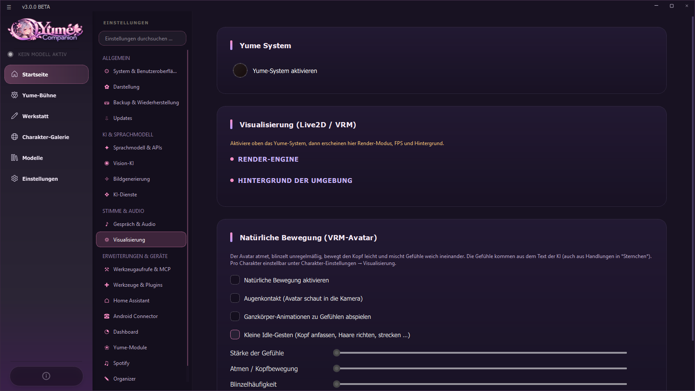
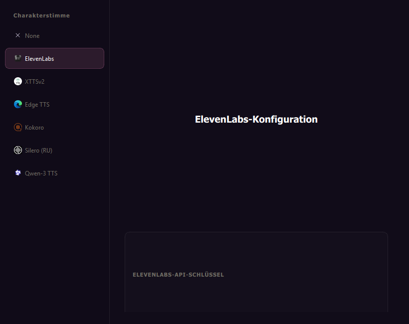
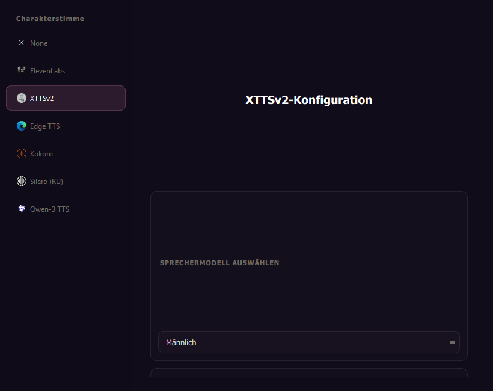
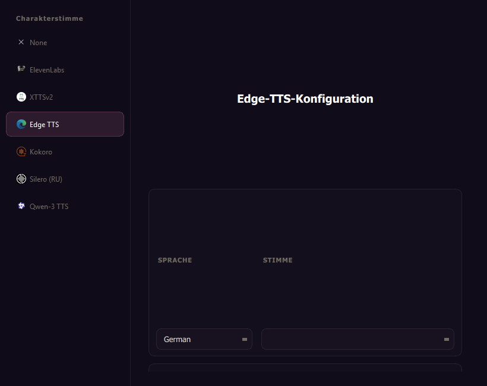
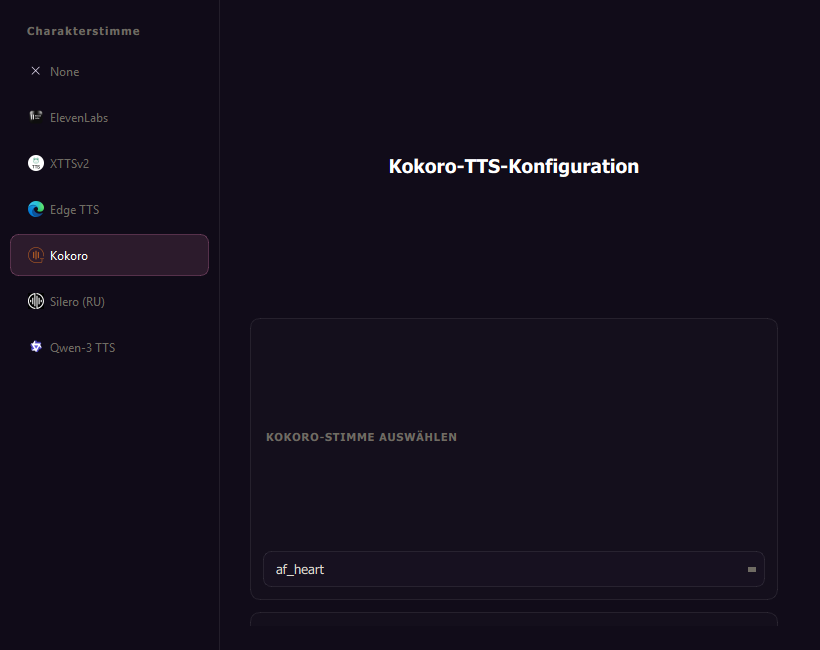
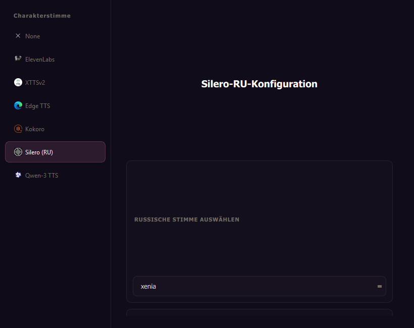
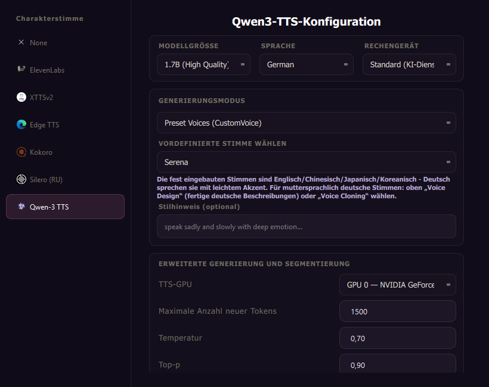
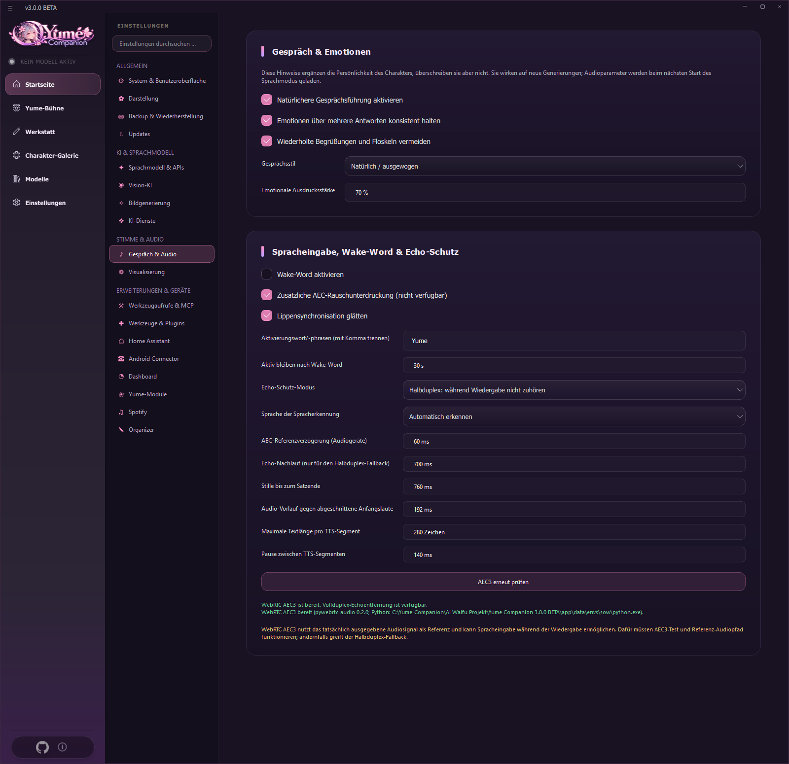

# 05 Voice and Avatars

This chapter explains how your character **speaks**, how it **hears** you and how it **looks**.

## 5.1 Turning on the Yume system

Avatars, calls and extra modules run in the **Yume system** (the extended mode). Turn it on under **Settings → Visualization → Enable Yume system**. If the button for facial expressions is missing in the character menu later, this module is switched off.

On this page you will also find:

| Setting | Meaning |
| --- | --- |
| **Mode** | *Yume system* (call as a full-screen window with avatar) or *Yume desktop companion* (floating figure on the desktop, [Chapter 08](08-desktop-begleiter.md)) |
| **Frame rate** | 30, 60 or 120 FPS for Live2D/VRM |
| **Model background** | *Color* (black, deep blue, burgundy, dark green, soft violet, warm charcoal) or *Image* |
| **Natural movement (VRM)** | Breathing and head movement, blink frequency, smooth blending of emotions, **eye contact** (the avatar looks into the camera), **full-body animations for emotions**, small **idle gestures** (touching the head, fixing hair, stretching), *strength of emotions*, *hold emotion, then relax*. Adjustable per character under character settings → visualization |

## 5.2 Speech output (TTS)

You choose the voice per character: tile → **Voice settings** (microphone icon).

| Engine | Type | Notes |
| --- | --- | --- |
| **ElevenLabs** | cloud | your own API key and voice ID |
| **XTTSv2** | local | speaker model *Male*, *Female*, *Female, calm*. The reference voices are short recordings `male.wav`, `female.wav`, `calm_female.wav` in `app/voices` (not included in the repository: put your own, freely usable recordings there) |
| **Edge TTS** | cloud (Microsoft, no key) | choose language and voice |
| **Kokoro** (82M) | local | light, many voices |
| **Silero (RU)** | local | Russian voices |
| **Qwen-3 TTS** | local | best quality, details below |

On the **first start** of a local engine the program downloads the models automatically (progress in the console). After that speech works offline.

The pages of the individual engines:

| ElevenLabs | XTTSv2 | Edge TTS |
| --- | --- | --- |
|  |  |  |

| Kokoro | Silero (RU) |
| --- | --- |
|  |  |

### Qwen3-TTS in detail
* **Model size**, **language**, **compute device** (*Default* follows the AI services; your own CPU/GPU choice applies only to this character).
* **Generation mode:** *Preset voices* (ready-made voices; they speak German with a slight accent), *Voice design* (describe the voice in English, ready-made German descriptions work too) and *Voice cloning* (reference WAV and the wording of the recording).
* **Style hint** (optional, e.g. "speak sadly and slowly").
* **Advanced generation and segmentation:** TTS GPU, maximum new tokens (start 1500), temperature, top-p, **maximum characters per segment** (220–280), **pause between segments** (120–200 ms), **silence at the end** (100–250 ms), *automatically repeat suspiciously short output once*, *maximum generation time per segment*.
* If the voice cuts off at the end of a sentence: shorter segments, a slightly higher token limit and moderately more silence at the end of the segment.

### RVC (voice conversion)
On the engine page, **enable RVC** and choose a folder with a `.pth` voice (folder in `assets/rvc_models`). If there is no `.pth` file in the folder, the app reports it. **Use only your own, synthetic or licensed voices. Cloning the voices of real people without their consent is not allowed.**

### More rules for speech output
* **Speech output mode** (Settings → System → text-to-speech rules): e.g. *Read quotes only* or your own **regular expression** (e.g. `\*(.*?)\*` reads only text between asterisks).
* Output happens **sentence by sentence** (streaming), so the voice starts while the AI is still writing. A shared text cleaner removes actions, emojis and markdown.
* Lip movement is smoothed (**smooth lip sync**).

## 5.3 Speech input

* **Speech recognition:** Faster-Whisper with Silero VAD (detects speech pauses). Device (CPU/GPU) under *AI services*.
* **Settings → Conversation & audio** (card *Speech input, wake word & echo protection*):

| Setting | Meaning |
| --- | --- |
| **Enable wake word** | the program only reacts once one of the phrases is said (several separated by commas, e.g. `Yume, Hey Yume`). Detection in the Whisper text, no special detector |
| **Stay active after wake word** | seconds of listening after the last sentence |
| **Echo protection mode** | *Off*, *Half duplex* (microphone pauses while the character speaks, plus tail time) or **WebRTC AEC3** (real echo cancellation, you can talk over the AI) |
| **Speech recognition language** | *Detect automatically* or fixed |
| **AEC reference delay** | alignment between loudspeaker and microphone (default 60 ms) |
| **Echo tail** | only for the half-duplex fallback (700 ms) |
| **Silence until end of sentence** | how long a pause counts as the end of a sentence (760 ms; too low cuts off pauses) |
| **Audio pre-roll** | prevents cut-off initial sounds (192 ms) |
| **Maximum text length per TTS segment**, **pause between segments** | fine-tuning of the output |
| **Recheck / install AEC3** | checks the library `pywebrtc-audio`; on errors half duplex is used automatically |

Most audio values only take effect after restarting the voice mode. Whether AEC3 sounds good depends on speakers, microphone and room; try it out.

### Echo protection (anti-echo) in detail

So that the AI does not hear itself, there are three methods. The names correspond to the entries in the app (*Settings → Conversation & audio → Echo protection mode*):

| Entry in the app | Technical term | Effect |
| --- | --- | --- |
| **Off** | no echo protection | The microphone stays open all the time. Only useful with headphones, otherwise the AI hears itself |
| **Half duplex: do not listen during playback** | *half-duplex* (anti-echo with muting) | The microphone is muted while the character speaks, plus **echo tail** (700 ms). Reliable and needs no extra package, but you cannot talk over the AI |
| **WebRTC AEC3 (full-duplex echo cancellation)** | *full-duplex* with *acoustic echo cancellation* (WebRTC **AEC3**, library `pywebrtc-audio`) | The audio actually played serves as a reference and is subtracted from the microphone signal. The microphone stays open, you can **interrupt the AI**. Fine-tuning with **AEC reference delay** (60 ms) |

At start the app checks whether AEC3 works (*"WebRTC AEC3 is ready. Full-duplex echo cancellation is available."*). If the package is missing or the test fails, it falls back to **half duplex** automatically; **Check / install WebRTC AEC3** repairs this in the app's Python environment.

**On the phone** the switch is called **Echo suppression** (*Settings → Conversation*): during a call the app switches to Android's telephone audio path (`USAGE_VOICE_COMMUNICATION`) and activates the phone's echo canceller (`AcousticEchoCanceler`, if the device has one). That is also a full-duplex solution. With **Interrupt** (*By speaking*, *Only with stop word*, *Off*) you decide how to stop the AI mid-sentence. Everything works best with headphones. See [Android App](11-android-app.md#117-settings-on-the-phone).

* **Hey Yume on the PC** (always listening, even with the chat closed) is described in the [Organizer](10-organizer.md#1017-hey-yume-on-the-pc).
* **Mood sense** from the voice (experimental, only numbers are evaluated, no recordings): [Organizer](10-organizer.md#108-conversations-and-mood).

## 5.4 Calling

On a character's tile choose the **phone icon** ("Call"). You decide the **call mode**:

* **Yume system**: full-screen call window with an interactive avatar and voice chat.
* **Yume desktop companion**: borderless figure that stays above other windows.

The character needs a **voice** beforehand. Without a voice the app says "Assign a voice to the character before you start the call". A local LLM must be loaded, otherwise the hint "Choose *Local LLM* in the model hub" appears. The button *Start conversation* begins listening; during output it shows "Speaking …".

## 5.5 Avatars

The character is animated in the chat to the right of the messages and reacts to every answer.

### The emotion system
A classifier reads every answer and assigns it to **28 emotions**: neutral, joy, love, sadness, anger, admiration, amusement, annoyance, approval, caring, confusion, curiosity, desire, disappointment, disapproval, disgust, embarrassment, excitement, fear, gratitude, grief, nervousness, optimism, pride, realization, relief, remorse, surprise. For each emotion you can store your own reaction.

### Four display types
Tile → **Facial expressions** (*expression selection*). On the left choose the *visualization engine*, pick the folder or file, **Save selection**.

| Expression images | Live2D model | VRM 3D model |
| --- | --- | --- |
|  |  |  |

| Type | Where the files are | Notes |
| --- | --- | --- |
| **No visualization** | – | only the static character card |
| **Expression images** | `assets/emotions/images/<folder name>/` | One file per emotion, name = emotion: `neutral.png`, `joy.gif`, `anger.png` … (PNG, JPG or GIF). If an emotion is missing, `neutral` is used. Lightest option, no load on CPU/GPU |
| **Live2D model** | `assets/emotions/live2d/<model folder>/` | only format **.moc3** (old .moc is not supported). Motions (blinking, arms, poses) and lip sync. With **Assign emotions to motions** you assign an animation group to each of the 28 emotions |
| **VRM 3D model** | `assets/emotions/vrm/` | free 3D models (`.vrm`), e.g. built with the free software VRoid Studio or from VRoid Hub. Hair and clothes move, facial expressions, eye contact, body animations |

Tip: If the app does not react immediately when loading a Live2D or VRM model, wait a moment and do not close the window.

### Live2D motion assignment
Assigns a body animation group to each of the 28 emotions; **Restore default** and **Save assignment**.

### Your own content and rights
This repository contains only freely redistributable avatars: self-drawn expression images of the demo characters and two **VRoid sample models** (`Anime Girl.vrm`, `Anime Man.vrm` from the pixiv VRoid Project, VRM Public License 1.0, see [NOTICE](../../NOTICE.md)). The demo characters Mika and Kai use them:

The 28 body animations for the emotions (`app/utils/emotions/vrm/expressions/*.fbx`) are **not in the source repository** (probably Mixamo material that should not be passed on as individual files), only in the finished setup. If you work from source you do not have them: then the model stands in a T-pose; put your own animations, named after the emotions (`neutral.fbx`, `joy.fbx` …), into that folder. No Live2D models are included here. If you use models from others, respect their license (credit, commercial use, modification). The Cubism components of Live2D are under their own license.

## 5.6 Ambient sounds and backgrounds

* **Ambient sounds** (Settings → Yume modules): plays fitting atmosphere when the chat opens (forest, rain, tavern, campfire …). Put your own files into `assets/ambient` (button *Open ambient folder*), *Refresh audio list*. Default track and volume are adjustable; in the chat the audio HUD at the top right controls the soundscape and volume.
* **Chat background:** images from `assets/backgrounds` (for landscape "Horizontal …", for portrait "Vertical …"), selectable per chat.
