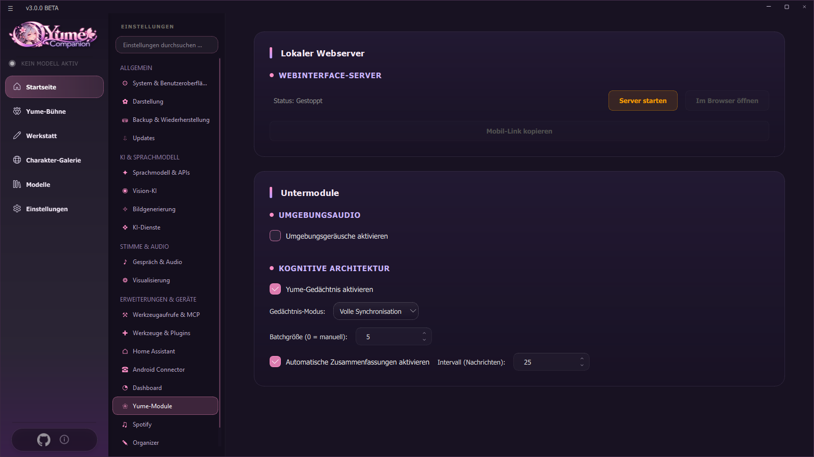
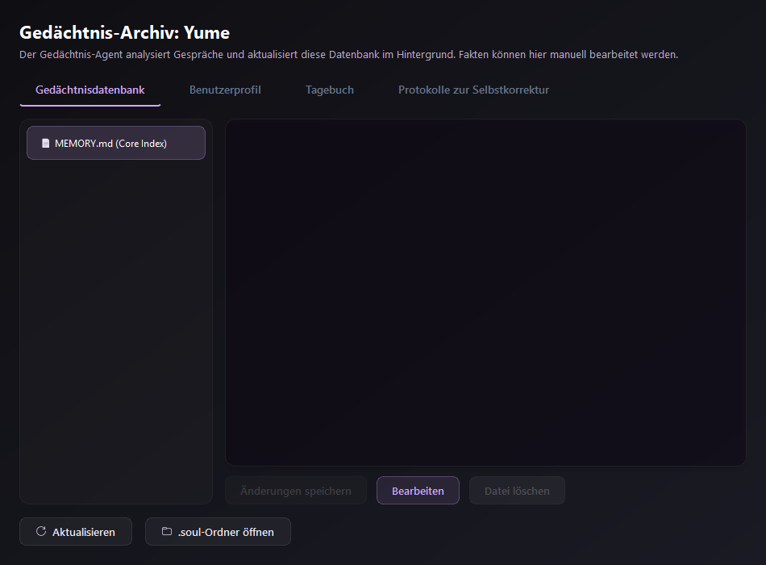
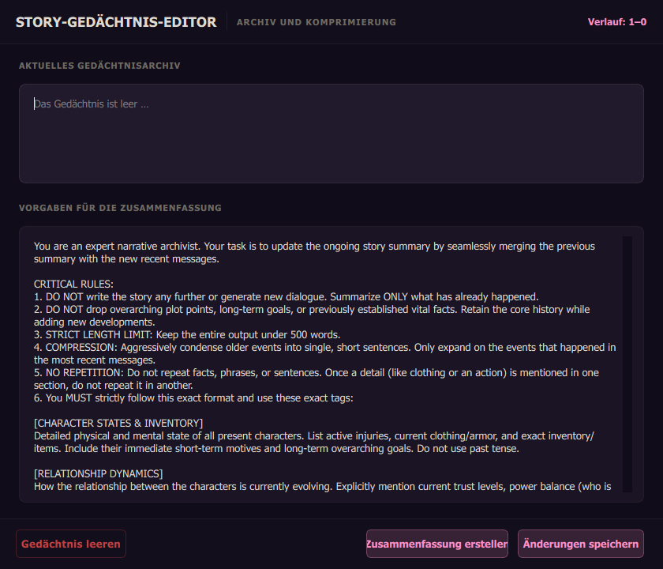

# 06 Memory

Yume Companion remembers things on three levels: the **chat history** in the context window, the **story memory** (condensed summary of long chats) and the **Yume memory** (long-term, cognitive memory per character).

## 6.1 The Yume memory

Instead of relying only on the chat history, every character keeps its own files (folder `.soul/<character>/`):

| File / level | Content |
| --- | --- |
| **MEMORY.md** (core index) | The character's psychology: mood, goals, motives |
| **USER.md** (user profile) | what the character knows about **you**, relationship data |
| **Topic archive** | condensed episodes and facts, searchable with local embeddings |
| **Diary** | personal first-person entries about your conversations |
| **Self-correction logs** | what the memory agent changed |

Background agents analyze the conversations on their own. Feelings fade over time (natural transition), contradictions are detected and resolved, duplicates are merged, and files are saved safely (atomically). The result: less unnecessary context and a consistent personality, also in the [Yume Stage](07-yume-buehne.md) and with the [desktop companion](08-desktop-begleiter.md).

### Turning it on and choosing a mode
**Settings → Yume modules → Cognitive architecture → Enable Yume memory.**

| Mode | What is active | Suitable for |
| --- | --- | --- |
| **Full synchronization** | everything: psychology index, topics/lore, diary | strong PCs or APIs, the best experience |
| **Soul link** | personality and feelings (MEMORY.md) and diary; no topics | deep bond without high load |
| **Spark of thought** | only the MEMORY.md index | slow PCs, fast role-play |
| **Reflection flow** | only the diary | maximum speed while keeping the feelings history |

**Batch size** determines after how many messages the memory is updated (0 = manual only). With the icon **"Force memory now"** in the chat input line you trigger it immediately.

### Viewing and editing memory
In the chat, the **memory icon** at the top right:

Tabs *Memory database*, *User profile*, *Diary*, *Self-correction logs*. With **Edit** you change facts by hand, **Save changes**, **Delete file**, **Refresh** and **Open .soul folder**. If the chat is empty, the app points it out ("Open a chat with a character first").

## 6.2 Story memory (automatic summary)

Long conversations would fill the context window. That is why the app condenses older messages into a **summary**:

* **Enable automatic summaries** (Yume modules) with **interval (messages)**, default 25.
* In the chat the **summary icon**: *story memory editor* with the current memory text ("History: 1–N"), the **summary guidelines** (how the AI should condense), and the buttons **Create summary**, **Clear memory**, **Save changes**.

## 6.3 Author notes

Global instructions that always go into the context without changing the character card. See [Chapter 03](03-chat-und-charaktere.md#author-notes).

## 6.4 What else Yume remembers (Organizer)

Besides the memory per character there is a **general notebook**: if you say "Remember that I don't like rain hints in the morning", Yume stores it permanently and uses it in every chat, briefing and routine. Everything can be viewed and deleted in the [Organizer](10-organizer.md#107-what-yume-remembers).

## 6.5 Data, backup and deleting

* The memory lives in the folder `.soul` in the program directory (not in the repository).
* It is part of the **profile backup** (option *Yume memory*) – see [Chapter 14](14-backup-updates-sicherheit.md).
* You delete single files in the archive. To make it forget **a single device or person**: delete the file in the archive or remove `.soul/<character>`.
