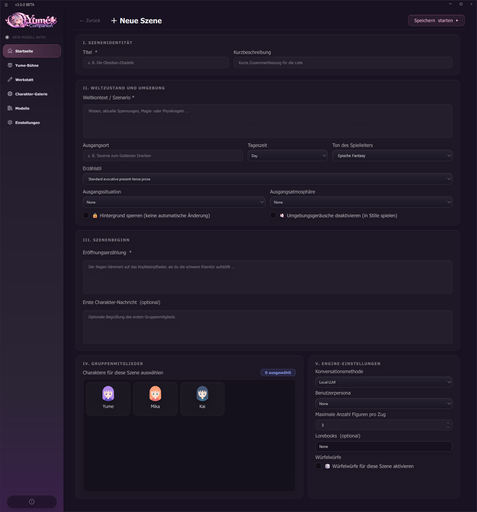

# 07 Yume Stage

The **Yume Stage** is a text adventure engine: an AI acts as **game master** (narrator) and guides several characters through a story, with dice checks, inventory, event cards and side characters. It works like a pen-and-paper role-playing game on the PC.

## 7.1 Managing scenes

Sidebar → **Yume Stage**. At the top: **New folder**, **Import**, **New scene** and a search. Each scene is a card with title, short description, the pictures of the group members and the buttons:

| Icon / button | Function |
| --- | --- |
| **Play** | Open the scene. If it has a saved history, you choose *continue* (load N saved messages) or *start over* (history is deleted) |
| Folder icon | Move the scene into a folder |
| Export icon | Pass on the scene as a file (JSON); **Export all** backs up all of them |
| Pencil | Edit the scene |
| Trash | Permanently delete the scene including its history |

Folders group scenes ("scene folders"). The scene gallery of the character gallery offers ready-made scenarios ("Add to stages").

## 7.2 Creating a scene

**New scene** opens the scene editor with five sections:

| Section | Fields |
| --- | --- |
| **I. Scene identity** | Title, short description |
| **II. World state and environment** | **World context/scenario** (attached to every prompt as background), starting location, **time of day** (morning, day, evening, night), **game master tone** (epic fantasy, everyday life, crime & noir, romance, horror, comedy, sci-fi), **narrative style**, **starting situation** (background image) and **starting atmosphere** (ambient sound), both can later be changed dynamically by the planner, optionally **lock background** and **disable ambient sounds** |
| **III. Scene start** | **Opening narration** (the narrator's first words), optionally the **first message** of a group member |
| **IV. Group members** | any characters from your list |
| **V. Engine settings** | **Conversation method** (provider), **user persona**, **maximum number of characters per turn** (1–6, default 3), **lorebooks**, **dice rolls** |

**Save & start** creates the scene and begins.

## 7.3 Playing

In the scene you write what your character does. The input has four **modes**:

| Mode | Meaning |
| --- | --- |
| 💬 **Speak** | said out loud |
| ⚔ **Act** | an action |
| 💭 **Think** | silent inner thought |
| 🎬 **Direct** | out-of-character remark to the game master |

More controls:

* **Next up:** you choose who speaks next (instead of leaving it to the game master), or *Auto*.
* **Private** ("whisper"): your message becomes private knowledge of the chosen character only; the group does not learn about it.
* **Choice suggestions:** the game master offers action options (or you write your own).
* **Continue action:** the story continues; optionally you give a hint ("There is an explosion outside").
* **Intervene** (⚡): stops the AI's turn.
* **Scene image:** creates an image for the current scene (needs image generation).
* **Message menu:** copy, edit (resets the world state and replays the turn), translate, **regenerate round**, delete.
* **Export scene as Markdown.**
* **Event cards:** encounter, discovery, visit, plot twist and "moment" appear randomly with fitting hints for your answer.

### Dice checks
If you enable **Dice rolls for this scene**, the game master asks for **d20/2d6/3d6** checks for risky or disputed actions. Rolling is regulated deterministically and is not left to the model. Skills with a modifier (−5 to +10) are factored in.

### Inventory, status, resources
The scene shows a **HUD** with inventory (weapons, consumables, tools, valuables, quest items, other; *Use* and *Drop*), states and resources ("name: current/maximum").

## 7.4 World state and campaign

The **world state window** (icon in the scene header) has tabs:

| Tab | Content |
| --- | --- |
| **Scene** | Location, time of day, world context |
| **Important facts** | "key: value" per line |
| **Inventory** | one item per line |
| **Status** | States and status effects |
| **Resources** | Resources and skills |
| **World knowledge cards** | Campaign knowledge that only enters the story on matching triggers |
| **Campaign overview** | **Goals** ("title \| current/maximum \| status \| description") and **clocks** (pressure clocks) |
| **Story arcs** | hidden story arcs; a locked arc does not exist for any character |
| **Relationships** | how one character sees another ("A -> B \| sympathy −100…100 \| perspective \| keywords") |
| **Character states** | evolving roles and personal facts |
| **Active NPCs** | side characters created by the narrator (read only) |

## 7.5 Side characters and memory

* The narrator can **summon NPCs** ("Backstage / role list"); they have their **own memory**, which is kept (`.soul_stage/npc_memory`). Characters leave the scene with a note in the log.
* The **Yume memory** (icon *Memory*) shows the memories of the group members after you have chosen the character.
* The memory of characters is also used here when the Yume memory is active ([Chapter 06](06-gedaechtnis.md)).

## 7.6 Tips

* Give the game master a clear **world context** and an **opening narration**: the more concrete, the more coherent.
* Start with 2–3 group members; more characters per turn make every round longer.
* For dice checks and inventory the model should follow the format well (an 8B model or better).
