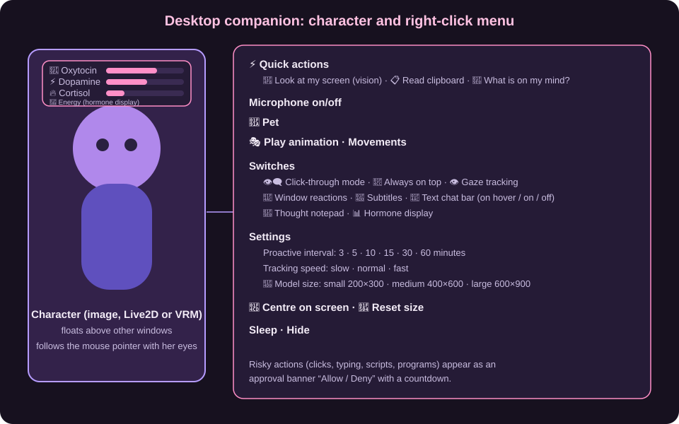

# 08 Desktop Companion

The **desktop companion** is your character **on the desktop**: borderless, always visible (if you want), with its own mood that reacts to the screen and to what you do. It is not a chat window but a housemate who can say something on its own.

> The drawing shows the layout schematically (labels in German). The figure itself appears with your image, Live2D or VRM model.

## 8.1 Starting

1. **Settings → Visualization**: *Enable Yume system* and choose *Yume desktop companion* as the **mode**.
2. Give the character an appearance (images, Live2D or VRM, [Chapter 05](05-stimme-und-avatare.md)) and assign a **voice**.
3. On the tile choose **Call** → call mode **Yume desktop companion**. The figure appears above other windows.

## 8.2 The hormone model

Behind the figure a simple "hormone system" works. Four values between 0 and 1 determine mood, talkativeness and behavior:

| Value | Display | Meaning |
| --- | --- | --- |
| **Oxytocin** (love, bonding) | 🧪 | rises when you talk to her and are active; falls when you are away for longer (she gets lonely, below 0.25) |
| **Dopamine** (focus, interest) | ⚡ | rises with new events and when you speak; falls slowly |
| **Cortisol** (stress) | 🔥 | rises in unpleasant situations; fades on its own |
| **Energy** (vitality) | 🔋 | is used up by speaking and thinking and regenerates; at very low energy the figure **sleeps** and wakes up when it has recovered enough |

The values influence the prompt (mood, time since the last word) and thus whether she speaks, stays quiet or only changes her face. Show them with *Hormone display* in the menu.

## 8.3 How she decides

On every **event** (you speak, a program opens, time passes, a timer runs out) the language model chooses an **action** and returns it as a structured answer:

| Action | Effect |
| --- | --- |
| *speak* | speaks aloud (also on her own, "proactively") |
| *idle* | stays quiet, only adjusts hormones or feeling |
| *micro_react* | only changes the facial expression |
| *inner_thought* | thinks quietly (ends up in the **thought notepad**) |
| *use_tool* | uses a tool, e.g. screenshot, system info, web search |

She picks her feeling: neutral, curious, warm, amused, worried, playful, relaxed, tired, melancholic, enthusiastic.

## 8.4 The right-click menu

Right-clicking the figure opens the menu:

| Entry | Function |
| --- | --- |
| **⚡ Quick actions** | *Look at my screen (vision)*, *Read clipboard (analyze)*, *What is on my mind?* |
| **Microphone on/off** | Speech input for the companion |
| **🤚 Pet** | Reaction of the figure |
| **🎭 Play animation / Movements** | Live2D motions and VRM animations |
| **Click-through mode** | Clicks pass through the figure to the windows behind it |
| **Always on top** | stays above all windows |
| **Gaze tracking** | the eyes follow the mouse pointer |
| **Window reactions** | she comments on windows and programs you open |
| **Subtitles** | shows spoken words as text |
| **🧠 Thought notepad** | shows her inner thoughts (title: "Companion's internal thoughts") |
| **Text chat bar** | Input line *on hover*, *on* or *off* |
| **Proactive interval** | how often she may say something on her own: 3, 5, 10, 15, 30 or 60 minutes |
| **Follow speed** | slow, normal, fast |
| **📐 Model size** | small 200×300, medium 400×600, large 600×900 |
| **📊 Hormone display** | Bars for oxytocin, dopamine, cortisol, energy |
| **📍 Center · 🔄 Reset size** | Position and size |
| **Sleep · Hide** | Pause or hide the figure |

## 8.5 Tools (what she can do on the PC)

The companion uses the same tools as the chat (see [Chapter 09](09-werkzeuge-und-integrationen.md)):

* **Read screen** (screenshot to an image-capable model), **clipboard**, **system info**, **hardware**
* **Web search**, **browser agent** (Playwright: reads pages, clicks, fills in forms)
* **GUI control** (mouse, keyboard, scrolling, key combinations), **app control** (start programs, focus windows, end processes)
* **Run code** (Python/PowerShell in a sandboxed local environment), **file management**, **task planner**
* **Media control** (pause, next track), **system monitoring** ("hardware guard": battery, GPU temperature, finished downloads)
* **Your own plugins** in the folder `app/utils/soul_companion/plugins` (Python class `Plugin` of `BaseTool`)

**Safety:** Risky actions (clicking, typing, scripts, starting programs) appear as an **approval banner** "The companion wants to perform an action" with **Allow** and **Deny** and expire after a short time without an answer. You can switch off each type of tool individually (*Settings → Tool calls & MCP*). The **tool log** (`logs/tool_log.jsonl`) records what was executed, approved and how it went; secrets are masked (can be switched off).

## 8.6 Tips

* A strong local model (8B or more) decides actions and tools more reliably; if needed use the [external tool model](04-sprachmodelle.md#46-external-tool-model).
* If she should talk less, increase the *proactive interval* or switch off *window reactions*.
* The companion and the chat share the [Yume memory](06-gedaechtnis.md): what you say in the chat she also knows on the desktop.
