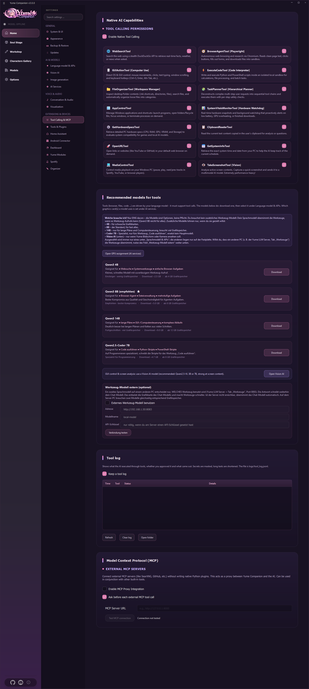
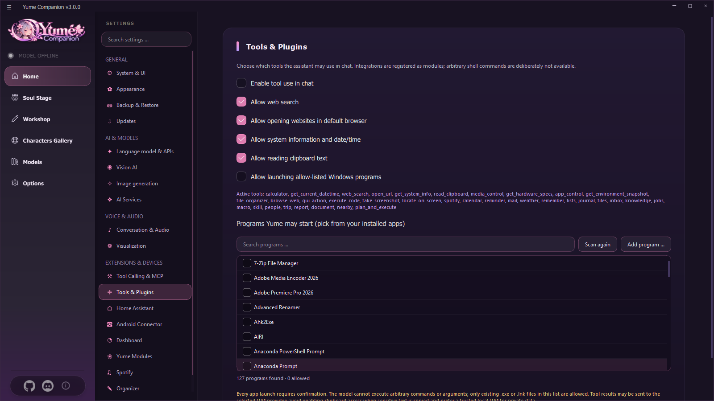
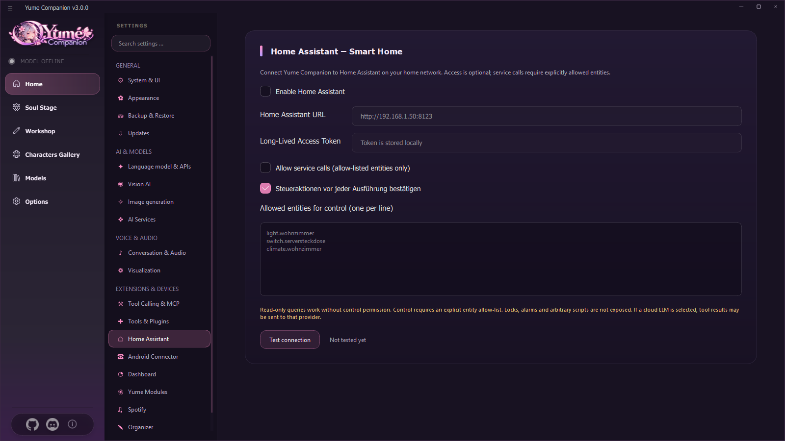
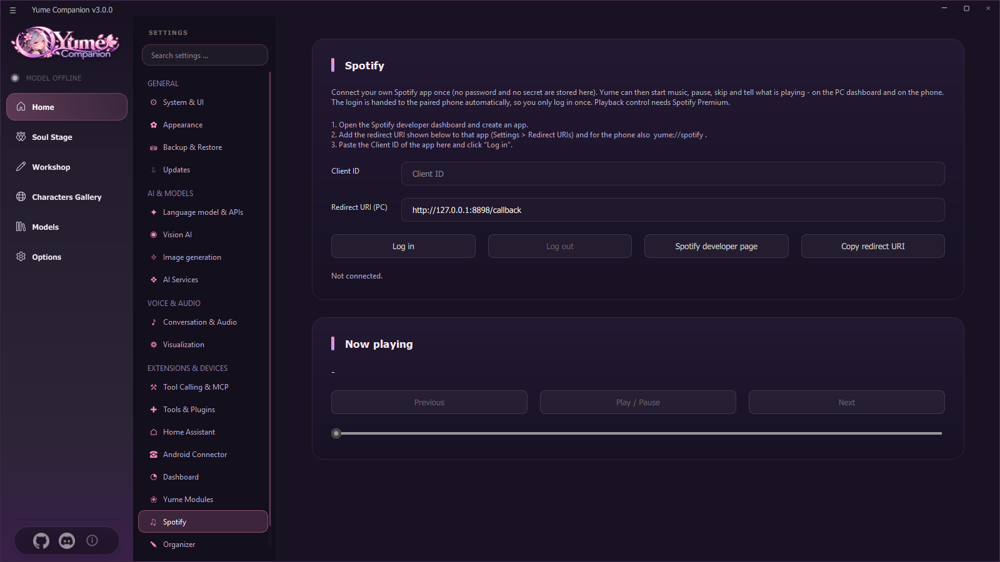
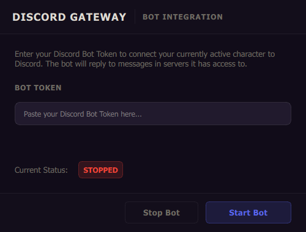
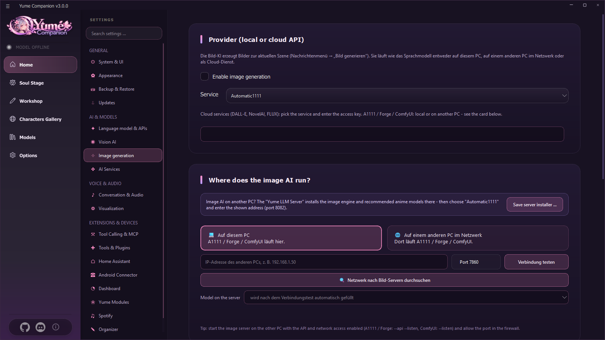
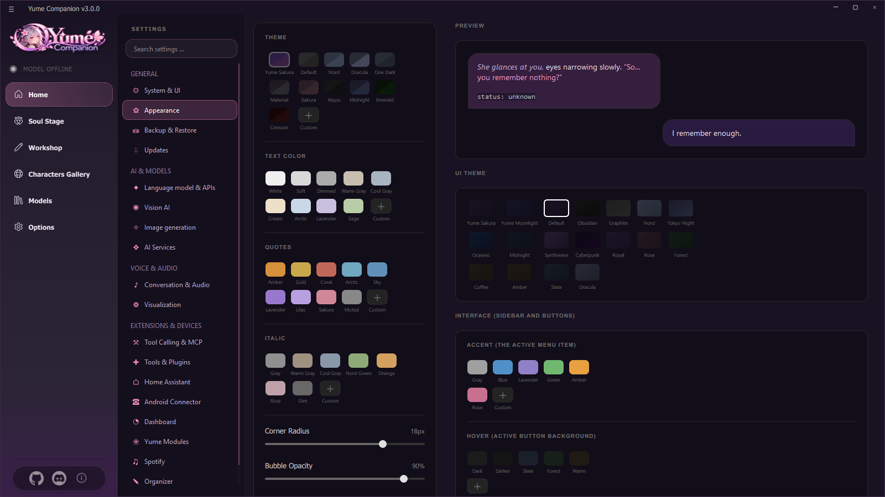

# 09 Tools and Integrations

This chapter explains what the AI may **do** on the PC (tools) and all connections: MCP, Home Assistant, Spotify, Discord, image generation, dashboard and appearance.

## 9.1 Tools (tool calls)

**Settings → Tool calls & MCP.** With **Enable native tool calls** the AI may execute functions during an answer. Every capability has its own switch:

| Tool | What it can do |
| --- | --- |
| **Web search** | searches via DuckDuckGo for facts, weather, news |
| **Browser agent** (Playwright) | automates Chromium: reads pages, clicks, fills in forms, downloads files into a workspace |
| **GUI control** | Mouse, keyboard, scrolling, key combinations |
| **Run code** | Python and PowerShell scripts in an isolated local environment (calculations, files) |
| **File management** | Search the desktop and folders, sort files into categories automatically |
| **Task planner** | splits complex tasks into steps and executes them with safety checks |
| **App control** | Start Windows apps, open folders, focus windows, end processes |
| **System monitoring** | Battery, GPU overheating, finished downloads |
| **Detect PC hardware** | CPU, RAM, GPU, VRAM, storage (compatibility with games and AI models) |
| **Read clipboard** | current text for analysis |
| **Open URL** | Links in the default browser |
| **System information** | Date and time |
| **Media control** | Pause, play, next/previous track |
| **Analyze screenshot** (vision) | Capture the screen and have an image-capable model describe it (very compute-intensive) |
| More | Calculator, calendar, reminders, mail, weather, remember, lists, diary, files, inbox, knowledge base, jobs, macros, skills, people, trips, weekly review, documents, nearby places, Spotify, phone (see [Organizer](10-organizer.md)) |

**Approval:** Risky actions ask for your confirmation. For external MCP tools: "Ask before every external MCP tool call" (on by default).

### Recommended models for tools
Tools are controlled by the language model, which must support tool calls. **You need only one** of the additional models if your chat model cannot do that: **Qwen3 4B** (fast, weak graphics cards), **Qwen3 8B** (recommended, default for almost everything including the browser agent), **Qwen3 14B** (long plans, computer control), **Qwen2.5-Coder 7B** (code). You only need a **vision model** if the AI should see the screen or camera. Each model can be downloaded with one click.

### External tool model (optional)
Another PC (e.g. tab *Tools* of the [Yume LLM Server](12-llm-server.md), port 8083) decides **which tool** is used; the chat model still writes the answer. That relieves the graphics card. Address, model name, API key and **Test connection**. If the server is not reachable, the chat model takes over automatically.

### Tool log
**Keep tool log** writes to `logs/tool_log.jsonl` what the AI executed, whether you confirmed it and what came out (secrets masked, long texts shortened). Buttons: *Refresh*, *Clear log*, *Open folder*.

## 9.2 Tools & plugins (permissions)

**Settings → Tools & plugins** determines what the AI may use in the **chat**.

* **Enable tool use in chat** (main switch), then individually: web search, open web pages (only `http://` and `https://`, never local files), system information, read clipboard (off by default, sensitive), **start approved Windows programs**.
* **Programs Yume may start:** The app searches installed programs (Start menu, desktop, App Paths). You tick the allowed ones, can **rescan** or add an `.exe`/`.lnk` with **Add program …**. **Every program start must be confirmed**; the AI can execute neither free commands nor arguments.
* The row **Active tools** lists all registered tools.
* **Privacy:** Results go to the chosen language model as context. With cloud models they can reach the provider. Enable sensitive tools only deliberately.

## 9.3 Model Context Protocol (MCP)

At the bottom of the tools page: **Enable MCP proxy integration**, enter the **MCP server URL** (e.g. `http://127.0.0.1:8000`), **Test MCP connection** shows the offered tools. External tools (e.g. SearXNG, GitHub) are then available in the chat without writing Python plugins. Chat tool use must be active for this, too. Never expose the endpoint unprotected to the internet and check what an MCP server is allowed to do.

## 9.4 Home Assistant

**Settings → Home Assistant.** Yume can query states and control (only approved) devices.

1. **Enable Home Assistant**, enter the **Home Assistant URL** (reachable from the PC, e.g. `http://192.168.1.20:8123`). If HA runs in a Docker container, use the address and published port of the host, not the internal Docker address.
2. In HA create a **long-lived access token** (profile → security) and enter it here (stored locally).
3. **Test connection**.
4. For control commands additionally enable **Allow control commands** and enter the **allowed entities**, one per line (e.g. `light.living_room`, `switch.server_rack`). Optionally **Confirm control actions before every execution**.

Approved services: lights, switches, helpers, fans, scenes, climate, covers and media players. **Locks, alarm systems, free scripts and arbitrary service data are intentionally not approved.** For the AI to use it in the chat, tool use must be active, too.

## 9.5 Spotify

**Settings → Spotify** (PC and phone share **one** login).

1. Create an app in the **Spotify developer portal**.
2. Enter the displayed **redirect URI (PC)** (e.g. `http://127.0.0.1:8898/callback`) there, and for the phone additionally `yume://spotify`.
3. Paste the app's **client ID** here, **Sign in**. Neither password nor "secret" is stored (PKCE).
4. Afterwards Yume starts, pauses and skips music and says what is playing: on the PC, in the dashboard and on the paired phone. Playback control needs **Spotify Premium**.
5. The card *Now playing* shows the title and controls (back, play/pause, next).

## 9.6 Discord gateway

**Workshop → Discord gateway** connects the **currently active character** to a Discord bot. The bot answers messages on servers it has access to and can describe images and GIFs with the vision model.

1. In the Discord developer portal create an application and a bot, copy the **bot token** and turn on the necessary *intents*.
2. Paste the token into the field → **Start bot**. Status: *STOPPED / RUNNING*.
3. Bring the bot to your server with the invite link.
4. **Stop bot** when you no longer need it.

The token is stored only in `api.json` on your PC. Observe the Discord terms of use.

## 9.7 Image generation

**Settings → Image generation** (and Workshop → Image generation). Creates images for the current scene via *message menu → Generate image* and for scene images of the Yume Stage.

* **Service:** *Automatic1111*, *ComfyUI* (also your own workflow), *NovelAI*, *DALL-E 3* or *FLUX* (API). For cloud services enter the key.
* **Where does the image AI run?** *On this PC*, or *on another PC in the network* (IP address, port, **Test connection**, **Search network for image servers**, choose **model on the server**). The **Yume LLM Server** installs an image engine with recommended anime models for this (port 8082).
* **Prompt additions:** additional prompt (always appended) and negative prompt; **width, height, steps**; **checkpoint**.
* The app analyzes the scene and builds a "cinematic" prompt from it. Finished images: *Save as …*, *Regenerate*, *Show in folder*.
* **Warning:** Local LLM and local image generation at the same time need a lot of VRAM.
* Tip for A1111/Forge: start with `--api --listen`; ComfyUI with `--listen`; open the port in the firewall.

## 9.8 Dashboard and Android

* **Dashboard:** a separate web page with CPU, RAM, GPU, processes, services, context usage, tool statistics and alarms – see [Chapter 13](13-web-und-dashboard.md).
* **Android Connector:** pair the phone, web server, control permissions – see [Chapter 11](11-android-app.md).

## 9.9 Appearance

**Settings → Appearance** adjusts the look, with a **live preview** of a chat bubble:

* **Design** of the chat bubbles (Yume Sakura, Default, Nord, Dracula, One Dark, Material, Sakura, Abyss, Midnight, Emerald, Purple and custom color).
* **Text color**, **quotation marks**, **italics** (10 presets each plus custom color).
* **Corner radius**, **bubble opacity**, **maximum width**, **font size**.
* **UI design** of the window (Yume Sakura, Yume Moonlight, Default, Obsidian, Graphite, Nord, Tokyo Night, Oceanic, Midnight, Synthwave, Cyberpunk, Royal, Rosé, Forest, Coffee, Amber, Slate, Dracula) with **accent color**, **hover color** and **button text color**.
* **Reset** and **Save**.

## 9.10 Ambient sounds

See [Chapter 05](05-stimme-und-avatare.md#56-ambient-sounds-and-backgrounds). Activate under *Settings → Yume modules → Ambient audio*.

## 9.11 Local web server

*Settings → Yume modules → Web interface server*: **Start/stop server**, **Open in browser**, **Copy mobile link** (port 8000). Access is protected by a token. Details: [Chapter 13](13-web-und-dashboard.md).
