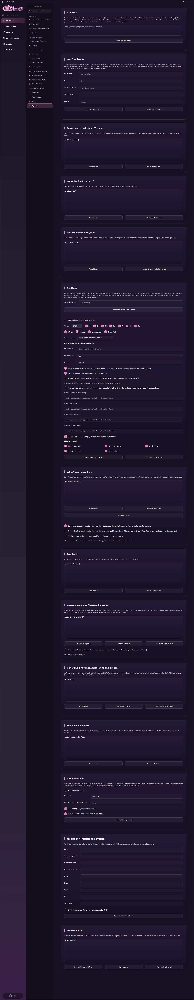

# 10 Organizer

The **Organizer** turns the character into an everyday helper: calendar, mails (read only), reminders, lists, morning briefing, commute time, birthdays, your own documents, letters and invoices, knowledge base and more. Everything works through **normal language** in the chat (on the PC or the phone) – the settings under **Settings → Organizer** only set up the accesses and show what is stored.

**Data storage:** `%LOCALAPPDATA%\YumeCompanion\` (that is, **outside** the project folder, not in releases). Credentials (iCal links, mail password, Spotify) are encrypted with Windows data protection. The organizer data is part of the **profile backup**.

Requirement: **Chat tool use active** ([Chapter 09](09-werkzeuge-und-integrationen.md)) and a language model that can call tools.

## 10.1 Calendar

Yume reads calendars and enters your own appointments ("Add dentist tomorrow at 3 pm").

* **On the PC:** under *Calendar* paste one or more **iCal links** (secret address in iCal format from Google, Outlook, Apple, Nextcloud …), one per line → **Save and test**. ICS calendars are read-only; the links are encrypted.
* **On the phone:** the phone's calendar is read automatically through the phone app (permission needed).
* **Your own appointments and reminders** appear under *Reminders and own appointments* ("Refresh", "Delete selected").

## 10.2 Mail (read only)

Yume names and summarizes new mails. She **only reads**: nothing is sent, deleted or marked as read.

| Field | Example |
| --- | --- |
| IMAP server | `imap.gmail.com` |
| Port | `993` |
| Address / user | `name@example.com` |
| **App password** | **not** the normal password (for Gmail: Google account → security → app passwords; IMAP must be on) |
| Folder | `INBOX` |

**Save and test** / **Remove mail account**. Note: The text of read mails goes to the chosen language model; with a cloud model, that means to this provider.

**Mail drafts:** "Reply to Anna's mail and accept" writes a **draft**. Yume never sends on her own: in *Mail drafts* you open it in your mail program, copy the text or delete it.

## 10.3 Reminders

"Remind me about the laundry in 20 minutes." At the time a message appears on the PC and as a notification on the paired phone (the program must be running). You see the list in the organizer.

## 10.4 Lists

"Put milk on the shopping list" or "What do I still have to buy?". Any lists (shopping, to-do …), short forms such as "shopping" are merged. The lists apply to PC and phone chat and also appear in the phone's wall mode.

## 10.5 What Yume did today & undo

Every executed action (music, reminders, appointments, lists …) is in the log *This is what Yume did today*. Entries with a back arrow can be undone: with the button **Undo selected** or by voice: **"Undo that."**

## 10.6 Routines

### Morning briefing
At the set **time** and on the chosen **weekdays** (Mon–Sun) Yume says in her own words: **weather**, **appointments**, **reminders**, **new mails** (each selectable individually). Choose **where** it is spoken: *Phone if connected, otherwise PC*, *Phone* or *PC*. **Test morning briefing now** shows the result immediately. "Good morning" or "briefing" in the chat starts it as well.

* **Location for the weather** (e.g. "Hamburg") → **Save location and test weather**. The weather comes from **Open-Meteo** (free, no account).

### Good night
"Good night" executes small things (each can be deselected): **pause music**, **flashlight off**, **check alarm**, **tomorrow's appointments**, **tomorrow's weather**. **Test good night now**.

### Punctuality assistant
When do you have to leave? For appointments **with a location** Yume calculates the travel time (address → coordinates via OpenStreetMap, routes via OSM servers; the start is the current phone location, otherwise your **home address**). Adjustable: **Travelling by** (car, bike or on foot) and **buffer** (e.g. 10 min). **Tell me when I have to leave** switches the hints on.

### Rain alert
On the phone: a message when you are out and it is about to start raining (needs the phone location).

### Weekly review
Every **Sunday at 6 pm**: what Yume did, how you were doing (rough estimate from your words), what is coming up. All local from tool log, jobs, mood log, diary and calendar. Also on request: "weekly report".

### Presence
A phone counts as **at home** as long as it is connected to the PC from the home network. When you leave (about 5 minutes without connection) or arrive, the PC executes your sentences: *When I leave*, *When everyone is gone*, *When someone arrives*, *When the first one arrives*, e.g. "Turn off the light; pause the music" (several steps separated by `;`).

## 10.7 What Yume remembers

"Remember that I don't like rain hints in the morning." Yume stores this permanently and uses it in every chat, briefing and routine. Under *What Yume remembers* you see everything, can refresh and **Delete selected**.

## 10.8 Conversations and mood

* **Mood sense:** Yume recognizes tiredness, stress or sadness from your words and the time of day (simple word lists, no model, no cloud) and answers accordingly; the mood lasts about **40 minutes**.
* **Voice sense (experimental):** estimates from volume, pitch, emphasis and tempo how you sound, compared with your own normal values (learns after about 10 sentences). **Only numbers are evaluated; no recording is stored.** The result only colors the tone of the answers and can be wrong.
* **Thinking mode of the language model** (slower, better for hard questions). Off = faster answers and more reliable tool calls (models such as Qwen3).
* **Self-test:** *Start self-test* checks everything Yume depends on (models, services, connections) and says in plain language what is missing and what to do. Also in the dashboard.

## 10.9 Diary

"Write in the diary: …" or simply tell her in the evening. The entries of the last weeks are in the list. They feed into the weekly review.

## 10.10 Knowledge base (your documents)

Yume searches **your** PDFs, Word files, Markdown, text, CSV and HTML files ("What does the rental contract say about termination?").

1. **Add folder …**, **Read documents now** (only new/changed files are read again).
2. Yume answers with file name and location.
3. Optionally **meaning-based search** (also finds passages without the same words; downloads a model once, about 470 MB).

Everything stays on the PC: local SQLite database with full-text search (partial words find "termination" in "termination period"). The index can be rebuilt and is therefore **not** part of the backups; the folder list is.

## 10.11 Background jobs, flows and skills

| Function | Example |
| --- | --- |
| **Jobs** | Tasks Yume works on independently ("Research … and tell me tomorrow morning") |
| **Flows** (macros) | taught by voice: "Remember this as flow *Evening*: light off, music on, check alarm." Every step is executed like a spoken command |
| **Skills** | small Python programs Yume writes for herself when a capability is missing ("Get me the Bitcoin price") |

**Skill safety:** A skill is only saved **after you have read and confirmed the code**. Beforehand the app checks statically (no processes, no writing/deleting of files, no dynamic code, no raw sockets, no registry). It runs in its own short-lived Python process (25 s time limit, limited output), never in the program. If the file is changed after approval it needs a new approval. *Open skills folder* shows the files. This is a safety net, not a complete sandbox: the real protection is you, approving the code. Skills may use the internet.

## 10.12 People and trips

"Anna's birthday is on May 12 and she doesn't like mushrooms", "What did I give Anna last time?" Birthdays (also from the phone contacts), notes, gift ideas and **planned trips**. Yume reminds you of birthdays and uses everything in her answers.

## 10.13 Nearby places

"Where is the nearest pharmacy that is still open?" Data from **OpenStreetMap** (Overpass). Starting point: phone location, otherwise home address. Opening hours are read from the OSM tag `opening_hours`; if a rule is too complicated, it says "unknown".

## 10.14 Documents: letters, invoices, résumé

Yume writes **letters, invoices, free documents and résumés** from your dictation as **PDF and/or Word file**. Invoice totals are **calculated in the program, never by the language model**.

1. Under **My details (for letters and invoices)** enter name, company (optional), street, postcode/city, e-mail, phone, IBAN, BIC, tax number; tick **Small business** (no VAT under § 19 UStG).
2. "Write an invoice to …" in the chat. Files are in `Documents\Yume Dokumente` (button *Open documents folder*). PDFs are produced with Qt, Word files with python-docx.

## 10.15 Inbox: share to Yume

From the phone with **Share → Yume** you send voice messages (e.g. from WhatsApp), pictures, screenshots, PDFs, Word files, texts or links to the PC. They land in `Downloads\Yume Eingang`. Yume reads them on request ("What does it say in the thing I sent you?"): voice messages are **transcribed** (Whisper), images **described** (vision model), PDFs/Word/text **read** and can be summarized or processed further.

## 10.16 Quick commands without a language model

Short, clear commands are recognized by the app **without the model** and executed immediately; the AI only confirms in her own words. Examples: "Stop the music", "next song", "open WhatsApp", "flashlight on", "louder", "Reply I'll be there soon" (answers the last message on the phone), "weekly report". Everything else goes to the model as usual.

## 10.17 Hey Yume on the PC

Yume **listens in the background** (even with the chat closed) for your wake phrase. When she hears it, a small card with her 3D model (VRM) appears at the bottom right, you speak, she answers.

| Setting | Meaning |
| --- | --- |
| **Listen for wake phrase** | on/off |
| **Wake phrase** | e.g. "Hey Yume" |
| **Stay awake after the last sentence** | Seconds |
| **Show 3D model (VRM) in the card** | on/off |
| **Short sound on waking up** | on/off |
| **Show card now (test)** | Preview |

Built from the existing building blocks (microphone with voice activity detection, echo protection, Whisper): everything heard is only checked for the wake phrase; **nothing is stored or sent**.

## 10.18 How the connection to the phone and wall mode fits together

* Phone chat and PC chat use the same lists, appointments, reminders.
* The phone's **wall mode** shows clock, weather, appointments, reminders, lists, birthdays, music and mails (updated every 20 seconds), see [Chapter 11](11-android-app.md).
