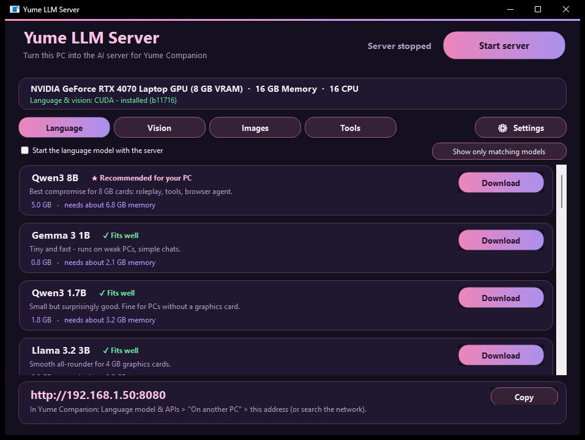
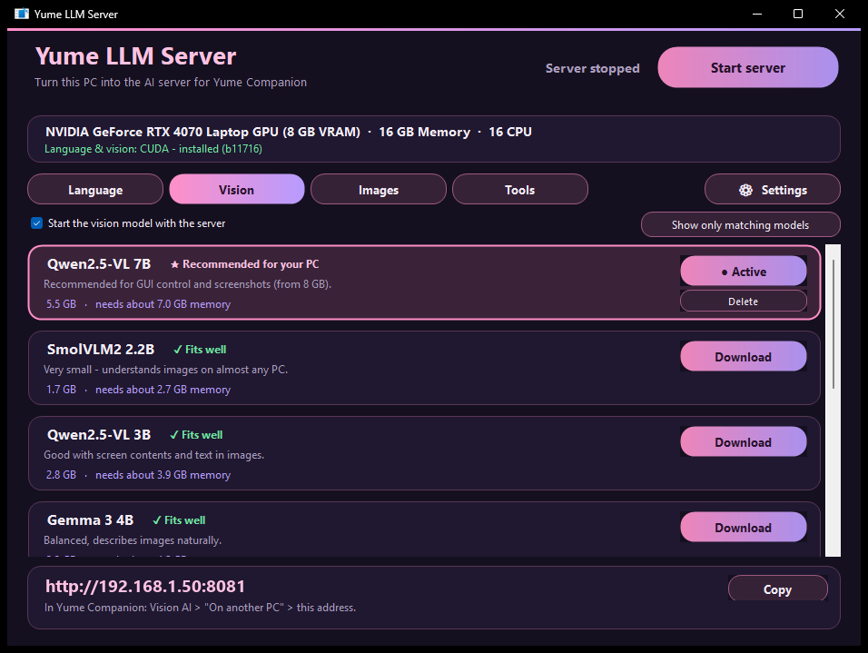
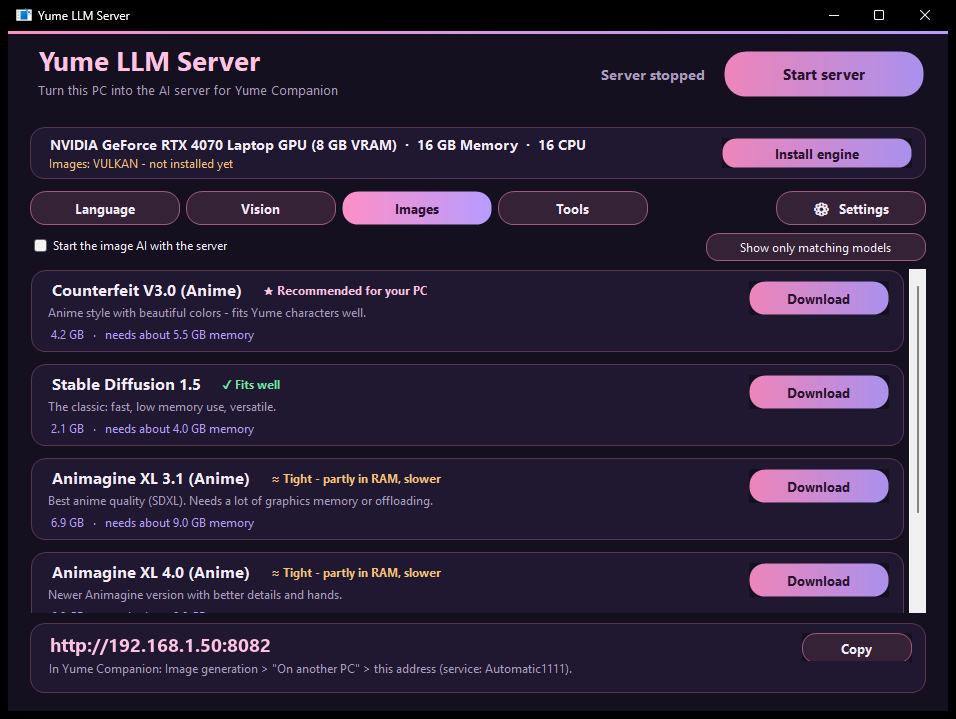
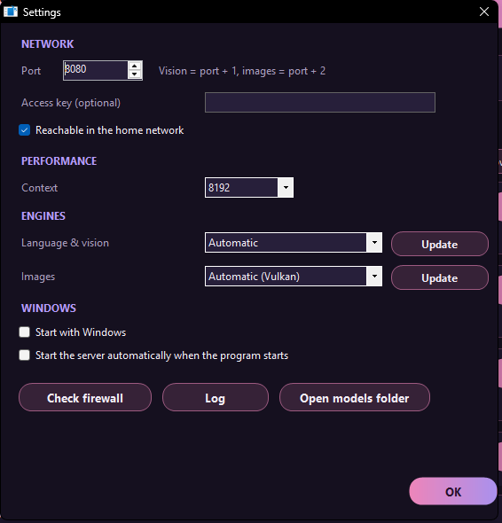

# 12 Yume LLM Server

The **Yume LLM Server** turns a **second PC** (or a strong spare computer in the house) into an **AI server** for Yume Companion. On this PC the language model, vision model, image AI and a tool model run; your main PC stays free for the program, voice and avatars.



The program is a small Windows application (C#, needs only the .NET Framework 4 that ships with Windows, about 300 KB; it downloads the engines when needed). Source code: `llm-server/src/YumeLlmServer.cs`. The interface is German or English (depending on the Windows language).

## 12.1 Installation on the second PC

1. Run `Yume-LLM-Server-Setup-<version>.exe` (about 3 MB, no administrator rights; default folder `%LOCALAPPDATA%\Programs\Yume LLM Server`). The setup creates a Start menu/desktop shortcut. You get it under **Releases**, or from Yume Companion: *Language model & APIs → On another PC in the network → Save server installer …* (USB stick or network folder).
2. Start the program. On the first start it checks **graphics card, VRAM, RAM and CPU** and shows them at the top (e.g. "NVIDIA GeForce RTX 4070 Laptop GPU (8 GB VRAM) · 16 GB memory · 16 CPU").
3. **Install engine** (llama.cpp): The program downloads the matching version itself and installs the Visual C++ runtime if needed. Possible variants: **CPU**, **Vulkan** (AMD/Intel/NVIDIA) and **CUDA 12.4 / 13.4** (NVIDIA; depending on driver version). *Automatic* picks the best.
4. Choose and download a **model** (see 12.2).
5. **Start server.** On the first start the program asks whether it may open the **Windows firewall** for the ports (administrator prompt). Only then can your main PC reach the server.

Afterwards the footer shows the address you enter in Yume Companion (e.g. `http://192.168.1.50:8080`) and a **Copy** button.

## 12.2 The four tabs

| Tab | Service | Port | Purpose |
| --- | --- | --- | --- |
| **Language** | llama.cpp (chat model) | 8080 (adjustable) | the character's answers |
| **Vision** | llama.cpp with *mmproj* | port + 1 (8081) | describe images (screenshots, photos) |
| **Images** | stable-diffusion.cpp (Automatic1111-compatible) | port + 2 (8082) | AI images for Yume Companion |
| **Tools** | llama.cpp (small model) | port + 3 (8083) | decides which tool is used (optional) |

Each tab lists **models** with size and "needs about X GB of memory". The rating fits *your* PC:

| Hint | Meaning |
| --- | --- |
| ★ Recommended for your PC | best choice for your hardware |
| ✓ Fits well | runs completely in graphics memory |
| ≈ Tight – partly in RAM, slower | is partly offloaded |
| ✗ Too large for your PC – very slow | loadable only with a warning |

*Show only fitting models* / *Show models that are too large (N)* filters the list. Per model: **Download** (with progress and cancel), afterwards **Select**, **● Active**, **Delete**. The files are in `%LOCALAPPDATA%\YumeLLMServer\models` (button *Open model folder*).




**Model catalog (selection):**

* **Language:** Gemma 3 1B, Qwen3 1.7B, Llama 3.2 3B, Qwen3 4B, Gemma 3 4B (high quality), Llama 3.1 8B, Gemma 2 9B, **Qwen3 8B**, Gemma 3 12B, Qwen3 14B, Phi-4 14B, Mistral Small 3.2 24B, Gemma 3 27B, Qwen3 30B-A3B (MoE), Qwen3 32B, Llama 3.3 70B, Qwen2.5 72B and more.
* **Vision:** SmolVLM2 2.2B, Qwen2.5-VL 3B/7B/32B/72B, Gemma 3 4B/12B/27B.
* **Images:** Counterfeit V3.0 (anime), Stable Diffusion 1.5, Animagine XL 3.1/4.0 and others.
* **Tools:** Qwen3 4B/8B/14B, Qwen2.5-Coder 7B.

Note: Models have their own licenses (e.g. Gemma Terms of Use, Llama Community License). The program downloads them from Hugging Face; you are responsible for their use.

Both servers (language + vision) run **at the same time**: with little graphics memory take smaller models or only one of the two. With the checkboxes *Start language model / vision model / image AI / tool model at start* you decide what **Start server** brings up.

## 12.3 Settings



| Area | Setting | Meaning |
| --- | --- | --- |
| **Network** | **Port** | Base port (default 8080; vision = +1, images = +2, tools = +3) |
| | **Access key (optional)** | passed to llama.cpp as `--api-key`; enter it in Yume Companion under "Access key" |
| | **Reachable in the home network** | on = binds to all addresses (`0.0.0.0`), off = this PC only |
| **Performance** | **Context** | Size of the context window (default 8192) |
| **Engines** | **Language & vision** | *Automatic*, CPU, Vulkan or CUDA; **Update** reinstalls the pinned version |
| | **Images** | *Automatic (Vulkan)*, CPU …; **Update** |
| **Windows** | **Start with Windows** | Autostart |
| | **Start server automatically when the program starts** | starts the services right away |
| Buttons | **Check firewall** | checks/creates the rule (administrator prompt) |
| | **Log** | shows the server log |
| | **Open model folder** | |

Settings are stored in `%LOCALAPPDATA%\YumeLLMServer\settings.ini`. The access key is stored there in plain text: do not pass the file on.

**Taskbar notification area:** When closed, the server keeps running **in the background** ("right-click the icon to quit"). Status display: *Server stopped*, *Loading model …*, *Server running*, *The server ended unexpectedly* (details in the log). Only **one instance** runs at a time.

## 12.4 Connecting to Yume Companion

On the main PC:

| What | Where in Yume Companion | Address |
| --- | --- | --- |
| Chat model | *Settings → Language model & APIs → On another PC in the network* | `192.168.1.50` or `http://192.168.1.50:8080` |
| Vision | *Settings → Vision AI → On another PC* | `…:8081` |
| Images | *Settings → Image generation → On another PC in the network* (service **Automatic1111**) | `…:8082` |
| Tool model | *Settings → Tool calls & MCP → External tool model* | `…:8083` |

**Tip:** Instead of typing the IP, click **Search network automatically** (in each card) and choose the server found. With **Test connection** the app detects the model automatically.

Switch *Characters now use the remote PC*: all characters with "Local LLM" then run through the server. If you switch back, they use the local llama.cpp again.

## 12.5 Security

* Without an access key the server has **no login**. Run it only in a **trusted home network**, never directly on the internet (no port forwarding).
* The Windows firewall rule should be limited to the **private network**.
* For access from outside use a VPN instead of a port forward.

## 12.6 Self-test and troubleshooting

* On the command line: `YumeLLMServer.exe --selftest cpu` (or `sd`, `sdvulkan`) loads the engine and checks it; the result is in `%LOCALAPPDATA%\YumeLLMServer\selftest.log`.
* `YumeLLMServer.exe --exit` ends a running instance (also used by the setup when updating).
* If your main PC does not reach the server: firewall rule, correct IP, same network (no guest Wi-Fi), server really *running* (green dot), port not in use.
* "Model does not fit completely into graphics memory": llama.cpp then offloads parts to RAM; that is much slower. Choose a smaller model or a smaller context.

## 12.7 Building it yourself

```powershell
cd llm-server
powershell -ExecutionPolicy Bypass -File ".\Build Yume LLM Server.ps1" -Version 1.1.0
```

The script compiles with the `csc.exe` from the .NET Framework (no SDK needed) to `llm-server\build\YumeLLMServer.exe`. If **Inno Setup 6** is installed, `llm-server\dist\Yume-LLM-Server-Setup-<version>.exe` is created as well and is also copied to `tools\server\Yume-LLM-Server-Setup.exe` (so Yume Companion offers it for saving). With `-NoInstaller` only the exe is created.

License note: The program downloads **llama.cpp** and **stable-diffusion.cpp** (MIT) at runtime and does not ship them.
