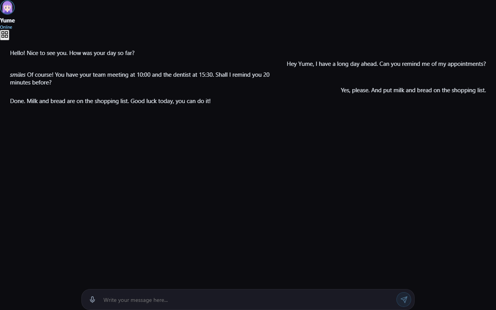
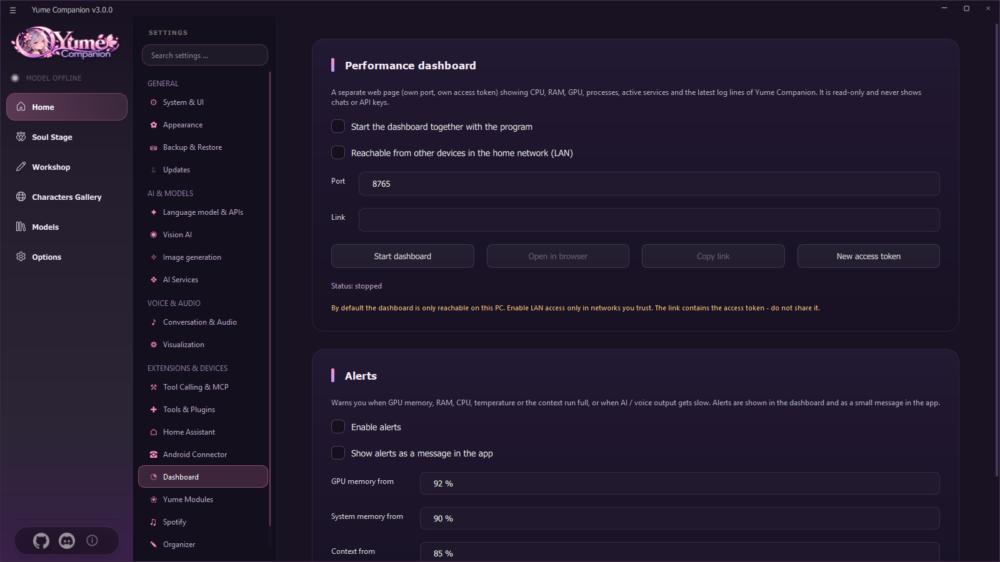
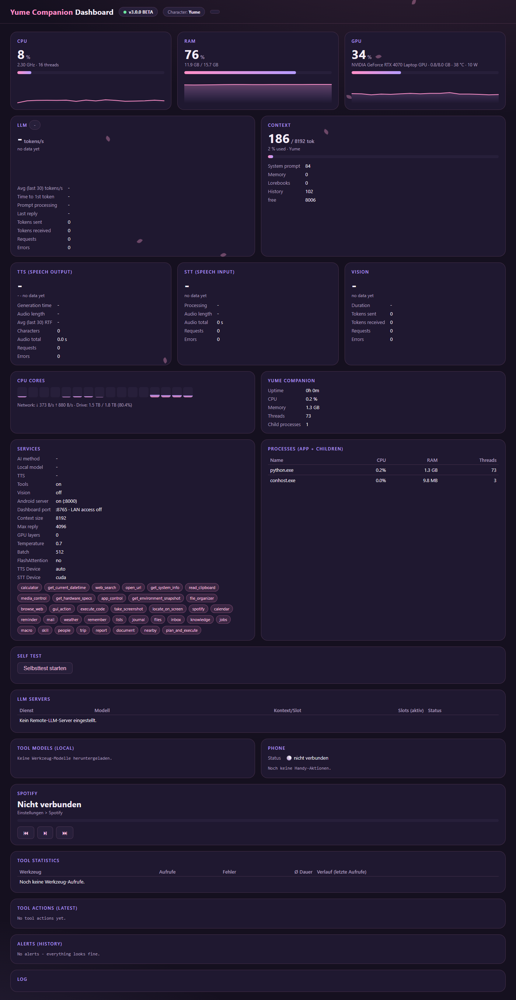

# 13 Web and Dashboard

Yume Companion has two built-in web pages: the **web client** (chat in the browser, also for phone and tablet) and the **performance dashboard** (numbers and status). Both only run while you start them, each has its **own port and token** and by default they are reachable only on this PC.

## 13.1 The web client (port 8000)

The **local web server** belongs to the Android Connector (see [Chapter 11](11-android-app.md)). You start it under **Settings → Yume modules → Web interface server → Start server** or under *Android Connector*. With **Open in browser** (on the PC) or **Copy mobile link** (for the phone) you open it. The link contains the **access token**.

The web client offers:

* **Chat** with the active character: history, new messages and **stop generation**. (Editing, deleting, regenerating and variants are also provided by the server, see 13.3; the web interface itself uses only part of that.)
* **Character library** for switching the character.
* **Speech input** (microphone button): the recording is recognized on the PC with Whisper.
* **Avatar** with **Live2D animations** (emotions and movements) and the character's background.

> The web client is the web interface of the original (Soul of Waifu), extended with the phone connection. The complete, native phone interface is the [Android app](11-android-app.md).

### Security
* Access only with a **token** (`?token=…`, header or cookie). Never share the link publicly.
* A new token is generated by *Settings → Android Connector*; afterwards devices must pair again.
* The server listens on all network cards (`0.0.0.0`, port 8000) so that the phone can reach it. For access from outside use a **tunnel** (e.g. Cloudflare Tunnel) or VPN, no open port forward.
* If the **Windows firewall** is not opened, the Android Connector reports it.

## 13.2 The dashboard (port 8765)

**Settings → Dashboard.** A separate web page with CPU, RAM, GPU, processes, services and the latest log lines. **It is read-only and shows neither chats nor API keys.**

| Setting | Meaning |
| --- | --- |
| **Start dashboard together with the program** | Autostart |
| **Reachable from the home network (LAN)** | otherwise only `127.0.0.1`; LAN only in trusted networks. The link contains the token |
| **Port** | Default 8765 (must not be the port of the Android server) |
| **Start dashboard / Open in browser / Copy link / New access token** | Operation |
| **Alarms** | Warnings when **graphics memory** (from 92 %), **RAM** (from 90 %), **context** (from 85 %), **GPU temperature** (from 85 °C) or **CPU** (from 95 %) become critical, or when AI/speech output/recognition become slow or disk space runs low. They appear in the dashboard and optionally as a small **message in the app** |

### What the dashboard shows

| Tile | Content |
| --- | --- |
| **CPU, RAM, GPU** | Load, history, temperature, power consumption |
| **LLM** | Tokens per second, time to first token, prompt processing, last answer, tokens sent/received, requests, errors |
| **Context** | used / total, split into system prompt, memory, lorebooks, history and free |
| **TTS / STT / Vision** | Generation time, real-time factor (RTF), audio length, characters, requests, errors |
| **CPU cores** | every core; network and drive |
| **Yume Companion** | Runtime, CPU, memory, threads, child processes |
| **Services** | AI method, model, TTS, tools, vision, Android server, ports, context size, GPU layers, temperature, batch, FlashAttention, devices; the **active tools** as badges |
| **Processes (app + children)** | Name, CPU, RAM, threads |
| **Self-test** | checks everything and says in plain language what is missing |
| **LLM server** | remote servers (service, model, context/slot, active slots, status) |
| **Tool models** | locally loaded tool models |
| **Phone** | paired phones and their latest actions |
| **Spotify** | Title, progress, keys (back, play/pause, next) |
| **Tool statistics** | Calls, errors, average duration per tool |
| **Tool actions (latest)** | what the AI executed |
| **Alarms (history)** | earlier warnings |
| **Log** | last lines of the program log (secrets masked) |

### Access and interfaces
The dashboard only answers with a valid token (`?token=…`, header `X-Dashboard-Token` or cookie). Interfaces (read only, JSON): `/api/metrics`, `/api/stats`, `/api/status`, `/api/extra`, `/api/alerts`, `/api/toollog`, `/api/logs`, `/api/selftest`; only `/api/spotify/control` controls music.

## 13.3 Web server interfaces (for developers)

The web server (FastAPI) on port 8000 offers, among others:

| Path | Purpose |
| --- | --- |
| `GET /` , `GET /api/ping` | Web client or heartbeat (without token) |
| `POST /api/pair` | Pairing with a one-time code → device token |
| `GET/DELETE /api/mobile/devices` | paired devices |
| `GET /api/mobile/bootstrap`, `/api/mobile/health` | Start data for the phone |
| `GET /api/characters`, `POST /api/character/switch` | Character list and switching |
| `GET /api/history/{name}`, `/api/sync/{name}` | History or offline synchronization |
| `PATCH/DELETE /api/messages/{id}`, `POST …/regenerate`, `…/variant` | Edit messages |
| `POST /api/generation/stop` | Stop generation |
| `POST /api/voice/stt` | Speech recognition (Whisper) |
| `GET /api/avatar/{name}`, `/api/avatar/models`, `/api/avatar/model`, `/api/avatar_config/{name}` | Avatars, VRM models |
| `GET /api/wake_phrase` | Wake phrase and answer sentences |
| `POST /api/transcribe`, `/api/translate` | Transcription, translation |
| `POST /api/vision/describe` | Describe an image |
| `POST /api/inbox`, `/api/inbox/text` | "Share → Yume" |
| `GET /api/kiosk` | Data for wall mode |
| `GET/POST /api/spotify/…` | Spotify access and control |
| WebSocket | Chat events and phone commands (role `phone`) |

All paths except `/`, `/api/ping`, `/api/pair` and static files require the token. The interfaces are **not** guaranteed as a stable public API and may change during the beta.
