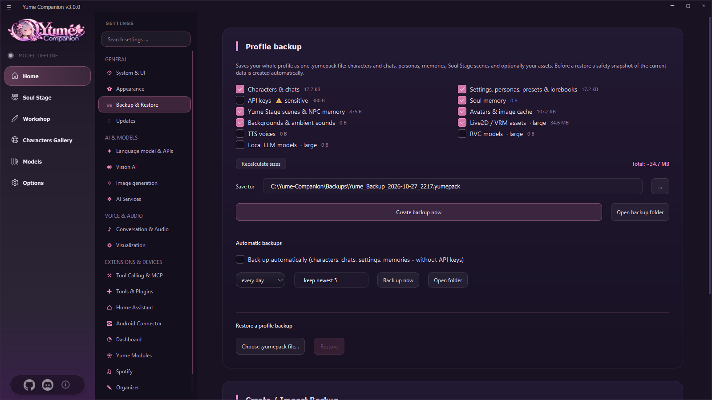
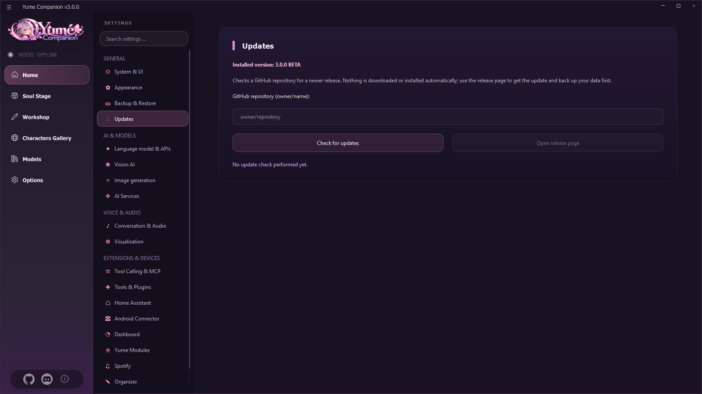

# 14 Backup, Updates, Security

## 14.1 Backup and restore

**Settings → Backup & Restore.** The **profile backup** saves your whole profile in **one file** (`.yumepack`).

| Option | Content |
| --- | --- |
| **Characters & chats** | always included (cannot be deselected) |
| **Settings, personas, presets & lorebooks** | Program settings, personas, presets, lorebooks |
| **API keys** ⚠ sensitive | only on explicit request; the app warns: "The backup contains your API keys. Keep the file private." |
| **Yume memory** | Folder `.soul` |
| **Stage scenes & NPC memory** | Yume Stage |
| **Avatars & image cache**, **backgrounds & ambient sounds** | small assets |
| **Live2D/VRM assets**, **RVC models**, **TTS voices**, **local LLM models** | large, only on request (sizes are shown) |

* **Recalculate sizes** shows the total size. **Save as** chooses target and name (default `Backups\Yume_Backup_<date>.yumepack`). **Create backup now**. **Open backup folder**.
* **Automatic backups:** *Back up automatically (characters, chats, settings, reminders – without API keys)* every **1, 3 or 7 days**, the **newest N** (2–30) are kept (`Backups\auto`). **Back up now** and **Open folder**. The card shows "Last automatic backup: … · N saved".
* **Restore:** *Choose .yumepack file …* → **Restore**. Before restoring, the app creates a **safety snapshot** (`.soul_stage/backups`); if the restore fails, it is put back automatically. Afterwards a **restart** is necessary. Older backups (`.sowpack`, `.zip` from version 2.5) can be restored as well.
* The second card *Create / import backup* (ZIP) saves the configuration including additional data and can import old **backup folders**.
* The organizer data (`%LOCALAPPDATA%\YumeCompanion`: appointments, lists, people, diary …) is included in the profile backup (the **knowledge base indexes** are not, they can be rebuilt). Passwords there are Windows-encrypted and readable only on this account.

> **Important:** Backups with API keys and chats are **private**. Never upload them, never put them in a GitHub release. The project's `.gitignore` excludes `*.yumepack`, `*.sowpack` and `Backups/`.

## 14.2 Updates

### Checking
**Settings → Updates:** enter the GitHub repository as `owner/name` (or the full URL), **Check for updates**. The app compares the installed version (`VERSION.txt`) with the newest release (beta versions included) and reports *New version available*. It also checks in the background when the program starts and then shows a window with the button **Download and install**.

**Download and install:** The app asks once, downloads the setup of the release (with a progress bar, can be cancelled) and checks its **SHA-256 checksum**. Only if it matches is the setup started and Yume Companion closed; your characters, chats and settings are kept. If anything is wrong (address does not belong to the repository, checksum missing or different, wrong size, not a program file), the file is deleted and **nothing is installed**. The setup itself runs as the usual wizard, so you confirm once more there. If you prefer to download yourself, use **Open release page**.

Possible messages: *Repository not found (or private)*, *The repository has no releases or tags yet*, *GitHub limit reached*, *GitHub not reachable*.

### Checking downloads and Windows warnings
- **Checksum (SHA-256):** Every file of a release has a checksum (GitHub shows it next to the file; the release text lists it as well). In PowerShell check it with `Get-FileHash Yume-Companion-Setup-….exe -Algorithm SHA256`. The two values must be **exactly the same**; otherwise delete the file and download it again. The app's updater does this check itself.
- **Source code:** The PC app is open source (GPL-3.0). The setup is built from a clean copy of this source. The Android app and the LLM server are free to use, their source is visible.
- **Windows says "Windows protected your PC" (SmartScreen):** The setup is **not digitally signed yet**. A certificate costs money and the project is developed by a private person. If the checksum matches and you downloaded the file from the official GitHub page: *More info → Run anyway*. If you prefer not to, wait for the signed version.
- **Windows 11 with "Smart App Control"** blocks unsigned programs completely, so the setup cannot be started. That needs a signature, which is being worked on (see [Signing and virus scanners](../SIGNIERUNG.md), German).
- **A virus scanner reports something:** Unsigned setups that download packages and start programs often trigger false alarms. Check the checksum; if it matches, it is the file from the release. Please report the false alarm to the scanner's vendor and open an [issue](https://github.com/Kreqzxoo/Yume-Companion/issues) so that we can document it.

### Check at program start
At start the program queries the **update repository from the branding file** (`app/configuration/branding.json`, field `update_repo`). If nothing is entered there, the original repository `jofizcd/Soul-of-Waifu` is checked (an older original version is never offered as an update). **After publishing, enter your repository there** (rebrand program, field *Update repository*, see [Chapter 16](16-entwicklung.md)) so that all users see your updates.

### Installing
* **Setup installation:** install the new setup over the old one (settings stay).
* **Update setup:** The *Yume Release Tool* can create a small **update setup** that applies only changed files and new Python packages (`requirements_extra.txt`).
* **Source:** `git pull`, `installer.bat` for new packages.

### Updating engines
You update llama.cpp separately under *Language model & APIs → Hardware and backend* ([Chapter 04](04-sprachmodelle.md)); the LLM server has its own engine updater ([Chapter 12](12-llm-server.md)).

## 14.3 Security at a glance

| Topic | What applies |
| --- | --- |
| **Where are secrets?** | `api.json` (API keys, tokens), `settings.json` (web and dashboard token, credentials for integrations), `%LOCALAPPDATA%\YumeCompanion` (encrypted). Never pass them on |
| **Network** | Web server (8000) and dashboard (8765) are protected by a **token**. Dashboard local only by default. The LLM server has no login without a key: only in the home network |
| **Tools** | risky actions require confirmation; program start only from your list; skills only after code approval; Home Assistant only approved entities, no locks/alarm systems |
| **Phone** | every control function can be switched off individually; risky actions are confirmed on the phone (optionally with PIN); device tokens can be revoked individually |
| **Mail** | read only (IMAP), app password instead of main password |
| **Cloud models** | Chat texts and tool results go to the provider |
| **Backups** | contain chats, possibly keys: keep them private |
| **Logs** | `logs/` can contain paths and system data. Check before sharing |

## 14.4 What the app downloads from the internet

Only what you use or switch on:

| Purpose | Destination |
| --- | --- |
| Models (GGUF, Whisper, TTS, vision, embedding) | Hugging Face |
| llama.cpp engines | GitHub (`ggml-org/llama.cpp`) |
| Recommendations, characters, lorebooks, scenarios of the gallery | GitHub data of the original (`jofizcd/sow-data`), Chub |
| Update check | GitHub API |
| Weather | Open-Meteo |
| Places, routes, addresses | OpenStreetMap (Nominatim, OSM routing, Overpass) |
| Web search | DuckDuckGo |
| Music | Spotify |
| Cloud AI, speech synthesis, image AI | the provider you chose |
| Chromium for the browser agent | Playwright download |

## 14.5 Legal matters and responsibility

* Yume Companion is under the **GPL-3.0** and comes **without any warranty**.
* **Content:** You are responsible for the content you create, import and share. Use only models, voices, images and characters you have the rights to. Do not clone the voices of real people without their consent.
* **Age and youth protection:** The app contains an NSFW switch. Observe the laws of your country and the rules of the services (Discord, providers).
* Licenses of the components used: [LIZENZEN_UND_UPLOAD.md](../LIZENZEN_UND_UPLOAD.md) (German).
